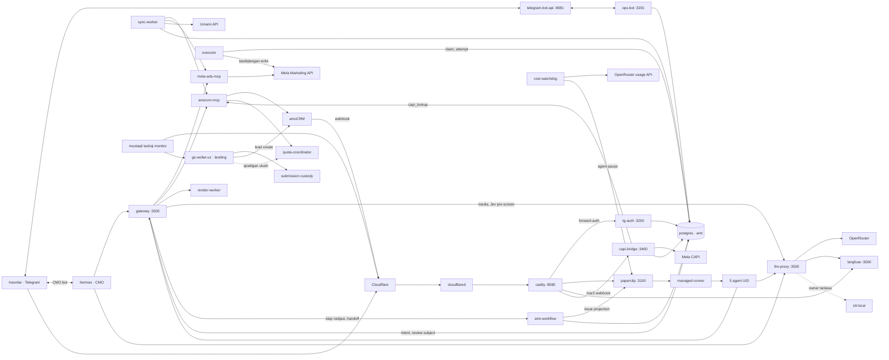
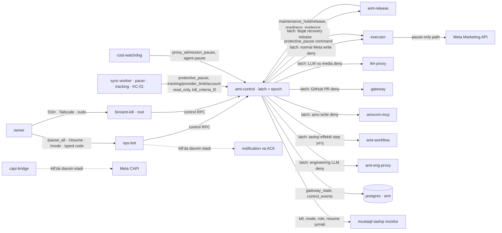
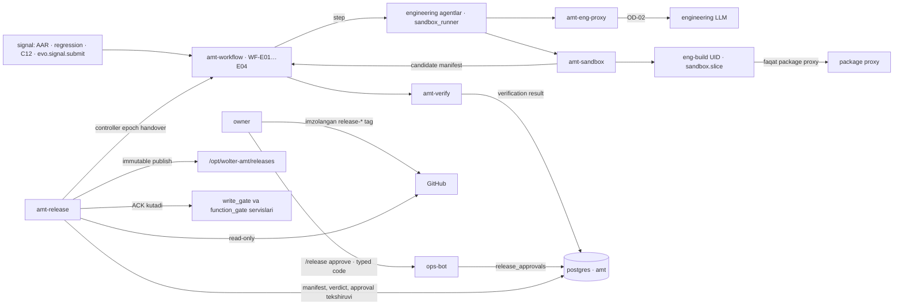
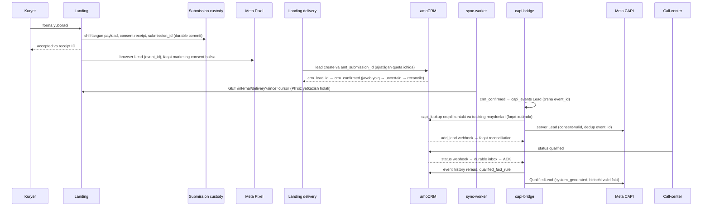
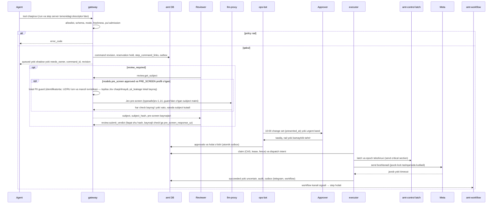
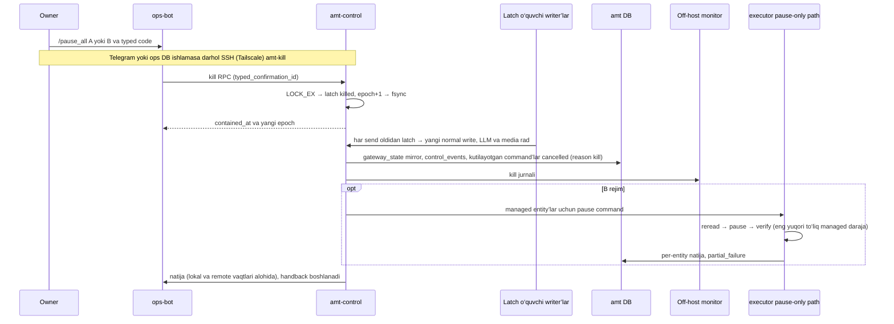
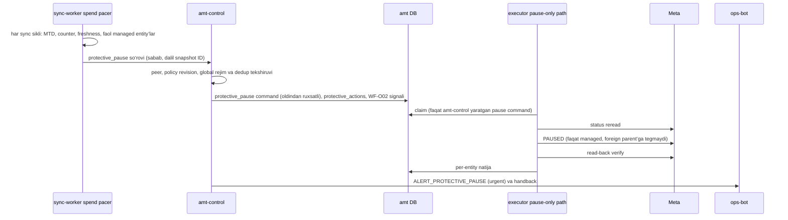

# ARCHITECTURE — Wolter AMT

Holat: spetsifikatsiya · Runtime: NOT_RUN · Sana: 2026-10-23.

Bu hujjat komponentlar, servis identity’lari (UID, port, DB roli, credential, egress), ishonch chegaralari, asosiy oqimlar va repo tuzilmasini belgilaydi. Arxitektura yozilgani uning qurilgani yoki sinovdan o‘tgani emas.

Ustuvorlik [DECISION_LOG §0](../00_Decisions/DECISION_LOG.md) bo‘yicha: owner ✅ qarorlari → [INVARIANTS](../11_Production_Contracts/INVARIANTS.md) → production kontraktlar va config shablonlari → shu hujjat. Biznes ma’nolari faqat [BUSINESS_CONTRACT](../11_Production_Contracts/BUSINESS_CONTRACT.md)da. Servis reyestrining machine manbai — [runtime-isolation.yaml](../09_Config_Templates/runtime-isolation.yaml) `services`; §3 uni inson o‘qiydigan shaklda beradi, farq bo‘lsa config ustun va validator bundle’ni rad etadi. Workflow va evolution qatlamining ichki dizayni [WORKFLOW_RUNTIME](WORKFLOW_RUNTIME.md) va [SELF_EVOLUTION](SELF_EVOLUTION.md)da; bu hujjat ularning komponentlari va chegaralarini ko‘rsatadi, tafsilotni takrorlamaydi. Mantiqiy schema va DB grantlari [DATA_MODEL](DATA_MODEL.md)da.

## 1. Arxitektura tamoyillari

| Tamoyil | Bajariladigan shart |
|---|---|
| Agent taklif qiladi, deterministik kod bajaradi | Barcha tashqi tool gateway orqali, barcha pullik LLM/media proxy orqali. Agentda vendor kaliti, approval, kill yoki release huquqi yo‘q (I02) |
| Issiq yo‘lda LLM yo‘q (Q26 ✅) | Intake, webhook/CAPI, rol va approval, pul rezervi, freshness, kill-criteria, alert, kill, protective control, workflow step o‘tishi, handoff sxema tekshiruvi, timer, epoch fence, manifest tasnifi, verification verdict va release tekshiruvi — deterministik kod ([ADR-007](../04_ADR/ADR-007-deterministic-hot-paths.md)). Agent faqat step’ni bajaradi va artifact beradi |
| Ish birligi — workflow run | Har biznes, operatsiya va engineering ishi `amt-workflow` ledger’idagi versiyalangan run; Paperclip issue — projection va vazifa yuzasi, truth emas (I16–I18) |
| Biznes murojaati yo‘qolmaydi | Landing durable receipt commit’dan oldin `accepted` qaytarmaydi; CRM noaniqligi kuzatiladi va reconcile qilinadi (I08) |
| Tasdiq aniq nusxaga tegishli | Payload, offer, asset, review, human check, rol va policy revision har dispatch/retry/rollback’da qayta tekshiriladi (I06) |
| Pul avval band qilinadi, cap mustaqil | Parallel ishlar bitta actual+reserved hisobidan o‘tadi; noma’lum xarajat nolga tenglashtirilmaydi. Ads Manager account spending limit AI’dan mustaqil va majburiy (Q37 ✅); `protective_pause` — qo‘shimcha deterministik qatlam, limit o‘rnini bosmaydi (◇ P-21) |
| To‘xtatish lokal boshlanadi | `amt-control`ning durable latch va epoch’i yangi dispatch’ni Paperclip, snapshot, DB yoki vendor javobini kutmasdan yopadi (I07, ◇ P-03) |
| Ishonch chegarasi process bilan mos | Har servis va agent alohida UID/credential; Reviewer va writer alohida process; public intake, renderer, uchinchi tomon MCP va privileged executor ajratilgan; engineering rollari faqat sandbox’da (I02, I20) |
| Fresh signal talab qilinadi | Tracking, fleet, offer, spend va sale readiness eskirsa tegishli write yopiladi; eski PASS abadiy amal qilmaydi |
| O‘lchov biznes ma’nosini saqlaydi | Qualified, contract, cash, fulfilment va renewal alohida; attribution va kogorta revision bilan (I09) |
| O‘zgarish owner release bilan | Merge va release owner’da; artifact bir marta build qilinadi va aynan o‘sha digest chiqariladi (Q11 ✅, I19–I21) |
| Tiklash tashqi holat bilan moslashadi | Restore `killed` holatida boshlanadi; `shadow`+L0 faqat reconcile’dan keyin owner qadami bilan (◇ P-16); eski approval qayta ijro qilinmaydi (I14) |

## 2. Komponentlar va ishonch chegaralari

Uch tekislik alohida chiziladi: biznes runtime, control (to‘xtatish va himoya) va workflow/evolution. Servis nomlari §3 reyestridagi `service_id`; tashqi tizimlar alohida nomlangan.

### 2.1 Biznes runtime tekisligi



### 2.2 Control tekisligi: to‘xtatish va himoya



### 2.3 Workflow va evolution tekisligi



Landing boshqa production hostida qoladi. AMT bitta host — owner’ning ofisdagi PC’si (`amt-pc`, Q52) — va u yagona nosozlik nuqtasi ([ADR-032](../04_ADR/ADR-032-owner-pc-office-host.md)). AMT hosti yo‘qolishi yangi murojaatni qabul qilishni to‘xtatmasligi kerak: submission custody va CRM intake ulushi landing (production Dokploy) hostida mustaqil ishlaydi. Host yo‘qolishi doirasi (Q55): PC buzilsa disklar boshqa PC’ga ko‘chiriladi (shifrlanmagan, Q54); ikkala disk yo‘qolsa yoki o‘g‘irlansa AMT tarixi (approval, audit, readiness imzolari, ledger’lar) yo‘qoladi — qabul qilingan risk; lead’lar landing custody va amoCRM’da qoladi, intake va CAPI holati shulardan qayta quriladi ([TRACKING_CAPI §8](TRACKING_CAPI.md)). Analytics warehouse PII custody bilan bir baza yoki bir credential emas. Mode, latch va epoch’ning yagona yozuvchisi `amt-control`; boshqa servislar holatni faqat RPC orqali so‘raydi (§10). Engineering zonasi production secret, production DB write, Meta/CRM write, root, sudo va Docker socket’siz (I20).

## 3. Servis reyestri

Kanonik reyestr — [runtime-isolation.yaml](../09_Config_Templates/runtime-isolation.yaml) `services`. `service_id` ACK yozuvi (`service_revision_acks.service_id`), DB grantlari, rendered credential fayli ([env.example](../09_Config_Templates/env.example) bo‘limlari: bitta servis — bitta 0600 env fayli) va validator cross-check’ining yagona kaliti. Bitta umumiy `amt` UID yoki `amt_writer` DB roli yo‘q. Portlar `127.0.0.1`da yoki private socket’da (`cloudflared` metrics ham `127.0.0.1:20241`da); istisnolar — `sshd` (faqat `tailscale0` da: `ssh.socket` drop-in’i `BindToDevice=tailscale0`, `0.0.0.0%tailscale0:22` va `[::]%tailscale0:22`, `ListenAddress` yo‘q; LAN NIC’da ufw ikkinchi qatlam, tailnet’da Tailscale siyosati filtrlaydi) va `tailscaled` (UDP 41641 hamda tailnet IP’lardagi peerAPI); Internetdan kiruvchi port yo‘q (Q57). UID nomlari deployment shartnomasi; mavjud adapter buni o‘zi ta’minlaydi degan da’vo yo‘q.

### 3.1 Reyestr

Qiymatlar `runtime-isolation.yaml#services` dan generatsiya qilinadi; validator (D21) farqni rad etadi.

| service_id | unit | UID | listen | DB role | credential_file | egress | ACK class |
|---|---|---|---|---|---|---|---|
| `caddy` | `caddy.service` | `caddy` | `127.0.0.1:8080` | none | none | none | none |
| `cloudflared` | `cloudflared.service` | `cloudflared` | 127.0.0.1:20241 (metrics only; pinned with --metrics) | none | /run/amt/secrets/cloudflared.env (TUNNEL_TOKEN via EnvironmentFile; never on the command line) | Cloudflare Tunnel edge (outbound 7844 tcp+udp); on loopback only 127.0.0.1:8080 (Caddy) and the systemd-resolved stub 127.0.0.53:53 / 127.0.0.54:53 (DNS) - per-UID nftables, so a hostname added in the Cloudflare account cannot reach any other local service | none |
| `tailscaled` | `tailscaled.service` | root (vendor daemon) | tailscale0 (peerAPI TCP on the tailnet IPv4/IPv6) + UDP 41641 WireGuard on all addresses (tailscaled accepts it itself in netfilter mode on; NAT traversal or DERP) | none | /var/lib/tailscale/tailscaled.state (root 0600) | Tailscale control plane, DERP relays and WireGuard peers (UDP to arbitrary peers; the one root service whose egress is not narrowed) | none |
| `sshd` | `ssh.service` | root (vendor daemon) | tailscale0 only - ssh.socket drop-in BindToDevice=tailscale0 (0.0.0.0%tailscale0:22 and [::]%tailscale0:22 - the noble ssh.socket has separate IPv4 and IPv6 ListenStream lines; no ListenAddress); the socket is not started from sockets.target - the udev rule starts it when tailscale0 appears (boot, tailscaled restart), and ssh.service runs only through it (Requires=ssh.socket; standalone sshd would bind *:22); ufw default-deny also closes 22 on the LAN NIC; on tailscale0 the Tailscale policy (owner -> tag:amt:22 only) is the filter | none | /etc/ssh host keys (root 0600) | none | none |
| `tg-auth` | `amt-auth.service` | `amt-auth` | `127.0.0.1:3200` | `amt_auth` | `/run/amt/secrets/tg-auth.env` | none | `function_gate` |
| `ops-bot` | `amt-ops.service` | `amt-ops` | `127.0.0.1:3201` | `amt_ops` | `/run/amt/secrets/ops-bot.env` | telegram-bot-api (local), Google Drive upload | `write_gate` |
| `telegram-bot-api` | `amt-telegram.service` | `amt-telegram` | `127.0.0.1:8081` | none | `/run/amt/secrets/telegram-bot-api.env` | Telegram data centres - the local Bot API server talks to Telegram itself, not to api.telegram.org (container: DOCKER-USER allows only the published Telegram ranges, core.telegram.org/resources/cidr.txt, from its fixed-name bridge) | none |
| `paperclip` | `paperclip.service` | `paperclip` | `127.0.0.1:3100` | paperclip (own database) | `/run/amt/secrets/paperclip.env` | none | none |
| `hermes` | `hermes.service` | `hermes` | pinned in F4 | none | `/run/amt/secrets/hermes.env` | gateway, llm-proxy, api.telegram.org (CMO bot only) | none |
| `managed-runner` | `amt-runner.service` | root (fixed entrypoint) | private socket | none | none | none (systemd IPAddressDeny=any, IPAddressAllow=localhost; role workers get their own UID rules) | none |
| `gateway` | `amt-gateway.service` | `amt-gateway` | `127.0.0.1:3300` | `amt_gateway` | `/run/amt/secrets/gateway.env` | meta-ads-mcp (local), amocrm-mcp (local), GitHub API (PR tokens), Google Drive read, Umami API, Clarity API | `write_gate` |
| `executor` | `amt-executor.service` | `amt-executor` | private socket | `amt_executor` | `/run/amt/secrets/executor.env` | `graph.facebook.com` | `write_gate` |
| `amt-control` | `amt-control.service` | `amt-control` | private socket | `amt_control` | `/run/amt/secrets/control.env` | independent monitor endpoint | `write_gate` |
| `meta-ads-mcp` | `amt-meta-read.service` | `amt-meta-read` | private stdio/socket | none | `/run/amt/secrets/meta-read.env` | `graph.facebook.com` | none |
| `amocrm-mcp` | `amt-amo.service` | `amt-amo` | private socket (peer-UID allowlist; separate capi_lookup socket for capi-bridge only) | `amt_amo` | `/run/amt/secrets/amocrm.env` | `<subdomain>.amocrm.ru` | `write_gate` |
| `quota-coordinator` | `amt-quota.service` | `amt-quota` | private endpoint | `amt_quota` | `/run/amt/secrets/quota.env` | none | `write_gate` |
| `llm-proxy` | `amt-proxy.service` | `amt-proxy` | `127.0.0.1:3500` | `amt_proxy` | `/run/amt/secrets/llm-proxy.env` | openrouter.ai, Langfuse (local) | `write_gate` |
| `stt-local` | `amt-stt.service` | `amt-stt` | `127.0.0.1:3510` | none | none | none | none |
| `capi-bridge` | `amt-capi.service` | `amt-capi` | `127.0.0.1:3400` | `amt_capi` | `/run/amt/secrets/capi-bridge.env` | graph.facebook.com (CAPI), amocrm-mcp capi_lookup socket; dispatch only under a fresh monitor ACK (operations.yaml#host_loss.capi_dispatch_lease) | `function_gate` |
| `sync-worker` | `amt-sync.service` | `amt-sync` | none | `amt_sync` | `/run/amt/secrets/sync-worker.env` | amocrm-mcp (local), meta-ads-mcp (local), Umami API (read token), go.wolter.uz delivery read API (GET /internal/delivery only) and public build metadata (GET /.well-known/amt-deployment.json; hashes and commit only, no credentials) | `function_gate` |
| `render-worker` | `amt-render.service` | `amt-render` | private socket | none | none | none | none |
| `cost-watchdog` | `amt-watchdog.service` | `amt-watchdog` | none | `amt_watchdog` | `/run/amt/secrets/watchdog.env` | OpenRouter usage API (read credential), Paperclip API (agent pause only) | `function_gate` |
| `postgres` | `postgresql.service` | `postgres` | `127.0.0.1:5432` | owner amt_migrator (non-login) | none | none | none |
| `langfuse` | langfuse compose stack | `langfuse` | `127.0.0.1:3000` | own PostgreSQL | `/run/amt/secrets/langfuse.env` | none (TELEMETRY_ENABLED=false; DOCKER-USER drops new connections leaving its fixed-name bridge - per-UID nftables do not see container traffic; Docker Engine >= 29.0 has firewall-backend pinned to iptables; older engines have only iptables) | none |
| `amt-workflow` | `amt-workflow.service` | `amt-workflow` | private socket | `amt_workflow` | `/run/amt/secrets/workflow.env` | Paperclip API (projection only) | `write_gate` |
| `amt-release` | `amt-release.service` | root (fixed publisher entrypoint) | private socket | amt_release; migrations through login role amt_migrate that may only SET ROLE amt_migrator | /etc/amt/release-signers + read-only deploy key + /run/amt/secrets/release.env | GitHub (read-only; systemd IPAddressDeny=any + IPAddressAllow from release-policy.yaml#publisher_egress) | none |
| `amt-verify` | `amt-verify.service` | `amt-verify` | private socket | `amt_verify` | `/var/lib/amt-verify/holdout.key` | none | none |
| `amt-sandbox` | `amt-sandbox.service` | `amt-sandbox` | private socket | none | `/run/amt/secrets/sandbox.env` | package proxy; GitHub push to cand/* only (ENG_GITHUB_TOKEN) | none |
| `amt-eng-proxy` | `amt-eng-proxy.service` | `amt-eng-proxy` | private socket | `amt_eng_proxy` | `/run/amt/secrets/eng-proxy.env` | engineering LLM provider (OD-02) | none |
| `amt-backup` | `amt-backup.timer` | root (fixed entrypoint) | none | amt_backup (read) | none | none (systemd IPAddressDeny=any, IPAddressAllow=localhost; root units cannot be told apart by UID) | none |

`managed-runner`, `amt-release` va `amt-backup` qatorlaridagi `root` — root egaligidagi fixed entrypoint; u repo’dan kelgan ixtiyoriy buyruqni bajarmaydi. `tailscaled` va `sshd` — root sifatida ishlaydigan vendor daemon’lar: `tailscaled` vakolati Tailscale siyosati (`tailscale-policy.hujson`), `sshd`niki esa `BindToDevice=tailscale0`, kalit, `AllowUsers` va LAN NIC’dagi firewall bilan cheklanadi (Q58, [SECURITY §3](SECURITY.md)); `tailscaled` — egress’i toraytirilmaydigan yagona root servis. Release controller `amt-release.service` — shu root egaligidagi fixed publisher entrypoint; alohida servis UID’i yo‘q va u faqat owner tasdiqlagan manifest bilan ishlaydi ([SELF_EVOLUTION §1](SELF_EVOLUTION.md)); `amt-control` socket’ida u `root:amt-release` peer sifatida faqat §10.1 matritsasidagi op’larni chaqiradi (`maintenance_hold`, `maintenance_release`, `readiness_evidence`, `status`).

### 3.2 Vazifa va chegara

| service_id | Mas’uliyat | Qilmaydi |
|---|---|---|
| `caddy` | tunnel ortida faqat `127.0.0.1:8080`da qabul; yo‘l allowlist, UI forward-auth (Q49, Q57) | biznes qaror, webhook tarkibini o‘qish, tashqi interfeysda tinglash |
| `cloudflared` | masofadan boshqariladigan Cloudflare Tunnel’ga chiquvchi ulanish — yagona kirish yo‘li (Q57); ingress faqat `mar`, `mar2`, `mar3` → `http://127.0.0.1:8080`, qolgani `http_status:404` (kutilgan holat `infra/cloudflared/ingress.expected.yaml`, F0-AT-04); `TUNNEL_TOKEN` faqat `EnvironmentFile` orqali; metrics faqat `127.0.0.1:20241` | tashqi interfeysda tinglash, loopback’da Caddy (`127.0.0.1:8080`) va systemd-resolved DNS stub’idan (`127.0.0.53:53`, `127.0.0.54:53`) boshqa servisga ulanish (per-UID nftables), yo‘l allowlist yoki auth qarori (ular Caddy’da), biznes qaror |
| `tailscaled` | owner qurilmalaridan SSH uchun tailnet (`tailscale0`); Tailscale siyosati (`tailscale-policy.hujson`) faqat owner qurilmalariga `tag:amt:22`ni ochadi (Q58) | AMT’dan boshqa tailnet tuguniga ulanish, Tailscale SSH, exit node, subnet route, Tailscale DNS |
| `sshd` | owner va builder uchun kalit bilan SSH; faqat `tailscale0` da — `ssh.socket` drop-in’i `BindToDevice=tailscale0` (`0.0.0.0%tailscale0:22` va `[::]%tailscale0:22`, `ListenAddress` yo‘q); socket `sockets.target` dan emas, `tailscale0` paydo bo‘lganda udev qoidasi bilan ishga tushadi, `ssh.service` faqat socket orqali; LAN NIC’da ufw ikkinchi qatlam, tailnet’da Tailscale siyosati filtrlaydi (Q58) | parol yoki root login, Tailscale SSH, boshqa interfeysda tinglash |
| `tg-auth` | UI sessiya, login challenge, flag tekshiruvi; break-glass kodlari faqat `paperclip_ui` scope’ini beradi (★) | rol yozish, approval |
| `ops-bot` | change set va approval callback, typed code (`typed_confirmations`), alert outbox va ACK, fleet va `/sale_ready` wizard, kontent quarantine, owner buyruqlari, release/proposal tasdig‘i; `amt-control` RPC chaqiruvchisi | mode/latch’ni o‘zi yozish, vendor write |
| `telegram-bot-api` | ops-bot’ning lokal Bot API transporti | biznes holat |
| `paperclip` | org, issue, routine va run reyestri; workflow projection | workflow truth, agent runtime UID, vendor yoki provider kaliti |
| `hermes` | CMO runtime va suhbat; gateway/proxy orqali; CMO boti approval kanali emas | shell/execute/browser, Meta/CRM write, approval |
| `managed-runner` | root egaligidagi oldindan belgilangan role→unit/entrypoint’ni ishga tushirish | caller tanlagan UID, executable, shell yoki credential |
| `gateway` | agent auth, tool allowlist, policy va guard, command intent, sanitized read, review subject store, GitHub PR tokenlari | Meta write kaliti, mode yozish |
| `executor` | faqat durable approved command; Meta write credential; dispatch barrier; pause-only emergency path (`protective_pause` va kill B) | people/role/policy/config o‘zgartirish |
| `amt-control` | durable kill latch, monoton `control_epoch`, `gateway_state`/`control_events` yagona yozuvchisi, protective control’lar, readiness yozuvlari va imzolarining yagona yozuvchisi (`readiness_evidence`, `readiness_sign`), capability tekshiruvi, startup deny, off-host jurnal | vendor credential, normal command ijrosi |
| `meta-ads-mcp` | byadsco adapter (≥ v4.0.0, pinned, Q40 ✅); faqat tasdiqlangan read tool va `ads_read` | write tool, Lead Ads PII |
| `amocrm-mcp` | amoCRM’ning yagona credential egasi; tor read va `AMT:` teg/allowlist field write; qiymat sanitizatsiyasi; capi-bridge uchun alohida `capi_lookup` | contact/pipeline/status yozish |
| `quota-coordinator` | barcha amoCRM caller’lari uchun ulush va lease; owner ceiling ≤ 7 so‘rov/s ichida (Q25 ✅) | ceiling’ni oshirish |
| `llm-proxy` | yagona OpenRouter kaliti, request ledger, reservation, attribution, kill va admission gate, STT yo‘li; faqat gateway uchun OpenRouter Decisions endpoint’i — Jev pre-screen, model allowlist `typesafe/jev-1.14` (Q61) | Meta/CRM/approval huquqi; Jev alias yoki router modeli |
| `stt-local` | ixtiyoriy lokal STT engine | zaxira (fallback) yo‘l |
| `capi-bridge` | webhook durable inbox, CAPI event ledger, consent-valid yetkazish | PII’ni diskda saqlash, agentga chiqarish |
| `sync-worker` | CRM, Meta insights va spend, Umami, landing yetkazish holati; `tracking_health`, kill-criteria, exposure guard va spend pacer job’lari | vendor write, mode’ni o‘zi o‘zgartirish |
| `render-worker` | statik HTML/ffmpeg render; untrusted fayl, alohida scratch | vendor kaliti, tarmoq |
| `cost-watchdog` | ledger va provider usage farqi, `provider_usage_snapshots`, agent pause va admission so‘rovi (`amt-control` orqali), alert | pre-dispatch reservation o‘rnini bosish |
| `postgres` | `amt` va alohida `paperclip` bazalari; obyekt egasi `amt_migrator` | runtime DDL |
| `langfuse` | trace va eval; o‘z Docker stack va PostgreSQL’i | billing yoki limit manbai |
| `amt-workflow` | durable run/step/timer/handoff/signal, controller epoch, Paperclip projection ([WORKFLOW_RUNTIME](WORKFLOW_RUNTIME.md)); workflow output’idagi readiness dalilini `amt-control`ga yuborish (`readiness_evidence`) | command state yozish, vendor write |
| `amt-release` | manifest/verification/approval tekshiruvi, immutable publish, ACK, rollback, harness handover; config publish; merge bo‘lgan commit’dagi readiness evidence manifest’ini `amt-control`ga yuborish (`readiness_evidence`) | repo’dagi ixtiyoriy script, Dokploy/landing credential |
| `amt-verify` | himoyalangan suite va holdout’ni exact manifest ustida yurgizish, verification result | candidate’ni o‘zgartirish, live egress |
| `amt-sandbox` | proposal bo‘yicha worktree, cheklangan build/test (`eng-build`), candidate manifest | production secret/DB/socket |
| `amt-eng-proxy` | engineering LLM identity va accounting (`engineering` hisobi) | runtime OpenRouter kaliti |
| `amt-backup` | lokal snapshot: har kecha 02:00 (`amt-backup.timer`, workflow emas) va har upgrade oldidan — OS yoki paket, vendor komponent, kod yoki config release (`amt-backup --pre-upgrade`); har run o‘z katalogida `/var/backups/amt/<YYYY-MM-DDTHHMMZ>-<nightly\|pre-upgrade\|catchup>` — o‘sha RAID1, shifrlanmagan, har tur 7 kun (katalog yoshi bo‘yicha), `MANIFEST` bilan (Q54, Q55); tartib: `amt` dump (boshlanishi — consistency point), `paperclip`, Langfuse ClickHouse → MinIO → PostgreSQL, fayllar (`operations.yaml#local_snapshot.order`); WF-O03 restore tekshiruvi va `restore_drill` uchun snapshot manbasi | runtime yozuvi, tashqi egress, PC’dan tashqariga nusxa |

### 3.3 Agentlar, engineering rollari va qo‘shimcha Unix userlar

| Agent / rol | UID | Runtime |
|---|---|---|
| `cmo` | `hermes` | `hermes_gateway` |
| `media-buyer` | `agent-media-buyer` | `isolated_managed_runner` |
| `creative-studio` | `agent-creative-studio` | `isolated_managed_runner` |
| `cro` | `agent-cro` | `isolated_managed_runner` |
| `funnel-analyst` | `agent-funnel-analyst` | `isolated_managed_runner` |
| `reviewer` | `agent-reviewer` | `isolated_managed_runner` |
| `eng-planner` | `agent-eng-planner` | `sandbox_runner` |
| `eng-architect` | `agent-eng-architect` | `sandbox_runner` |
| `eng-implementer` | `agent-eng-implementer` | `sandbox_runner` |
| `eng-verifier` | `agent-eng-verifier` | `sandbox_runner` |

Biznes agentlari gateway/proxy’dan boshqa egress’ga ega emas (`agent_egress`); `hermes` uchun yagona istisno — CMO boti uchun `api.telegram.org` (`cmo_telegram_transport`). Engineering rollari biznes agenti emas va biznes tool’larini olmaydi (I01, I20).

| Unix user | Kim | Vakolat |
|---|---|---|
| `owner` | owner SSH (faqat Tailscale orqali, Q58) | host administratori va sops age kaliti egasi (qog‘oz/QR nusxasi seyfda, Q56); jismoniy ish (o‘rnatish, reset, disk almashtirish) faqat owner (Q52); sudoers: `80-owner` (NOPASSWD, ★ qulaylik) va `/opt/wolter-amt/current/bin/amt-kill` uchun alohida `70-owner-kill` yozuvi (F1, F1-AT-27) — umumiy sudo olib tashlansa ham kill yo‘li ishlaydi |
| `builder` | qurilish davridagi Claude Code | NOPASSWD sudo HG-F0-00 dan F1 qabuligacha, keyin buyruq allowlist’i; F6 Step 1 dan oldin to‘liq olinadi (HG-F6-06, ◇ P-05). Yangi PC’dagi `00-owner-bootstrap.sh --rebuild` uni qayta yaratmaydi; keyingi yordam HG-OPS-02 |
| `amt-build` | unprivileged build/install/test | root yo‘q; release artifact’lari shu yerda bir marta build qilinadi (`release-policy.yaml` `build_install_test_as_unprivileged_user`) |
| `eng-build` | sandbox build’lari | `amt-sandbox` transient unit, `sandbox.slice`, faqat package proxy egress |

### 3.4 ACK sinflari

[release-policy.yaml](../09_Config_Templates/release-policy.yaml) ikki to‘plamni belgilaydi; ikkalasi ham reyestrdagi `ack_class` dan olinadi.

| Sinf | Servislar | ACK yetishmasa |
|---|---|---|
| `write_gate` | `gateway`, `executor`, `llm-proxy`, `ops-bot`, `amt-control`, `amocrm-mcp`, `quota-coordinator`, `amt-workflow` | normal write yopiq, oldingi release faol |
| `function_gate` | `sync-worker`, `capi-bridge`, `cost-watchdog`, `tg-auth` | sync job’lari ishlamaydi; capi outbox yangi mapping ACK’igacha hold; watchdog oldingi threshold’larda qoladi; tg-auth yangi sessiyani rad etadi |
| none | qolganlari | release ACK talab qilmaydi; health va versiya baribir ko‘rsatiladi |

Har health javobi desired, prepared va active revision’ni ko‘rsatadi. SIGHUP yuborilgani activate dalili emas.

### 3.5 Kill latch o‘quvchilari va kill’da davom etadigan yo‘llar

Har tashqi send oldidan latch’ni o‘qiydigan writer’lar va `killed`dagi xulq [execution-policy.yaml](../09_Config_Templates/execution-policy.yaml) `kill_rejects`/`kill_allows` bilan bir xil; to‘liq writer-class jadvali (`shadow`, `read_only`, `killed`, L0 ustunlari) [SECURITY §6](SECURITY.md)da.

| Writer | `killed`dagi xulq |
|---|---|
| `executor` normal Meta write | rad (`normal_external_write`) |
| `executor` pause-only path | ruxsat (`protective_pause`, kill B pauzalari) |
| `llm-proxy` LLM va media | rad (`llm_dispatch`, `media_dispatch`) |
| `amocrm-mcp` teg/field write | rad (`amo_write`); capi uchun read davom etadi |
| `gateway` GitHub PR | rad (`github_write`) |
| `amt-workflow` | tashqi effektli step dispatch qilinmaydi; tahlil step’larining LLM chaqiruvi proxy’da rad |
| `amt-release` | faqat recovery release (`non_recovery_release` rad) |
| `amt-eng-proxy` | engineering LLM rad |
| `capi-bridge`, landing CRM delivery, ops-bot notification va ACK | davom etadi (`capi_delivery`, `landing_crm_delivery`, `notifications_and_acks`) |

### 3.6 STT

Owner bitta STT engine tanlaydi: `llm-proxy` orqali provider audio modeli yoki `stt-local`. Avtomatik zaxira (fallback) yo‘l qurilmaydi (Q44.3 ✅). Tanlangan engine’ning F4 capability testi va F5’dagi model tasdig‘i (`models.assignments`) ikki alohida qadam. `stt-local` faqat proxy chaqiruvchisi uchun ochiq.

## 4. Agent runner integration gate

F1 prototipida va F4 yakuniy integratsiyada Paperclip `claude_local`/ACP hamda Hermes adapterlarining haqiqiy ishga tushirish, signal, log, run context va credential uzatish yo‘li isbotlanadi. Restricted managed runner’ga faqat `agent_id`, oldindan berilgan `run_id` va ruxsatlangan ish descriptor’i beriladi. U root egaligidagi mapping’dan UID, executable, fixed arguments, read-only knowledge/config bundle va alohida workspace’ni tanlaydi. Caller executable path, shell snippet, UID, credential fayli yoki systemd unit tanlay olmaydi (`runner_contract`).

Mapping agentga o‘qish uchun faqat faol release ichidagi `/opt/wolter-amt/knowledge` va `/opt/wolter-amt/config`ni ochadi; yozish huquqi yo‘q. Claude Code uchun bu ruxsatli katalog flag’i bilan, MCP ro‘yxati esa faqat gateway’ni ko‘rsatadigan qat’iy config bilan beriladi; flag nomlari pinned versiyada F1’da tekshiriladi [T]. Render shablonlari faqat `/opt/wolter-amt/knowledge/templates/` dan. Sessiya va workspace xotira emas (◇ P-88, `runner_contract.session_policy: fresh_per_step`): har workflow step yangi sessiyadan boshlanadi, adapter sessiyani faqat o‘sha step ichida (o‘sha chaqiruvning retry’si) davom ettiradi, step’lar yoki Paperclip heartbeat’lari orasida hech qachon; workspace tmpfs va step tugashi bilan o‘chiriladi; rol UID home’i read-only — Claude Code memory fayllari (`CLAUDE.md`, `~/.claude/**`) yozilmaydi (`claude_code_memory: disabled`); transcript har so‘rovning input’i, shuning uchun `max_input_tokens` uni chegaralaydi (`input_over_bound`); uzun step (masalan haftalik C07) step ichida chegaradan oldin compaction qiladi — runner Claude Code env’ini o‘zi pin qiladi (`runner_contract.claude_code_env`: `CLAUDE_CONFIG_DIR` step tmpfs’ida, `CLAUDE_CODE_DISABLE_AUTO_MEMORY=1`, `CLAUDE_CODE_MAX_OUTPUT_TOKENS` = rolning `max_output_tokens`, `ANTHROPIC_DEFAULT_HAIKU_MODEL` = rol slot modeli, `API_TIMEOUT_MS`, compaction oynasi va foizi `max_input_tokens`dan past), compaction chaqiruvi oddiy proxy so‘rovi (`request_kind: compaction`) va rol ulushida hisoblanadi (◇ P-102); CMO workflow run’i har safar yangi Hermes sessiya ID’si bilan boshlanadi; doimiy ko‘rsatma faqat release qilingan saboq (ADR-028, I24); F4-AT-30. Hermes uchun kerakli knowledge fayllari release build’ida `hermes/` konfiguratsiyasiga ko‘chiriladi; Hermes checkout’ga yozmaydi.

Paperclip root/sudo olmaydi va boshqa agentning tokenini ko‘rmaydi. Agentning Paperclip bilan ishlashi gateway’dagi bridge orqali faqat `paperclip_bridge.allowed_ops` bilan: issue yaratish/biriktirish/izoh/status, hujjat biriktirish, o‘ziga biriktirilgan yoki bog‘liq issue’ni o‘qish; agent yollash, instructions/adapter/model, budget, routine va approval so‘rovi rad. Har bir agent uchun `/proc`/process inspection, ptrace, workspace, socket va egress salbiy testlari bo‘ladi. Run context foydali qo‘shimcha signal; shu UID o‘qiy oladigan JWT izolyatsiya dalili emas (`same_uid_tokens_count_as_isolation: false`).

Writer va Reviewer process izolyatsiyasi F4_AGENTS uchun majburiy (◇ P-07). Adapter bu kontraktni qo‘llamasa, tasdiqlangan cheklangan bridge quriladi yoki F4 gate `blocked` qoladi va F5/F6 hamda har qanday live write ochilmaydi; same-UID fallback bilan gate yopilmaydi. Izolyatsiya umuman imkonsiz bo‘lsa qaror ownerga chiqadi (⧗ OD-05). Engineering rollari shu runner orqali `sandbox_runner` rejimida, faqat o‘z sandbox workspace’i va tool’lari bilan ishga tushadi; biznes agentlari uchun `arbitrary_command: false` o‘zgarmaydi. Hermes saqlanadi, uning shell/execute/browser imkoniyatlari o‘chiq.

## 5. Domenlar va tarmoq

| Host | Marshrut | Himoya |
|---|---|---|
| `mar.wolter.uz` | Cloudflare Tunnel → Caddy → Paperclip 3100 | tg-auth + Paperclip auth; proxy trust faqat Caddy; Paperclip’dan faqat superadmin (owner) va u ruxsat bergan foydalanuvchilar (Q57) |
| `mar2.wolter.uz` | Cloudflare Tunnel → Caddy: faqat `/amo/<secret>` va zarur bo‘lsa `/meta/<secret>` → 3400 | secret rotation, account tekshiruvi, vendor qo‘llasa raw-body signature; boshqasi 404; `/tg` ochilmaydi (Q46.2 ✅) |
| `mar3.wolter.uz` | Cloudflare Tunnel → Caddy → Langfuse 3000 | UI tg-auth + Langfuse login; faqat `/api/public/*` tg-auth’siz, Langfuse API kaliti bilan (★); UI bypass yo‘q |
| `go.wolter.uz` | mavjud production Dokploy | alohida landing release, intake monitoring, rollback (Q46.4 ✅) |
| `stats.wolter.uz` | production Umami | read-only analytics credential |

Kiruvchi port yo‘q (Q57; [ADR-033](../04_ADR/ADR-033-tunnel-tailscale-omada-access.md)): ofisda statik IP yo‘q (Uztelecom GPON 1 Gb/s), shuning uchun `mar`, `mar2`, `mar3` faqat Cloudflare Tunnel orqali keladi — `cloudflared` Cloudflare edge’iga chiquvchi ulanish ochadi va ingress qoidalari bo‘yicha faqat shu uch hostname’ni `http://127.0.0.1:8080`ga uzatadi, qolgani `http_status:404`. Tunnel masofadan boshqariladi; kutilgan holat `infra/cloudflared/ingress.expected.yaml`da va API read-back bilan solishtiriladi (F0-AT-04). Cloudflare boshqa jihatdan faqat HTTPS proxy. Caddy faqat `127.0.0.1:8080`da tinglaydi, yo‘l allowlist’i hamda tg-auth forward-auth’ni saqlaydi (Q49) va `trusted_proxies static 127.0.0.1/32` + `client_ip_headers Cf-Connecting-Ip` bilan mijozning haqiqiy IP’sini oladi (F1-AT-06). Host firewall `ufw default deny incoming` (IPv6 ham) LAN NIC’dagi har kiruvchi portni, shu jumladan 22 ni, yopadi; sshd faqat `tailscale0` interfeysida tinglaydi — `ssh.socket` drop-in’i `BindToDevice=tailscale0` (`0.0.0.0%tailscale0:22` va `[::]%tailscale0:22`, `ListenAddress` yo‘q); socket `sockets.target` dan ishga tushirilmaydi (boot `tailscale0` ni 90 s kutmasligi uchun) — uni `tailscale0` paydo bo‘lganda udev qoidasi (`/etc/udev/rules.d/90-amt-tailscale0.rules`) ishga tushiradi, `ssh.service` esa faqat socket orqali ishlaydi; LAN NIC’dagi ufw ikkinchi qatlam, `tailscale0`dagi ufw qoidasi esa faqat niyatni yozadi — u yerda `tailscaled` trafikni o‘zi qabul qiladi va filtr Tailscale siyosati. SSH faqat Tailscale orqali (Q58): Tailscale siyosati (`tailscale-policy.hujson`) faqat owner qurilmalariga `tag:amt:22`ni ochadi, `tag:amt` manba bo‘lgan qoida yo‘q, shuning uchun AMT tuguni boshqa tailnet tuguniga ulana olmaydi; AMT tugunida Tailscale SSH, exit node, subnet route va Tailscale DNS o‘chiq, key expiry o‘chirilgan (builder sozlamasi, HG-F0-04); sshd faqat kalit bilan, `PermitRootLogin no`, `AllowUsers owner builder`. LAN izolyatsiyasi Omada’da (Q59): AMT o‘z VLAN’ida, PC’da statik IPv4 (DHCP yo‘q); ER605 ACL AMT ↔ ofis LAN’ni ikki tomonga rad etadi, "Gateway Management Page" ACL AMT’dan gateway’ning barcha interfeys IP’lariga (AMT VLAN gateway manzili ham) paketni rad etadi, routing esa ishlayveradi; switch va controller ACL AMT → SG2428P va controller boshqaruv IP’larini rad etadi; AMT → Internet ochiq; AMT uchun port forwarding, virtual server, DMZ va UPnP yo‘q, AMT VLAN’ida IPv6 o‘chiq; controller AMT PC’da ishlamaydi ([SECURITY §3](SECURITY.md)). Host DNS — statik netplan’dagi ommaviy resolver’lar (1.1.1.1, 9.9.9.9), gateway faqat default route. Zaxira internet liniyasi hozircha yo‘q (Q60); ER605 ikkinchi WAN’ni qo‘llaydi va tunnel bilan o‘tish config o‘zgarishini talab qilmaydi. Tunnel, Tailscale va Omada sozlamasining amaldagi xulqi F0 testlarida tekshiriladi ([F0_Server](../05_Build_Phases/F0_Server.md)). Ichki portlar Internetga ochilmaydi.

Chiquvchi trafik har servis bo‘yicha §3.1 `egress` ustunidagi qiymatdan oshmaydi. Per-UID nftables qoidalari faqat o‘z `table inet amt_egress` jadvalida (uni `amt-egress.service` yuklaydi; `flush ruleset` yo‘q, Ubuntu’ning standart `nftables.service` o‘chiq — ufw, Docker va tailscaled jadvallari saqlanadi, F0-AT-21): masalan `cloudflared` faqat Cloudflare Tunnel edge’ining 7844 portiga (chiquvchi, tcp+udp) va loopback’da faqat `127.0.0.1:8080` (Caddy) hamda systemd-resolved stub’i `127.0.0.53:53`/`127.0.0.54:53` (DNS) ga chiqadi. Docker konteynerlari trafigi per-UID qoidalarga ko‘rinmaydi — u `DOCKER-USER` zanjirida qat’iy nomli bridge’lar bo‘yicha (`br-amt-langfuse`, `br-amt-telegram`) va faqat bridge’dan chiqib ketayotgan yangi ulanishlar uchun filtrlanadi: Langfuse bridge’idan tashqariga yangi ulanish yo‘q (`TELEMETRY_ENABLED=false`), `telegram-bot-api` bridge’idan faqat Telegram e’lon qilgan IP diapazonlariga ([F1_Platform](../05_Build_Phases/F1_Platform.md) 5-vazifa). Root servislarni UID ajratmaydi, shuning uchun ular systemd bilan cheklanadi: `amt-backup` va managed runner — `IPAddressDeny=any` + `IPAddressAllow=localhost` (snapshot lokal, Q55), `amt-release` — `IPAddressDeny=any` + release policy’dagi GitHub diapazonlari va localhost; yagona istisno — `tailscaled` (Tailscale control plane, DERP relay’lari va ixtiyoriy WireGuard peer’lariga UDP). Agent UIDlari faqat gateway va proxy’ning autentifikatsiyalangan endpointlariga chiqadi; Hermes Telegram chiqishi faqat CMO boti uchun. Engineering UIDlari default-deny network namespace’da, faqat package proxy orqali (`engineering_egress`). Hostname yoki CDN/IP ro‘yxati nftables’da yozilgani kafolat deb qabul qilinmaydi; IPv4/IPv6, loopback, Unix socket va DNS bypass salbiy sinovlari [SECURITY §3](SECURITY.md)da.

## 6. End-to-end oqimlar

Kill tartibining kanonik manbai [INVARIANTS](../11_Production_Contracts/INVARIANTS.md) I07; ijro tafsiloti [SECURITY §6](SECURITY.md)da. Quyidagi diagrammalar komponentlar o‘zaro ta’sirini ko‘rsatadi.

### 6.1 Intake va biznes signali



Server `Lead` trigger’i — submission `crm_confirmed`; amoCRM `add_lead` webhook faqat reconciliation (◇ P-19). Browser Pixel faqat consent-valid durable acceptance’dan keyin; Pixel ishlagani CRM yetkazilganini bildirmaydi. Har qabul qilingan receipt terminal yoki mas’ul ko‘radigan pending holatga keladi. Landing’dan AMT’ga yetkazish holati **pull** bilan olinadi: sync-worker landing’ning faqat o‘qish uchun `GET /internal/delivery?since=<cursor>` endpoint’ini `SYNC_LANDING_DELIVERY_TOKEN` bilan chaqiradi (landing faqat token hash’ini saqlaydi), javob PII’siz — `submission_id`, pipeline, `accepted_at`, `delivered_at`, holat, `crm_lead_id`, `event_id`, `consent_ref`, `custody_ref` ([runtime-isolation.yaml](../09_Config_Templates/runtime-isolation.yaml) `external_dependencies[landing-delivery-api]`). Push `mar2` orqali emas: `mar2` faqat webhook’lar uchun (Q46.2). Endpoint landing PR’ida keladi, owner merge va deploy qiladi (HG-F2-01, Q46.4). AMT tomonida faqat PII’siz `amt.submission_delivery` bo‘ladi; AMT ishlamay qolsa landing qabul va CRM yetkazishni davom ettiradi, AMT qaytgach cursor’dan yetib oladi va server `Lead` original `event_time` bilan yuboriladi. Event nomlari, holatlar va consent qoidalari [TRACKING_CAPI §5](TRACKING_CAPI.md)da.

### 6.2 Command va approval



Jev pre-screen (Q61, [ADR-034](../04_ADR/ADR-034-jev-review-pre-screen.md)) faqat `models.pre_screen` approved va `PRE_SCREEN` profili (F5_GO ni talab qiladi, uni boshqa profil meros olmaydi; capability `review.pre_screen`) o‘tgan bo‘lsa ishlaydi: gateway avval lokal deterministik PII guard’ni yurgizadi — telefon, email, karta yoki pasport/ID raqami, yoki UZ/RU ism va manzil evristikasi topilsa Jev chaqirilmaydi va `pii_leakage` lokal bayroqlanadi (qoldiq: guard ushlamaydigan shakldagi ism — yolg‘iz ism, bosh harfsiz yolg‘iz familiya, ro‘yxatda yo‘q ism yoki boshqa oxirli familiya evristikadan o‘tadi, OI-54; asosiy himoya — Q28, agentlarda lead PII yo‘q); aks holda Jev’ni `review.get_subject` ichida faqat llm-proxy orqali chaqiradi, natija faqat qattiqroq tomonga ta’sir qiladi va Reviewer model slotlari (Q42) o‘zgarmaydi; Jev ishlamasa yoki xizmat ko‘rsatgan snapshot tasdiqlanganiga mos kelmasa subject kutadi (zaxira model yo‘q) — tafsilot [GUARDRAIL_GATEWAY §9.2](GUARDRAIL_GATEWAY.md). Natija va notification outbox bir transaction’da; qo‘lda bajariladigan harakat executor’ga bormaydi. Horizon kelganda `amt-workflow` timer’i Funnel Analyst’ga outcome step’ini ochadi; natija `command_outcomes`ga yoziladi va Trust Ramp shundan hisoblanadi ([DATA_MODEL §6](DATA_MODEL.md)).

### 6.3 Kill



Standart rejim A — AI to‘xtaydi, reklama mustaqil provider spending limit ostida davom etishi mumkin (`kill_default_mode: A`). B — A + har managed ierarxiyaning eng yuqori **to‘liq** managed darajasi PAUSED (butun campaign managed bo‘lsa campaign, aks holda ad set yoki ad); foreign parent’ga tegilmaydi. Best-effort account snapshot sync-worker orqali olinadi; olinmasa kill `snapshot_id` bo‘sh holda davom etadi. Kill’dan oldin boshlangan send in-flight sifatida reconcile qilinadi. Resume va restore qoidalari `execution-policy.yaml#resume` va `#restore`da.

### 6.4 Protective pause



Tafsilot va chegaralar §11da.

### 6.5 Kunlik va haftalik sikl

Vaqtlar yagona manbada — [operations.yaml](../09_Config_Templates/operations.yaml) `schedule` (Asia/Tashkent). Qisqacha: 08:00 fleet so‘rovi (◇ P-06) → 08:30 Media Buyer takliflari → 09:00 sale readiness (◇ P-22) → bugungi fleet snapshot qabul qilinganda rent takliflari → 09:30 tracking health → 09:45 batch cutoff → 10:00 change set (Q38 ✅). Haftalik: Du 07:30 kill-criteria job (WF-B06 boshlanadi), Du 08:00 Funnel Analyst `report.submit`, Reviewer pre-check, Du 09:00 Telegram BLUF va Paperclip to‘liq hisobot (Q24 ✅), Du 11:00 CMO rejasi (`weekly_plan`), Ju 16:00 CMO statusi (★). Har biri tegishli WF-B/WF-O workflow run’i sifatida yuradi.

## 7. Release va konfiguratsiya

Runtime `/opt/wolter-amt/releases/<release_id>` ichidagi root-owned immutable bundle’dan ishlaydi; faol release `/opt/wolter-amt/current` symlink’i atomik almashadi. Builder working tree `/srv/builder/wolter-amt` production manbai emas. Kod va config publish bitta yo‘ldan: `amt-release`ning root egaligidagi fixed entrypoint’i (F1’da quriladi) `validate → prepare → activate → ack` qiladi; FE qatlami unga manifest va verification bog‘lanishini qo‘shadi. Release holatlari `requested → validated → prepared → activated → acked → observing → closed`, xato yo‘llari `refused` va `rolled_back` ([SELF_EVOLUTION §6](SELF_EVOLUTION.md)).

**Owner release tasdig‘i yozuv, tag nomi emas.** `release_approvals` yozuvi ops-bot `/release approve <candidate_id>` va typed code bilan yaratiladi (`upgrade_release`, HG-REL-01) va `manifest_digest`, `verification_id`, `verdict`, `evaluator_revision`, `proposal_revision`, `policy_revision`, `role_revision`, `control_epoch`ga bog‘lanadi (`release-policy.yaml#release_approval.bound_to`; FE_RELEASE’dan oldin verification maydonlari va `proposal_revision` null). Bunga qo‘shimcha GitHub tag ruleset: `release-*` va `F*-done` tag’larini faqat owner yaratadi/o‘zgartiradi/o‘chiradi, bypass yo‘q; tag owner imzolagan annotated tag; publisher imzoni `/etc/amt/release-signers` bo‘yicha, commit `main`dan yetib boriladiganligini va tag commit = manifest commit ekanini tekshiradi. Engineering credential faqat `cand/*` ga push qiladi; builder tokeni `release-*` yarata olmaydi.

**Artifact identity — `build_once_promote`.** Artifact’lar bir marta, unprivileged `amt-build` (sandbox’da `eng-build`) ostida build qilinadi; digest’lari manifest’da; verification aynan shu digest’larda; `amt-release` aynan shu digest’larni publish qiladi. Merge fast-forward yoki rebase bo‘lib, tree hash teng bo‘lishi shart; aks holda yangi manifest va qayta verification. Root repo’dagi ixtiyoriy hook yoki package script’ni bajarmaydi.

**Manifest** `release-policy.yaml` `version_fields` (`code_sha`, `config_sha`, `manifest_digest`, `schema_version`, `min_compatible_code`, `max_compatible_code`, `target_profile`, `active_ack_at`, `tool_schema_digest`) va [candidate manifest](../09_Config_Templates/schemas/candidate-manifest.schema.json) (workflow definition, prompt, skill, model, adapter, dependency lock, evaluator revision) maydonlarini saqlaydi (I19). Eski run yangi definition’ni jim yuklamaydi.

**ACK.** §3.4 dagi `write_gate` servislari bir xil kerakli revision’ni ACK qilmaguncha normal write yopiq; `function_gate` servislari o‘z funksiyasini to‘xtatadi. `amt-release` va `amt-control` capability o‘z gate’idan o‘tmagan (release’da yoqiladigan capability — release snapshot’i, owner o‘tishi bilan ochiladigan — `control_events`) yoki `operational_validity` bajarilmagan bo‘lsa unga bog‘liq capability yoki rejimni rad etadi (`capability_requires_profile`; `readiness.yaml#rules`).

**Kill va maintenance.** Global `killed`da faqat recovery release ruxsat. Release oynasi (`upgrade_window`: 14:00–18:00, dushanba emas, ★) `maintenance_hold` bilan: global `read_only`, proxy admission pauza, release’dan keyin `maintenance_release` bilan faqat hold o‘zgartirgan o‘lchovlar (global rejim, proxy admission) tiklanadi, hold paytida yoqilgan kill va himoya nazoratlari o‘z chiqish qoidasigacha qoladi (`controls_raised_during_hold_persist`); bu kill emas va L2 pasaytirilmaydi.

**Doira.** `amt-release` faqat AMT hosti release’larini chiqaradi. Landing va Umami: AMT PR ochadi (WF-B04), owner merge qilib production Dokploy’da deploy qiladi (Q46.4 ✅), AMT nashr qilingan snapshot’ni read-only tekshiradi. `amt-release`da Dokploy yoki landing credential yo‘q (salbiy test).

Schema expand/contract mosligi yoki stop-write + forward-repair/restore yo‘li oldindan yoziladi; eski binary’ga qaytish DB rollback kafolati emas; parallel eski-yangi worker yozuvi yo‘q. Eksport qilingan `roles.yaml` runtime DB ustiga reload qilinmaydi. Offer snapshot landing’da ham revision bilan tasdiqlanadi. Tafsilot [CONFIG_CONTRACT](../11_Production_Contracts/CONFIG_CONTRACT.md) va [UPGRADE](../06_Runbooks/UPGRADE.md).

## 8. Runtime repo xaritasi

Repo `wolter-amt` (private). Monorepo: pnpm workspaces, TypeScript strict, vitest; har servis alohida systemd unit; Docker faqat Langfuse va `telegram-bot-api` uchun. Node, PostgreSQL, Docker va dependency versiyalari F1’da amaldagi qo‘llash bilan `infra/VERSIONS.lock.md`ga pin qilinadi; yozilgan eski raqam vendor kafolati bo‘lib qolmaydi.

```text
wolter-amt/
├── project-os/                  # ushbu ProjectOS hujjatlari; o‘zgarish faqat PR orqali
├── infra/
│   ├── bootstrap/               # 00-owner-bootstrap.sh (HG-F0-00; --rebuild builder sudo’sini yaratmaydi), external-check.sh, check-timers.sh
│   ├── caddy/Caddyfile
│   ├── cloudflared/             # ingress.expected.yaml — masofadan boshqariladigan tunnel’ning kutilgan holati: mar, mar2, mar3 → http://127.0.0.1:8080, qolgani 404 (HG-F0-02, F0-AT-04)
│   ├── tailscale/acl.hujson     # Tailscale siyosati (= 09_Config_Templates/tailscale-policy.hujson; HG-F0-04, F0-AT-08)
│   ├── systemd/                 # §3.1 dagi har unit, *.timer (Asia/Tashkent), control/production/sandbox slice’lari
│   ├── firewall/                # ufw (default deny incoming, LAN’da 22 ham yopiq), amt-egress.nft (table inet amt_egress, UID bo‘yicha egress) va uning unit’i
│   ├── publish/                 # amt-release root fixed entrypoint va per-service secret renderer
│   ├── backup/                  # amt-backup (lokal snapshot va MANIFEST)
│   ├── langfuse/docker-compose.yml
│   ├── prod/                    # landing.env.example, umami/ — production Dokploy uchun nomlar; owner deploy qiladi
│   └── VERSIONS.lock.md
├── bin/
│   └── amt-kill                 # owner SSH kill CLI → /opt/wolter-amt/current/bin/amt-kill
├── services/
│   ├── gateway/                 # tool gateway, policy/guard, review subject store; test/adversarial/
│   ├── executor/                # Meta write ijrosi va pause-only emergency path
│   ├── control/                 # amt-control: latch, epoch, control RPC
│   ├── llm-proxy/
│   ├── amocrm-mcp/
│   ├── quota-coordinator/
│   ├── capi-bridge/
│   ├── sync-worker/             # sync, tracking-health, kill-criteria, exposure guard, spend pacer
│   ├── ops-bot/
│   ├── tg-auth/
│   ├── cost-watchdog/
│   ├── render-worker/
│   ├── workflow/                # amt-workflow
│   ├── release-controller/      # amt-release (himoyalangan sirt)
│   ├── verify/                  # amt-verify (himoyalangan sirt)
│   ├── sandbox/                 # amt-sandbox
│   ├── eng-proxy/               # amt-eng-proxy
│   └── shared/                  # config loader, DB client, audit, schemas, latch reader
├── db/migrations/               # forward migration va verification (DATA_MODEL)
├── workflows/                   # WF-*.yaml definition’lari
├── config/                      # runtime config va schemas/
├── paperclip/
│   ├── company/                 # company paketi
│   └── skills/                  # 08_Skills’dan generatsiya qilingan SKILL.md
├── hermes/                      # Hermes konfiguratsiyasi, pinned toolset
├── evals/                       # eval to‘plamlari va runner
│   └── protected/               # himoyalangan suite (E sinfi); holdout bu yerda emas
├── knowledge/
│   ├── THINKING_MODELS.md       # fikrlash kutubxonasi; kernel_ref = Kernel matni sha256
│   ├── qualified-definition.md  # call-center bilan yozma ta’rif (HG-F2)
│   ├── baseline.md              # 8 haftalik va 12+ oylik baseline dalili
│   ├── brand-kit.md
│   ├── golden-copy/             # tasdiqlangan copy kutubxonasi (Q42)
│   ├── templates/               # statik HTML va video/ shablonlari — render.* tool’larining yagona manbai
│   ├── vendor-evidence/
│   └── lessons/                 # faqat WF-E04 release’i orqali yangilanadi
├── build/                       # F<n>/ va FE/ PLAN|EVIDENCE|REPORT.md, NEEDS_HUMAN.md, incidents/, ops/
└── secrets/                     # faqat *.sops.yaml; plaintext hech qachon
```

| Host yo‘li | Egasi va ruxsat | Mazmun |
|---|---|---|
| `/opt/wolter-amt/releases/<release_id>/` | root:root, immutable | code, config, knowledge, workflows, `bin/` |
| `/opt/wolter-amt/current` | root, atomik symlink | faol release |
| `/opt/wolter-amt/config`, `/opt/wolter-amt/knowledge` | root, read-only | faol release katalogiga barqaror yo‘l (`AMT_CONFIG_DIR`, `AMT_KNOWLEDGE_DIR`) |
| `/opt/wolter-amt/current/bin/amt-kill` | root:root | owner SSH kill CLI; owner’ning `amt-kill` uchun alohida sudoers yozuvi (`/etc/sudoers.d/70-owner-kill`, F1) bor — umumiy sudo (`80-owner`) olib tashlansa ham ishlaydi (F1-AT-27); argumentlar `execution-policy.yaml#kill_cli`: `--mode ai_only` (A, standart) yoki `--mode ai_and_ads` (B), `--status`, `--self-test` (◇ P-12) |
| `/run/amt/secrets/<service>.env` | o‘sha servis UID’i, 0600 | root renderer sops’dan yozadi |
| `/var/lib/amt-control/kill-state` | `amt-control` | durable latch holati |
| `/run/amt-control/control.sock` | `amt-control` | control RPC |
| `/etc/amt/release-signers` | root | owner release imzo kalitlari |
| `/srv/builder/wolter-amt` | `builder` | qurilish working tree; production manbai emas |
| `/srv/sandbox/<proposal_id>/<attempt>` | `eng-build` | candidate worktree |
| `/var/lib/amt-verify/holdout` | `amt-verify` | shifrlangan holdout |
| `/var/backups/amt/<YYYY-MM-DDTHHMMZ>-<nightly\|pre-upgrade\|catchup>` | root, 0700 | lokal snapshot: har run o‘z UTC vaqtli katalogida, o‘sha RAID1, shifrlanmagan, har tur 7 kun (katalog yoshi bo‘yicha), `MANIFEST` (har artefakt sha256 va boshlanish/tugash vaqti, consistency point) (Q54, Q55) |
| `/var/lib/tailscale/tailscaled.state` | root, 0600 | Tailscale tugun kaliti (Q58) |

AdClaw `reference_only`: hozirgi Paperclip/Hermes arxitekturasiga uchinchi production runtime sifatida qo‘shilmaydi; alohida ADR, capability va TCO dalilisiz almashtirish yo‘q ([ADR-023](../04_ADR/ADR-023-adclaw-reference-only.md)).

## 9. Muhit va qabul

Muhitlar va ularning resurslari — [environments.yaml](../09_Config_Templates/environments.yaml): `prod`, `staging`, `sandbox`, `restore_test` (taxminan oylik DB restore tekshiruvi — `restore_check` jadvali, dalil P25D bo‘lganda: lokal snapshot’dan AMT PC’dagi vaqtinchalik alohida PostgreSQL klasteriga, `127.0.0.1:5433`) va `restore_drill` (owner belgilagan choraklik to‘liq mashq: systemd-nspawn konteyneri — root, lokal snapshot `--bind-ro` bilan, `--private-network` (tarmoqsiz), o‘z mount, PID va network namespace’i, o‘z control socket va latch yo‘llari (`/run/amt-drill/control.sock`, `/var/lib/amt-drill/kill-state`), o‘z PostgreSQL klasteri, `sandbox` slice; AMT servislari konteyner ichida fixture’larga qarshi unit sifatida, Langfuse ma’lumot omborlari (PostgreSQL, ClickHouse, MinIO) o‘sha pinned versiyalarda oddiy jarayon sifatida ishlaydi — konteyner ichida Docker yo‘q, mashq trace va blob’larni bevosita o‘qib bog‘lanishini tekshiradi; production control socket va kill latch hech qachon ulanmaydi, production `control_epoch` va kill latch mashqdan oldin va keyin o‘qilib o‘zgarmagani tekshiriladi; lokal snapshot’dan to‘liq restore, owner eksport qilgan PII’siz manba eksportidan qayta qurish — landing receipt metadata va amoCRM eventlari read-only fayl sifatida, CAPI qayta yuborish konteyner ichidagi sintetik endpoint’ga; fixture’larda simulyatsiya qilingan Meta endpoint’iga qarshi kill A/B; schema-aware rollback) — ikkalasi AMT PC’dagi izolyatsiyalangan muhit, alohida tiklash hosti yo‘q (Q55). SSH kill yo‘li mashq ichida emas, production’dagi `amt-kill --self-test` bilan isbotlanadi; owner tasdiqlagan PAUSED Meta test integratsiyasi (F6-AT-08 (2)) Step 1 dan oldin production’da global `shadow` rejimida, F3-AT-05 dagi `origin=test` PAUSED fixture istisnosi bilan ishlaydi (production credential’lari, faqat PAUSED test entity, faollashtirish simulyatsiya qilinadi; faqat B kill ishlatadigan pauza chaqiruvi `origin=test` item orqali sinaladi, production kill bajarilmaydi — production `control_epoch` va kill latch o‘zgarmaydi) — hech qachon `staging` yoki `restore_drill`da emas; landing custody va Umami restore — production Dokploy hostidagi izolyatsiyalangan restore target’ga (owner, HG-F2-18); jonli DB ustiga hech qachon. Har biri o‘z DB, queue namespace, storage, Telegram bot va chat, gateway audience, credential to‘plami, egress allowlist va CAPI test kodi havolasiga ega; validator `must_not_intersect_with_prod` bo‘yicha kesishmani rad etadi. Ikkala restore muhitida live credential, job va egress yo‘q va ular `killed` holatida boshlanadi. `staging` ham `restore_drill` kabi e’lon qilingan: o‘z systemd-nspawn konteyneri (root, `--network-veth`) va network namespace’i, o‘z control socket va latch yo‘llari, konteyner ichidagi alohida PostgreSQL klasteri; AMT servislari va data store’lar konteyner ichida oddiy jarayon sifatida — ichida Docker yo‘q; `sandbox` slice; live job, webhook va production CRM/Telegram/Meta yozuvi yo‘q, egress faqat uning veth’i (`ve-amt-staging`) uchun `DOCKER-USER` zanjiridagi allowlist orqali — Docker iptables `FORWARD` siyosatini `DROP` qiladi, shuning uchun AMT’ning o‘z nft jadvalidagi ruxsat bu yerda yetmaydi: `-i ve-amt-staging -d <allowlist> -j ACCEPT` (allowlist’da resolver’lar 1.1.1.1 va 9.9.9.9, port 53, ham bor), `-o ve-amt-staging` qaytuvchi trafik (`ESTABLISHED,RELATED`) ACCEPT, `-i ve-amt-staging -j DROP` — qoidalar boshqa bridge’larga tegmaydi; systemd’ning standart `80-container-ve.network` (DHCP server, masquerade) saqlanadi va ufw konteynerning DHCP so‘rovini o‘tkazadi (`ufw allow in on ve-amt-staging to any port 67 proto udp`), aks holda `default deny incoming` uni tashlardi (staging allowlist: test endpoint’lar va CAPI test event’lari); staging credential’lari faqat test uchun (staging Telegram boti, CAPI test event kodi) va hech qachon production ad account’ga yozish credential’i emas (I14). AMT PC’dagi mashq PC yoki ikkala disk yo‘qolishiga qarshi kafolat bermaydi — bu doira Q55 da qabul qilingan risk. `shadow` global write rejimi muhit izolyatsiyasining o‘rnini bosmaydi. F3’dagi real PAUSED test obyekt tor owner ruxsati bilan, activation’siz ishlatiladi.

| Faza | Arxitektura dalili |
|---|---|
| F1 | izolyatsiya, config/release yo‘li, AI accounting, `amt-control` latch, workflow runtime prototipi (F1_WORKFLOW) |
| F2 | real trafikdan oldin intake durability, CAPI va mustaqil monitoring (UAT-08–12, UAT-23/29 intake qismi) |
| F3 | ijro, pul, RBAC, kill race, protective pause, command–workflow bog‘lanishi |
| F4 | runner va Reviewer izolyatsiyasi, creative integratsiya, handoff qabuli |
| FE | sandbox, mustaqil verification va release controller; F1’dan keyin parallel, FE_RELEASE F5 formal eval va shadow’dan oldin, exact baseline mustaqil texnik inson signoff’i bilan (Q66/Q67; F5_GO merosi saqlanadi) |
| F5 | konfiguratsiya, eval va shadow |
| F6 | Step 1 dan oldin `restore_drill` konteynerida restore, manbalardan qayta qurish, fixture’larda kill A/B va rollback drill’lari; production’da `amt-kill --self-test`; production’da global `shadow` rejimida PAUSED Meta test integratsiyasi (F3-AT-05 dagi `origin=test` istisnosi); cap va remote reconcile drill’lari |
| F7 | haqiqiy biznes kuzatuvi |

Test va dalil natijasi faqat `not_run | pass | fail | blocked | inconclusive` (data’da kichik harf; `inconclusive` faqat biznes/statistik test uchun) [PRODUCTION_ACCEPTANCE](../12_Acceptance/PRODUCTION_ACCEPTANCE.md) bo‘yicha. Faza, release va upgrade candidate holati bitta delivery lifecycle lug‘ati bilan yuritiladi: `specified → implemented → verified_in_staging → merged → released → deployed → observed → technically_accepted → business_accepted`; muqobil yakunlar `rejected | inconclusive | rolled_back | cancelled | not_applicable` ([PHASES](../05_Build_Phases/PHASES.md)). To‘liq qabul barcha UAT-01–34, EVO-AT01–14, WF-TEST-* va F0–F7/FE testlari hamda tegishli HUMAN_GATE’lar bilan yopiladi.

## 10. `amt-control` interfeysi

`amt-control` (UID `amt-control`) mode, latch va epoch’ning yagona yozuvchisi. Boshqa servislar holatni o‘zgartirmaydi, faqat so‘raydi yoki o‘qiydi. Konfiguratsiya: [execution-policy.yaml](../09_Config_Templates/execution-policy.yaml) (`kill_modes`, `kill_rejects`, `kill_allows`, `resume`, `restore`, `maintenance_hold`, `capability_requires_profile`) va [operations.yaml](../09_Config_Templates/operations.yaml) `protective_controls`.

### 10.1 Transport va chaqiruvchilar

Socket `AMT_CONTROL_SOCKET=/run/amt-control/control.sock` (Unix stream). Chaqiruvchi kernel peer credential’i bilan aniqlanadi; UID `CONTROL_ALLOWED_PEER_UIDS` ichida bo‘lishi shart: `amt-ops`, `amt-sync`, `amt-watchdog`, `amt-workflow` (`readiness_evidence` va `status`) va root — `amt-kill` hamda `amt-release` publisher’i (executable yo‘li bo‘yicha ajratiladi, jadvalda `root:amt-kill`, `root:amt-release`); har peer’ning ruxsatli op’lari `runtime-isolation.yaml#control_socket_peers`da, quyidagi matritsa u bilan bir xil (validator D24). Payload ichidagi “kim” maydoniga ishonilmaydi; chaqiruvchi `service_id` peer UID’dan olinadi. Qo‘shimcha himoya — per-caller HMAC (`INTERNAL_HMAC_KEYS_FILE`); u peer UID tekshiruvining o‘rnini bosmaydi.

| op | Ruxsatli peer | Qo‘shimcha shart | Natija |
|---|---|---|---|
| `kill` (`mode: A\|B`) | `amt-ops`, `root:amt-kill` | Telegram: owner `typed_confirmations` yozuvi (`kill_switch`); SSH: owner’ning `70-owner-kill` sudoers yozuvi | latch `killed`, epoch++, §6.3 |
| `control_resume` | `amt-ops` | owner typed code; binding `pipeline_set, from_mode, to_mode, cause_ref, control_epoch` | `execution-policy.yaml#resume` qoidalari |
| `global_mode_change` | `amt-ops` | owner typed code; binding `from_mode, to_mode, profile_evaluation_digest, control_epoch`; faqat `shadow` ↔ `enabled` (birinchi marta HG-F6-01); `shadow → enabled` — F6_STEP1 gate’i (`max_evidence_age` bilan, `control_events`ga `gate_result`), `enabled → shadow` gate emas | global `write_mode` |
| `pipeline_mode_change` | `amt-ops` | owner typed code; binding `pipeline, from_mode, to_mode, evidence_ref, policy_revision`; `L0 → L1`, `L1 → L2` oshirishi — gate, `max_evidence_age` bilan (`pipeline.rent.L1`→F6_STEP1, `pipeline.sale.L1`→F6_STEP2, `pipeline.any.L2`→L2_ENABLE va o‘sha pipeline’ning L1 profili); binding’da oshirish uchun `profile_evaluation_digest`; pasaytirish gate emas | pipeline rejimi |
| `takeover_scope_change` | `amt-ops` | owner typed code, HG-F6-04; binding `pipeline, managed_entity_manifest_hash, policy_revision` | `managed_entities` doirasi |
| `trust_graduation` | `amt-ops` | owner typed code, HG-L2-01, binding `action_type, pipeline, from_level, to_level, outcome_evidence_ref, isolation_evidence_ref, profile_evaluation_digest`; `L1 → L2` — gate (L2_ENABLE va o‘sha pipeline’ning L1 profili, `max_evidence_age` bilan); `L2 → L1` gate emas | trust level |
| `trust_demotion` | `amt-ops` (incident), `amt-sync` (harmful outcome) | qattiqroq yo‘nalish; owner kutilmaydi | trust level L2→L1 |
| `agent_resume` | `amt-ops` | owner typed code; binding `agent_slug, pause_reason_code, cause_ref`; pauza sababi hali faol bo‘lsa rad | `agent_runtime_state`; sabab `key_noncritical_stop`, `share_stop` yoki `month_boundary` bo‘lsa `proxy_admission_causes`dan o‘sha sababni olib tashlaydi (`execution-policy.yaml#mode_causes`) |
| `readiness_sign` | `amt-ops` | `/readiness approve\|cosign\|na\|withdraw` typed code (`readiness_signoff`); binding `kind, key, record_revision, value_hash, evidence_ref, evidence_at, role, control_epoch`; iste’mol paytida imzolovchi rolni egallaydi (`roles` yoki `responsibility_assignments`, `assignment_revision` o‘zgarmagan), dalil tayyorlovchisi emas, dalil `max_evidence_age` ichida; `withdraw` — owner (istalgan kalit) yoki accountable rol egasi, sabab bilan, tayyorlovchi va yangilik tekshiruvidan mustasno | `readiness_signatures`; barcha imzo bo‘lgach yozuv `approved`; `withdraw` — sababli qiymatsiz `pending` revision |
| `readiness_evidence` | `amt-workflow`, `root:amt-release` | kalit `readiness.yaml#requirements`da; dalil workflow output’idan (`amt-workflow`) yoki merge bo‘lgan main commit’dagi evidence manifest’idan (`amt-release` candidate yasashda); `evidence_prepared_by` kalitning `prepared_by`si yoki `builder` bo‘lishi shart (`agent_preparers`), aks holda rad; tasdiq bermaydi | yangi `evidenced` revision |
| `mirror_role_event` | `amt-ops` | `role_change` audit yozuvi | off-host jurnalga yozuv |
| `protective_pause` | `amt-sync` | `actions.protective_pause` policy revision; trigger dalili; global rejim `shadow`, `enabled`, `read_only` yoki `killed` (`allowed_global_modes`) | §11.2 |
| `tracking_read_only` | `amt-sync` | ikki ketma-ket kun gate fail | global `read_only`, sabab `tracking` |
| `provider_limit_read_only` | `amt-sync` | provider spending limit yo‘q yoki API read-back kutilgan qiymatga teng emas (`vendor.meta_cap`) | global `read_only`, sabab `provider_limit` |
| `account_restricted_read_only` | `amt-sync` | ad account cheklovi, disable yoki abuse signali | global `read_only`, sabab `account_restricted` |
| `kill_criteria_l0` | `amt-sync` | KC-01 baholash ID’si | pipeline `L0_shadow`, entity release, handback |
| `proxy_admission_pause` | `amt-watchdog` | `budgets.yaml` thresholds | admission pauzasi |
| `agent_pause` | `amt-watchdog` | `budgets.yaml` share thresholds | `agent_runtime_state` |
| `billing_unreliable_resume` | `amt-watchdog` | Q63; `budgets.yaml#openrouter.billing_resume_policy`: fresh reconciled usage/ledger, exact pause event, epoch va policy; boshqa cause saqlanadi | faqat mos billing cause yechiladi; boshqa pauza yoki kill bo‘lsa admission yopiq |
| `maintenance_hold` | `root:amt-release` | rejalashtirilgan release oynasi | `execution-policy.yaml#maintenance_hold` |
| `maintenance_release` | `root:amt-release` | o‘z `maintenance_hold`i; tasdiqlangan release faollashgan yoki oyna faollashtirishsiz yopilgan (`release_activations` yozuvi) | faqat hold o‘zgartirgan o‘lchovlar (global rejim, proxy admission) tiklanadi; hold paytida yoqilgan kill, protective `read_only`, admission pauzasi, `kill_criteria_l0` va `protective_pause` o‘z chiqish qoidasigacha qoladi (`controls_raised_during_hold_persist`) |
| `status` | barcha peer | — | holat snapshot’i |
| `self_test` | `root:amt-kill` | choraklik probe (◇ P-12) | rejim o‘zgarmaydi; barrier javobi o‘lchanadi |

Matritsada yo‘q op/peer juftligi rad. SSH `amt-kill` faqat `kill`, `status` va `self_test` bajaradi; resume va boshqa owner o‘tishlari ops-bot’ning ikki bosqichli yo‘lidan.

### 10.2 So‘rov va javob

So‘rov — bitta JSON obyekt: `request_id` (uuid), `op`, `scope` (`global` yoki `pipeline`), `pipeline` (kerak bo‘lsa), `target` (`mode`, `level` yoki `kill_mode`), `cause_ref`, `evidence_refs`, `expected_control_epoch`, typed code talab qiladigan har op uchun (owner op’lari va `readiness_sign`) `typed_confirmation_id`, `issued_at`, `hmac`. Takroriy `request_id` bitta natija qaytaradi. Javob: `request_id`, `result` (`accepted` yoki `refused`), `refusal_code`, `control_epoch`, `state_digest`, `contained_at` (kill uchun). Refusal kodlari: `peer_not_allowed`, `op_not_allowed_for_peer`, `confirmation_invalid`, `binding_mismatch`, `epoch_stale`, `profile_not_pass`, `policy_denied`, `latch_unwritable`.

### 10.3 Inson qarorini tekshirish

Typed code talab qiladigan op’da ops-bot shaxs bilan ikki bosqichli tasdiqni o‘tkazadi va `typed_confirmations` yozadi ([DATA_MODEL §8](DATA_MODEL.md)). `amt-control` shu yozuvni o‘qib tekshiradi: action va binding hash so‘rovga mos; shaxs iste’mol paytida action talab qilgan vakolatga ega — owner op’ida amaldagi `owner` membership’i, `readiness_sign`da kalitning accountable yoki co-signer roli (`roles` yoki `responsibility_assignments`), `withdraw`da owner yoki accountable rol — va `membership_revision`/`assignment_revision` o‘zgarmagan; tasdiq `two_step.typed_code.timeout_minutes` ichida; nonce ishlatilmagan. Keyin yozuvni bir marta `consumed` qiladi. Typed code — ataylab qilingan harakat tasdig‘i, ikkinchi autentifikatsiya omili emas; Telegram identity ishonchi ops-bot va tg-auth zimmasida qoladi [X].

### 10.4 Latch o‘qish modeli va send critical section

Latch — `AMT_CONTROL_LATCH_PATH=/var/lib/amt-control/kill-state` dagi kichik qayd (`write_mode`, `pipeline_modes`, `control_epoch`, `kill_mode`, `proxy_admission`, `maintenance_hold`, `read_only_causes` va `proxy_admission_causes` to‘plamlari, `written_at`, checksum; `execution-policy.yaml#mode_causes`) va uning yonidagi barqaror lock fayli. Faqat `amt-control` yozadi; latch o‘quvchilari (§3.5) faqat o‘qiy oladi.

- **Yozish:** `amt-control` lock faylida eksklyuziv lock oladi → yangi holatni vaqtinchalik faylga yozadi → fsync → atomik rename → katalog fsync → lock’ni bo‘shatadi. Kill’da shu qadam DB, Paperclip yoki vendor’dan oldin bajariladi.
- **O‘qish va send:** sender avval durable dispatch intent’ni (`execution_attempts`, `control_epoch` bilan) commit qiladi. Keyin lock faylida umumiy lock oladi → latch’ni o‘qiydi va checksum’ni tekshiradi → rejim/epoch intent’dagi bilan mos ekanini tekshiradi → request baytlarini socket’ga uzatishni boshlaydi → lock’ni bo‘shatadi. Provider javobi lock tashqarisida kutiladi; keshlangan permit yo‘q.
- **Natija:** kill eksklyuziv lock’ni olgandan keyin boshlangan har send rad etiladi; ungacha boshlangan send in-flight sifatida qayd etiladi va reconcile qilinadi. Intent yozilgan, lekin latch tekshiruvidan o‘tmagan urinish yuborilmaydi: attempt va command `failed_confirmed` (send boshlanmagani dalil, `error_code=write_mode_killed`), reservation bo‘shatiladi. Dispatch intent’gacha yetmagan `claimed` command `cancelled` bo‘ladi (`reason_code=kill`).
- **Fail-closed:** latch yo‘q, o‘qilmaydi, checksum xato yoki lock bounded vaqtda olinmasa — yangi send rad.

Linux `flock` semantikasi (umumiy lock’lar eksklyuziv lock’ni qancha kechiktirishi) [T]; critical section qisqa va bounded bo‘lishi va kill’ning lokal containment vaqti `ops.kill_targets` (`local_containment_max_ms`; boshlang‘ich taklif ≤5 s, ⧗ OD-11) ichida ekani F3-AT-25 (kill race) va UAT-21 bilan o‘lchanadi. Mexanizm test o‘tmasa kontrakt zaiflashtirilmaydi; boshqa mexanizm ADR bilan tanlanadi.

### 10.5 DB mirror, jurnal va startup

`gateway_state` va `control_events` faqat `amt-control` funksiyalari orqali yoziladi; dispatch qarori uchun latch kanonik, DB — audit va ko‘rinish uchun mirror. Ikkalasi zid bo‘lsa yangi send rad va alert. `kill`, `mode_change`, `role_revoke` va `resume` hodisalari mustaqil off-host jurnalga yoziladi (`mirror_events_to_off_host_journal`). Startup’da latch yo‘q, o‘qilmaydi yoki DB/jurnal bilan zid bo‘lsa default-deny; reconcile tugaguncha normal write ochilmaydi. Restore har doim `killed`dan boshlanadi (◇ P-16); resume darajasi `min(snapshot_mode, off_host_control_journal_last_mode, L1_approve_each)`, jurnal bo‘lmasa barcha pipeline `L0_shadow` va owner har birini alohida ochadi.

## 11. Himoya nazoratlari va `protective_pause` yo‘li

### 11.1 Katalog

[operations.yaml](../09_Config_Templates/operations.yaml) `protective_controls` bilan bir xil. Owner-only nazoratlar (`kill_switch`, `control_resume` va barcha `*_change` owner action’lari) bu katalogga kirmaydi.

| id | Trigger | Chaqiruvchi | Owner yo‘qligida | Ta’sir | Alert |
|---|---|---|---|---|---|
| `protective_pause` | managed spend headroom ≤ safety margin, yoki managed entity’lar faol paytda spend ma’lumoti `budget.ads_pacing` cutoff’idan eski | `amt-control` (spend pacer `amt-sync`da so‘raydi) | ruxsat | faqat managed entity pauzasi (executor pause-only path); provider spending limit mustaqil cap bo‘lib qoladi | `ALERT_PROTECTIVE_PAUSE` |
| `proxy_admission_pause` | key sarfi ≥ `openrouter.key_noncritical_stop_pct`, agent ulushi ≥ `share_stop_pct` yoki billing reconciliation `billing_unreliable_noncritical_pause_after_hours` dan uzoq yo‘q (`reason_code`: `key_noncritical_stop`, `share_stop`, `billing_unreliable`) | `cost-watchdog` → `amt-control` | ruxsat | yangi noncritical LLM/media admission to‘xtaydi; ishlayotgan reservation’lar settle bo‘ladi | `ALERT_BUDGET_100` |
| `tracking_read_only` | tracking gate ikki ketma-ket kun fail | `sync-worker` → `amt-control` | ruxsat | sabab hal bo‘lguncha va owner `/resume`gacha global `read_only` | `ALERT_READ_ONLY` |
| `provider_limit_read_only` | provider spending limit yo‘q yoki API read-back kutilgan qiymatga teng emas (`vendor.meta_cap`) | `sync-worker` → `amt-control` | ruxsat | read-back mos kelguncha va owner `/resume`gacha global `read_only` | `ALERT_SPEND_CAP_HEADROOM` |
| `account_restricted_read_only` | ad account cheklovi, disable yoki abuse signali | `sync-worker` → `amt-control` | ruxsat | cheklov hal bo‘lguncha va owner `/resume`gacha global `read_only`; avtomatik qayta ochilmaydi | `ALERT_ACCOUNT_RESTRICTED` |
| `kill_criteria_l0` | KC-01 | `sync-worker` → `amt-control` | ruxsat | pipeline `L0_shadow`, inson handback, C05 | `ALERT_KILL_CRITERIA` |
| `maintenance_hold` | rejalashtirilgan release oynasi | `amt-release` | ruxsat yo‘q | `execution-policy.yaml#maintenance_hold` | — |

### 11.2 `protective_pause` ijro yo‘li

1. **Pacer.** `sync-worker` har sync siklida `ads_spend_snapshots` (fresh MTD, provider counter, valyuta), faol managed entity’lar va ushlangan commitment’larni o‘qiydi. Trigger qiymatlari `budget.ads_pacing` readiness’da (headroom va freshness cutoff); formula uydirilmaydi.
2. **So‘rov.** Trigger bajarilsa `amt-sync` `amt-control`ga `protective_pause` so‘rovini yuboradi: sabab (`headroom` yoki `stale_spend`), dalil snapshot ID, managed entity to‘plami hash’i.
3. **Control.** `amt-control` peer’ni, `approval-policy.yaml` `actions.protective_pause` (oldindan owner tasdiqlagan policy revision, runtime approver yo‘q, ◇ P-21), global rejim (`shadow`, `enabled`, `read_only`, `killed` — `allowed_global_modes`) va dedup’ni tekshiradi; `protective_pause` command’ini yaratadi (`review_required: false`, commitment 0, `reservation_not_required`), WF-O02 incident run’iga bog‘laydi va `protective_actions` yozuvini ochadi.
4. **Executor pause-only path.** `executor` ichidagi alohida kod yo‘li faqat `amt-control` yaratgan pause command’larini qabul qiladi; amal faqat `pause`; activate, budget oshirish yoki create yo‘q. Har target uchun: remote status reread → ACTIVE bo‘lsa eng yuqori to‘liq managed darajada PAUSED → read-back verify → per-entity natija. Yangi UID yoki credential yo‘q; Meta token’ini API darajasida faqat pause bilan cheklab bo‘lmaydi [T], shuning uchun cheklov kod yo‘li, command manbai va audit bilan. Token yaroqliligi oldindan kuzatiladi (`operations.yaml#integration_watch[meta_token_health]`): probe fail bo‘lsa `/status` `protective_pause` ni `degraded` ko‘rsatadi va `ALERT_META_TOKEN_INVALID` ketadi; pauza baribir urinadi va natija `failed`, `reason=auth`.
5. **Natija.** `protective_actions`da `paused`, `already_paused`, `failed`, `unverified` ro‘yxati va `partial_failure`; urgent `ALERT_PROTECTIVE_PAUSE` va owner/targetolog handback’i (`handback_acks`).

### 11.3 Chegaralar

- `protective_pause` Ads Manager account spending limit’ning o‘rnini bosmaydi (Q37 ✅, `ads.provider_spend_limit_required: true`, `protective_pause_is_additional: true`). Limit HG-F3-02 da qo‘yiladi, HG-OPS-01 da har oy yangilanadi va `vendor.meta_cap` faqat API read-back kutilgan qiymatga teng bo‘lsa PASS.
- AMT hosti yo‘q bo‘lsa pacer ishlamaydi; mustaqil himoya — provider limiti. Hard-cap PASS uchun `provider_spend_limit_readback`, `gateway_headroom_test` va `host_down_test_provider_limit_holds` dalillari kerak (`ads.hard_cap_pass_requires`).
- Inson boshqaradigan (foreign) campaign’lar hech qachon AMT tomonidan pauza qilinmaydi; ular cap’ni yesa — urgent alert va owner handback (`foreign_spend_behavior: alert_and_owner_handback_only`).
- Protective pause bilan to‘xtagan entity avtomatik qayta yoqilmaydi; qayta yoqish odatiy approval’li command bilan.

## 12. Workflow va evolution qatlami

| Komponent | Asosiy hujjat | Bu yerda belgilangan chegara |
|---|---|---|
| `amt-workflow` | [WORKFLOW_RUNTIME](WORKFLOW_RUNTIME.md), [WORKFLOW_CONTRACT](../11_Production_Contracts/WORKFLOW_CONTRACT.md) | truth `amt` PostgreSQL’da; Paperclip projection; command state’ni yozmaydi; tashqi effekt faqat command ledger orqali; resurs jihatdan `production` slice’ida |
| `amt-sandbox`, `eng-build` | [SELF_EVOLUTION §4](SELF_EVOLUTION.md) | production secret/DB/socket yo‘q; package proxy, `amt-sandbox` uchun qo‘shimcha faqat `cand/*` ga GitHub push (§3.1); `sandbox.slice` |
| `amt-verify` | [SELF_EVOLUTION §5](SELF_EVOLUTION.md) | holdout kaliti faqat shu UID’da; verdict’ni muallif o‘zgartira olmaydi |
| `amt-release` | [SELF_EVOLUTION §6](SELF_EVOLUTION.md), §7 | deterministik; owner tasdig‘i va imzolangan tag’siz publish yo‘q; himoyalangan sirt |
| `amt-eng-proxy` | [EVOLUTION_CONTRACT §14](../11_Production_Contracts/EVOLUTION_CONTRACT.md) | `engineering` hisobi runtime AI cap’i — USD 150/oy (15 000 USD minor) — va ads cap’i — USD 1 500/oy (150 000 USD minor) — dan alohida; pullik engineering ⧗ OD-02 gacha o‘chiq |
| Engineering agentlari | [SELF_EVOLUTION §3](SELF_EVOLUTION.md) | `sandbox_runner`; biznes tool’lari yo‘q |

Step o‘tishi, handoff sxema tekshiruvi, timer, epoch fence, manifest tasnifi, verification verdict va promotion tekshiruvi deterministik kod; ularni o‘zgartiruvchi har candidate `evolution-policy.yaml` `protected_surfaces` va `change_classes` bo‘yicha himoyalangan yo‘ldan o‘tadi. Resurs ustuvorligi `control > production > sandbox` ([resource-policy.yaml](../09_Config_Templates/resource-policy.yaml)). Auto-release o‘chiq; yoqish Q11 ni o‘zgartiruvchi owner qarori va AUTO_RELEASE_ENABLE profilini talab qiladi (⧗ OD-03).
