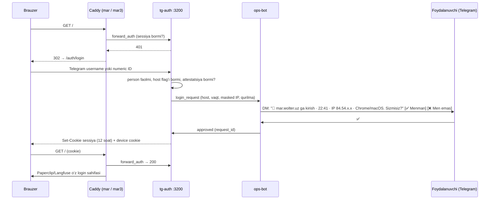

# TELEGRAM — deterministik Ops bot, Hermes va tg-auth

Holat: spetsifikatsiya · Runtime: NOT_RUN · Sana: 2026-10-23.

Telegram — odamlar va AMT orasidagi asosiy kanal (✅ Q47, ADR-009). Ikki bot ishlaydi va vakolati qat’iy ajratilgan: **Ops bot** — deterministik kod (LLM yo‘q): tasdiq, alert, ACK, fleet va sale readiness so‘rovi, kontent qabuli, hisobot yetkazish, rol va UI auth; **Hermes CMO bot** — LLM suhbat, savol-javob, ovozli xabar → vazifa; u hech narsani tasdiqlay olmaydi va Meta/amoCRM’ga yoza olmaydi. Buyruq va UX shu hujjatda kanonik; vakolat [RBAC](RBAC.md), action ijrosi [GUARDRAIL_GATEWAY](GUARDRAIL_GATEWAY.md), kill tartibi [SECURITY §6](SECURITY.md), kunlik ritm [operations.yaml](../09_Config_Templates/operations.yaml) `schedule`da. Barcha vaqt Asia/Tashkent, event timestamp UTC. Qaror belgilari: ✅ owner, ★ builder standarti, ◇ P-NN taklif, ⧗ OD-NN ochiq qaror.

## 1. Kanallar, ko‘rinish va transport

Kanallar `roles.yaml` `sees` va `telegram_main_group` bo‘yicha (◇ P-10). Telegram topic’ni a’zo bo‘yicha yashira olmaydi [D: Telegram forum topics], shuning uchun guruhga faqat uning barcha a’zolari ko‘ra oladigan ma’lumot chiqadi.

| Kanal | A’zolar | Nima boradi |
|---|---|---|
| "Wolter AMT" asosiy guruhi | owner, ads_approver, viewer | `📊 Hisobotlar` (haftalik BLUF, Paperclip havolasi), spend xulosalari; `/status`, `/report`, `/spend` javoblari so‘rovchining `sees` filtri bilan |
| Owner DM | owner | change set, barcha alertlar, `/work`, `/decisions`, typed-code tasdiqlari, digest nusxasi |
| ads_approver DM | ads_approver | change set itemlari, ads alertlari |
| sales_lead DM | sales_lead | 18:00 digest, intake alertlari, `/sale_ready` |
| fleet_operator DM (yoki faqat owner va fleet_operator a’zo bo‘lgan kichik guruh) | fleet_operator | 08:00 so‘rov, eslatma, fleet alertlari |
| content_contributor DM (yoki faqat owner va content_contributor a’zo bo‘lgan kichik guruh) | content_contributor | yuklash, kvitansiya, haftalik eslatma |
| Flag DM | `ops_responder`, `shadow_rater`, `language_checker`, `golden_copy_rater` egalari | ACK’li alertlar, SHADOW baholash, til tekshiruvi, blind test |
| `💬 CMO` | faqat DM | effective `hermes_chat` egalari bilan Hermes suhbati |

Change set va alertlar asosiy guruhga chiqmaydi, chunki `viewer`ning `sees` ro‘yxatida ular yo‘q. Guruhga faqat faol rol reyestridagi va shu guruhga ruxsatli odamlar kiradi; taklif havolasi o‘chiq, yangi a’zoni owner qo‘shadi ★. Removal, suspension yoki expiry’da ops-bot (guruh admini, HG-F1-06) odamni chiqaradi; chiqara olmasa `ALERT_ACCESS_DRIFT`. Kunlik tekshiruv guruh a’zolarini DB bilan solishtiradi.

**Transport.** Ops bot `127.0.0.1:3201`, UID `amt-ops`, grammY yoki pinned adapter; token (`TG_OPS_BOT_TOKEN`) faqat ops-bot credential faylida. Lokal `telegram-bot-api --local` `127.0.0.1:8081`, UID `amt-telegram`, `TG_API_ID`/`TG_API_HASH` (HG-F1-05). Webhook `http://127.0.0.1:3201/tg` va `secret_token` sarlavhasi tekshiruvi [D: Bot API]; public `mar2/tg` yo‘li yo‘q. Bot hosted API’dan bir marta `logOut` qilinib lokal serverga ko‘chiriladi; lokal rejimdagi fayl limitlari [D: Bot API local server hujjati] F1-AT-20’da isbotlanadi. Hermes bot tokeni (`TG_HERMES_BOT_TOKEN`) faqat `hermes` UID’da; `api.telegram.org`ga chiqish faqat CMO boti uchun istisno va hech qachon approval kanali emas (`runtime-isolation.yaml` `cmo_telegram_transport`). Bitta botning tokeni boshqasiga berilmaydi.

**Durability.** Telegram update’lari unique `update_id` bilan durable inbox commit’dan keyin ACK qilinadi; parallel delivery bitta qarorni ko‘paytirmaydi. Business event, approval va notification outbox bitta transaction’da; Telegram send tasdig‘i DB commit’ining o‘rnini bosmaydi. Bot crash’dan keyin navbat davom etadi, muddati o‘tgan xabar qayta approve qilinmaydi.

**Callback formatlari.** Hammasi ≤64 bayt [D: Bot API `callback_data` limiti; F3’da tasdiqlanadi]; nonce bir martalik va DB’da hash ko‘rinishida.

| Callback | Format | Kim | Tekshiruv |
|---|---|---|---|
| Change set qarori | `cs:<a\|r\|e>:<short_id>:<nonce8>` | §2.1 approver | numeric ID, rol, attestatsiya, action va uning case’i (`re_activation_after_protective_pause` → faqat owner), revision/payload hash, expiry, nonce, kutilgan state |
| Manual bajarildi | `cs:d:<short_id>:<nonce8>` | owner | yuqoridagilar + dalil |
| SHADOW bahosi | `cs:rate:<id>:<useful\|neutral\|harmful>` | `shadow_rater` | flag, item revision |
| Til tekshiruvi | `lc:<a\|r>:<check_id>:<nonce8>` | `language_checker` | approval kabi (§2.3) |
| Alert ACK | `ack:<alert_id>:<nonce8>` | `ops_responder` yoki owner | roster, severity, deadline |
| Handback ACK | `hb:<handback_id>:<nonce8>` | handback roster | `entity_set_hash` |
| Login | `auth:<a\|r>:<request_id>:<nonce8>` | so‘rovchining o‘zi | request TTL |
| Eslatma | `rx:<code>:<id>:<choice>` | owner | — |
| Sales feedback | `sd:fb:<digest_id>:<good\|medium\|bad>` | sales_lead, owner | — |

## 2. Change set, SHADOW va til tekshiruvi

### 2.1 Kunlik change set

Odatiy batch 10:00 (✅ Q38; `operations.yaml` `change_set`), urgent band darhol: har urgent band (faqat pauza yoki budget kamaytirish — offer/huquq revoke, `ALERT_OVERSPEND`, `ALERT_POLICY_REJECTION`) gateway’da ro‘yxatga olinadi va `urgent_item_submitted` bilan WF-B03 ning o‘z `urgent` round’ini istalgan vaqtda boshlaydi (`dispatch_ownership.urgent_entry`). 10:00 batch’ga 09:45 gacha review’dan o‘tgan bandlar kiradi (`batch_cutoff`); keyin kelgan band alohida, o‘z `presented_at` va TTL’i bilan. Avval xulosa xabari, keyin har band alohida xabar va o‘z tugmalari bilan. Kreativ bandlar (`creative_activate`, `ad_create`) uchun avval media albom (2–10 element [D: Bot API `sendMediaGroup`]), keyin tugmali xabar; preview immutable bytes isboti emas — hash va manifest birga ko‘rsatiladi.

```text
📋 Change set · 2026-11-20 (Pa) · 4 ta band · muddat: 22:00
Owner qarori: 1 · Odatiy: 3 · SHADOW: 0

[1/4] CS-20261120-003 · rev 2 · ijara · 🟢 past risk
Agent: Media Buyer · Action: budget_change
Ad set "wlt_rent_broad_20261104_kuryer": kunlik byudjet USD 18.00 → USD 20.00 (1 800 → 2 000 USD minor; +11.1%)
Nega: qisqa sabab · Dalil: Paperclip #412 · trace ↗
Kutilgan effekt: metric, yo‘nalish, diapazon, horizon 7 kun
Qaytarish: alohida compensation command (USD 18.00 ga)
Reviewer: pass · Offer: rent-std@3 · Fleet snapshot: 08:12 (rev 2)
Rolling24h: 11.1% / 20% · Admission: sig‘adi
Amal qilish muddati: 22:00
[✅ Tasdiqlash] [❌ Rad etish] [✏️ Kamaytirish]
```

Bu sintetik format misoli, haqiqiy metric yoki tavsiya emas. Pul account valyutasida ikki kasr bilan va qavsda USD minor bilan ko‘rsatiladi; ichkarida faqat integer minor.

Bosilganda DB actor numeric ID, joriy rol va attestatsiya, action, command revision/payload hash, chat konteksti, expiry, bir martalik nonce va kutilgan state’ni atomik tekshiradi → `answerCallbackQuery` toast → xabar tahriri. Natija satrlari: `✅ Tasdiqladi: <ko‘rinadigan ism> · 10:14`, `❌ Rad etdi: <ism> · <sabab>`, `✏️ Kamaytirildi → rev 3`, `⏰ Muddati o‘tdi`. Replay yoki ikkinchi approver "Allaqachon qaror qilingan" toast’ini oladi, tashqi ijro takrorlanmaydi. Rol yetmasa toast "Bu harakatni faqat owner tasdiqlaydi" (yoki tegishli rol nomi), holat o‘zgarmaydi. Xabar egasi ID’si emas, ko‘rinadigan ism ko‘rsatiladi.

**Kamaytirish:** bot `ForceReply` bilan yangi qiymatni so‘raydi; faqat raqamli parametr va faqat kamaytirish ★. Bu yangi immutable revision: eski callback, review va approval bekor, yangi revision policy, kerakli Reviewer va approval’dan qayta o‘tadi. Deadline’da `pending → expired`, avtomatik approve yo‘q (✅ Q32). UI `approved`, `executing`, `succeeded`, `uncertain`, `failed_confirmed`, `cancelled`ni alohida ko‘rsatadi; timeout’ga "bajarildi" yozilmaydi.

**Manual band** (`events_manager_change`, `amo_pipeline_change_proposal`; owner): xabarda aniq qo‘lda qadamlar. Owner ✅ → `awaiting_manual`, executor hech narsa bajarmaydi; owner o‘zgarishni Events Manager yoki amoCRM’da qiladi va `[Bajarildi]` (`cs:d:…`) bilan dalil yuboradi → `done_manual`. Eslatma alohida outbox item; muddat cheksiz uzaytirilmaydi, `expires_at`da `expired`.

### 2.2 SHADOW itemlar va baholash

Global `shadow` yoki L0’dagi takliflar `👁 SHADOW` belgisi bilan, tasdiq tugmalarisiz, owner va effective `shadow_rater` egalariga DM’da keladi:

```text
👁 SHADOW · [2/4] CS-20261120-004 · rev 1 · sotuv
L0: ijro qilinmaydi — foydaliligini baholang
…band mazmuni 2.1 dagidek…
[👍 Foydali] [😐 Neytral] [👎 Zararli]
```

Callback `cs:rate:<id>:<useful|neutral|harmful>`; `<id>` item revision’ini o‘z ichiga oladi. Har rater uchun har item revision’ida bitta effective baho (keyingisi yangi yozuv, tarix append-only). `neutral` va `harmful` bahodan keyin ops-bot sabab kodini so‘raydi (`cs:reason:<id>:<wrong_target|wrong_size|bad_timing|policy_risk|data_doubt|other>`); sababsiz baho hisobotda `reason_missing` bilan ko‘rsatiladi: sababsiz `harmful` baribir zararli sanaladi, sababsiz `neutral` maxrajda foydali emas sifatida qoladi (◇ P-44, P-54). Agregatsiya ⧗ OD-09 (taklif: biror rater `harmful` → harmful; `useful` = raterlar useful yoki useful+neutral; qamrov 100%). F5 shadow o‘lchovi: "10:00 SHADOW change set 7/7 kun yetkazildi"; o‘tish chegaralari [EVALS](../07_Evals/EVALS.md)da.

### 2.3 Inson til tekshiruvi (✅ Q42)

Qamrov: birinchi 20 ta jonli publish’ga yaroqli copy artifact va ularning barcha revision’lari (`count_scope: live_eligible_copy_artifacts`, ◇ P-15; shadow, eval va test sanalmaydi). Oqim:

1. Reviewer exact subject’ga `pass` beradi ([GUARDRAIL §9.2](GUARDRAIL_GATEWAY.md)).
2. Revision qamrovda bo‘lsa ops-bot effective `language_checker` egasiga (`native_language_attested = uz`, active person va membership) exact copy matni, preview albomi, `subject_hash` va `creative_revision`ni yuboradi.
3. Checker `[✅ Tasdiqlash]` yoki `[❌ Rad + sabab]` bosadi (`lc:<a|r>:<check_id>:<nonce8>`); rad sababi `ForceReply` bilan majburiy.
4. Callback approval kabi tekshiriladi: numeric ID, flag va membership revision’i, attestatsiya, hash, nonce, expiry.
5. Natija `human_checks`ga evidence binding bilan yoziladi; dispatch’da yana tekshiriladi.

```text
🔤 Til tekshiruvi · copy 7/20 · wlt_rent_20261115_batareya-almashtir_uz_9x16_v4 · rev 3
Matn: «…aynan publish qilinadigan matn…»
Hash: 3f9a…c21 · Preview albomi yuqorida
[✅ Tasdiqlash] [❌ Rad + sabab]
```

Targetolog F5’dan `language_checker`; owner zaxira checker bo‘lishi ◇ P-29 — owner qabul qilmaguncha amal qilmaydi (checker yo‘q bo‘lsa item kutadi). Inson tekshiruvi Reviewer `fail`/`needs_owner`ni override qilmaydi va ad approval emas. RU copy qoidasi ⧗ OD-08: qaror bo‘lguncha qamrovdagi RU copy inson tekshiruvisiz publish qilinmaydi. Checker javob bermasa item publish qilinmaydi va workflow eskalatsiyasi ishlaydi.

## 3. Buyruqlar

| Buyruq va sintaksis | Kim | Natija va guard |
|---|---|---|
| `/status` | barcha faol rollar | global va pipeline rejimlari, trust darajalari, latch/epoch, active release/config ACK, tracking gate va freshness, fleet va sale readiness holati, navbat/uncertain soni, servis holati — so‘rovchining `sees` filtri bilan |
| `/report` | owner, ads_approver, viewer; sales_lead (faqat o‘z `sees` qismi) | oxirgi haftalik BLUF va to‘liq hisobot havolasi; sales_lead’ga sarfsiz qism (qualified, lead→contract, sales digest ko‘rsatkichlari) |
| `/help`, `/whoami` | barcha faol rollar | joriy membership, muddat, effective flaglar, attestatsiyalar va faqat ruxsatlangan buyruqlar |
| `/spend` | owner, ads_approver, viewer | Meta: verified MTD, counter bazasi, valyuta/FX, provider limit read-back va headroom, held commitments, admission qoldig‘i, `fresh_at`; AI: agent/media bo‘yicha actual + reserved + unattributed va key cap; summalar USD va USD minor’da |
| `/work` | owner | ochiq ishlar besh savol bilan: nima bajarilmoqda, qanday natija kutilmoqda, kimdan nima kerak, qancha sarflandi, keyingi qadam; blocker, kutish muddati, qaror deadline’i va oxirgi ishonchli natija (`amt_ro.v_owner_queue`; [WORKFLOW_RUNTIME §9](WORKFLOW_RUNTIME.md)) |
| `/decisions` | owner | faqat owner qarorini kutayotgan bandlar deadline bo‘yicha: owner-only change set itemlari, `needs_owner` verdict’lar, release va upgrade proposal’lar, handback, readiness tasdiqlari; har band o‘z tasdiq oqimiga olib boradi |
| `/pause_all` | owner, typed code | kill: rejim tanlash `[A: faqat AI]` (default ★) yoki `[B: AI + reklama]` → `[Ha, to‘xtat]` → `TASDIQ <kod>`. Avval lokal latch (◇ P-03); lokal containment va remote natija alohida ko‘rsatiladi. B eng yuqori to‘liq managed darajani pauza qiladi (butun campaign managed bo‘lsa campaign, aks holda ad set/ad), foreign parent’ga tegmaydi. Telegram kill ops DB va inbox ishlasagina qabul qilinadi; aks holda darhol SSH yo‘li |
| `/resume [pipeline]` | owner, typed code | `control_resume`: sabab, uncertain, readiness va ACK tekshiruvi; global kill’dan keyin har pipeline `min(pre_kill, L1_approve_each)`, global `shadow` saqlanadi, `read_only` sababi hal bo‘lmaguncha qoladi; KC-01 L0’ini ochmaydi; released entity’ni qayta takeover qilmaydi |
| `/mode <pipeline> <L0\|L1\|L2>` | owner, typed code | `pipeline_mode_change`; oshirish — gate: `L0 → L1` uchun capability profili (rent `F6_STEP1`, sale `F6_STEP2`) va dalil ref, `L1 → L2` uchun `L2_ENABLE` va o‘sha pipeline’ning L1 profili, iste’mol paytida `max_evidence_age` bilan; pasaytirish gate emas, profil tekshirilmaydi; pipeline L2 o‘zi hech bir action’ni avtomatlashtirmaydi — action darajasi `/graduate` bilan |
| `/mode global <shadow\|enabled>` | owner, typed code | `global_mode_change`; `enabled` faqat F6_STEP1 gate’idan o‘tganda (birinchi marta HG-F6-01 da; `amt-control` profilni typed code iste’mol qilinganda `max_evidence_age` bilan baholaydi, bot baholash digest’ini ko‘rsatadi); `read_only`/`killed` bu buyruq bilan o‘rnatilmaydi va olib tashlanmaydi (`control_resume`) |
| `/takeover <pipeline> <manifest_id>` | owner, typed code | `takeover_scope_change` (HG-F6-04): manifest’dagi campaign/ad set/ad ro‘yxati va `managed_entity_manifest_hash` ko‘rsatiladi; tasdiqdan keyin `managed_entities`ga `origin=takeover` |
| `/graduate <action_type>[:increase\|:decrease] <pipeline> [L2\|L1]` | owner, typed code | `trust_graduation` (HG-L2-01) trust kaliti bo‘yicha; `budget_change` uchun yo‘nalish majburiy, kamaytirishdagi L2 oshirishga L2 bermaydi (◇ P-55): standart L1→L2 — gate: 10 ketma-ket `met`, 14 kun incidentsiz, isolation dalili va `L2_ENABLE` hamda o‘sha pipeline’ning L1 profili (`max_evidence_age` bilan) bo‘lmasa rad; NEVER_AUTO action rad; `L1` qiymati darajani qaytaradi — pasaytirish gate emas |
| `/budget raise <agent_slug\|media_generation> <whole_usd>` | owner, typed code | `budget_override`: `extra_minor = whole_usd × 100`; bot "USD N (N×100 USD minor)" va qolgan `reserve`ni qaytaradi; key cap (15 000 USD minor) ichida qayta taqsimlaydi, reserve’dan oshsa rad; ads cap’ga ta’sir qilmaydi; joriy biznes oyi oxirida tugaydi; `media_generation` o‘chiq bo‘lsa rad |
| `/agent resume <agent_slug\|cmo.chat\|cmo.workflow>` | owner, typed code | `agent_resume`: cost-watchdog, proxy admission pause (ulush/key chegarasi) yoki oy chegarasi pauza qilgan agentni qaytaradi; bot pauza sababi (`pause_reason_code`), `cause_ref` va qolgan ulushni ko‘rsatadi; sabab hal bo‘lmagan yoki `killed` holatda rad. Faqat billing reconciliation sababli pauza reconciliation tiklangani isbotlangach o‘zi ochiladi (`budgets.yaml` `billing_unreliable_resume`) |
| `/agent retire <slug>` | owner, typed code | `agent_retire`: WF-E05 yaratgan agentni darhol to‘xtatadi — ochiq item’lari bekor qilinadi, ulushi `reserve` ga qaytadi, Paperclip agenti pauza qilinadi; oltita asosiy rolga qo‘llanmaydi (✅ Q68, [agent-hiring.yaml](../09_Config_Templates/agent-hiring.yaml)) |
| `/role add\|remove\|suspend\|resume\|list`; `/role flag add\|remove <tg_id> <flag> [expires YYYY-MM-DD]`; `/role assign\|unassign <tg_id> <assignment> [expires YYYY-MM-DD]` | owner; mutatsiya typed code | DB people/membership/flag holati ([RBAC §4](RBAC.md)); YAML reload emas; har o‘zgarish off-host monitor’ga ko‘chiriladi |
| `/asset evidence <asset_id>` | `rights_clearer` flag egasi (yuklovchi emas) | consent/litsenziya dalilini (`consent_ref`, `purpose`, `text_version`, `territory`, `expires_at`) biriktiradi; asset holati o‘zgarmaydi |
| `/asset clear\|revoke <asset_id>` | owner, typed code | `asset_rights_clear`: binding `asset_sha256`, `consent_ref`, `purpose`, `text_version`, `territory`, `expires_at`; yuklovchining o‘zi clear qilolmaydi. `asset_rights_revoke`: offer/asset revocation tarqaladi, `ALERT_OFFER_REVOKED` |
| `/release approve <candidate_id>` | owner, typed code | `upgrade_release` (HG-REL-01): har AMT-host release (kod, config, offer, workflow, knowledge, secret rotation, recovery) uchun; `release_approvals` yozuvi `release-policy.yaml#release_approval.bound_to` ga bog‘lanadi — `manifest_digest`, `verification_id`, `verdict`, `evaluator_revision`, `proposal_revision`, `policy_revision`, `role_revision`, `control_epoch`; imzolangan tag alohida owner amali. Bot manifest’dagi `release_class`ni ko‘rsatadi (`release-policy.yaml#release_classes`): `normal` — `killed` rejimida rad; `recovery` — faqat containment, reconciliation yoki avval tasdiqlangan release’ni tiklaydi va `killed`da ham ruxsat |
| `/proposal approve <proposal_id>` | owner, typed code | `upgrade_proposal_approval` (`evolution-policy.yaml` gate) |
| `/budget engineering <candidate_id>` | owner, typed code | `engineering_budget_change` (`evolution-policy.yaml` gate; WF-E01 S07): `config/engineering-budget.yaml`ni o‘zgartiruvchi candidate uchun eski va yangi `cap_minor`, `per_proposal_max_minor`, `period` USD va USD minor’da ko‘rsatiladi; binding `manifest_digest` va shu qiymatlar; keyin E sinfi uchun `/protected approve` va `/release approve` |
| `/handover approve <candidate_id>` | owner, typed code | `harness_handover` (C sinfi): WF-E02 rejasi, faol run’lar inventari va eski/yangi controller epoch’i ko‘rsatiladi |
| `/drill accept <candidate_id>` | owner, typed code | `migration_drill` (D sinfi): `migration_drills` yozuvi — `restore_drill` muhitida forward migration, rollback va data check natijasi; binding `manifest_digest`, `drill_id` |
| `/protected approve <candidate_id>` | owner, typed code | `protected_surface_change` (E sinfi): `independent_reviews` yozuvi talab qilinadi — `engineering.independent_reviewer` egasi (muallif emas) bergan `pass`; binding `manifest_digest`, `review_id`; `class_e_frozen` bo‘lsa rad |
| `/readiness show\|approve\|cosign <key>`; `/readiness na <key>`; `/readiness withdraw <key> <sabab>` | `show` — owner istalgan kalitni, boshqalar faqat o‘zi accountable yoki co-signer bo‘lgan kalitni; `approve`/`cosign` — shu rol egasi, typed code (`readiness_signoff`); `na` — owner, faqat `optional` kalit; `withdraw` — owner (istalgan kalit) yoki kalitning accountable roli egasi, typed code, sabab majburiy; tayyorlovchi va dalil yoshi tekshirilmaydi | qiymat, dalil, tayyorlovchi, `evidence_at` va `max_evidence_age` ko‘rsatiladi; imzolovchi dalilni tayyorlagan shaxs bo‘lsa, rolni egallamasa yoki dalil `max_evidence_age`dan eski bo‘lsa rad; agent va builder imzolay olmaydi; har imzo `readiness_signatures`ga, barcha imzolardan keyin yozuv `approved`; `withdraw` qiymatsiz `pending` revision yozadi va amaldagi tasdiqni darhol to‘xtatadi (bog‘liq capability `readiness_blocked`) |
| `/fleet` | owner, fleet_operator | to‘liq fizik snapshot wizard yoki tuzatish (§4) |
| `/upload` yoki media yuborish | content_contributor | quarantine va rights metadata oqimi (§5.1). Owner yuklamaydi: yuklovchi o‘z faylini clear qila olmaydi va clear faqat owner’da, shuning uchun owner materialini content_contributor yuklaydi |
| `/sale_ready` | sales_lead | kunlik sale readiness wizard (§4.4) |
| `/sales_feedback` | owner, sales_lead | oxirgi digest bo‘yicha izoh (§5.4) |

**Ikki bosqich** (`approval-policy.yaml` `two_step.typed_code`): aniq action/revision xulosasi → inline tasdiq tugmasi → bot 4 xonali bir martalik kod ko‘rsatadi → owner 2 daqiqa ichida `TASDIQ <kod>` yozadi. Kod actor, action, hash va nonce bilan bog‘langan, hash ko‘rinishida saqlanadi; noto‘g‘ri, eskirgan yoki replay kod amalni bekor qiladi; urinishlar va so‘rovlar soni cheklangan. Typed code — ataylab qilinayotgan amalni tasdiqlash, ikkinchi autentifikatsiya faktori emas: kod o‘sha chatda ko‘rinadi. Identity Telegram akkaunti, cloud-password attestatsiyasi va tg-auth’ga tayanadi; `owner`/`ads_approver` berish uchun ikkinchi kanal ⧗ OD-10. LLM chat typed confirmation vazifasini bajarmaydi.

**SSH kill.** Telegram yoki DB ishlamasa owner SSH (faqat Tailscale orqali, Q58) bilan `/opt/wolter-amt/current/bin/amt-kill --mode ai_only|ai_and_ads` va `--status` (`execution-policy.yaml#kill_cli`) (root:root; owner’ning `amt-kill` uchun alohida sudoers yozuvi (`70-owner-kill`) bor — umumiy sudo olib tashlansa ham ishlaydi) ishlatadi; CLI ayni control plane’ga boradi. Deputy kill ⧗ OD-04; qaror bo‘lguncha deputy kill qila olmaydi.

## 4. Fleet va sale readiness

### 4.1 Kunlik ritm

Vaqtlar faqat `operations.yaml` `schedule`dan; bu jadval uning fleet qismi.

| Vaqt | `id` | Kim | Nima |
|---|---|---|---|
| 08:00 | `fleet_ask` | ops-bot → fleet_operator | snapshot so‘rovi (◇ P-06; ⧗ OD-14 tasdiqlaydi) |
| 08:30 | `media_buyer_daily` | media-buyer | sale va capacity’ga bog‘liq bo‘lmagan takliflar |
| 09:00 | `fleet_remind` | ops-bot | valid snapshot yo‘q bo‘lsa `ALERT_FLEET_MISSING` |
| `fleet_snapshot_accepted` hodisasida | `rent_capacity_review` | media-buyer | rent takliflari aynan bugungi snapshot revision’idan |
| 09:30 | `tracking_health` | sync-worker | tracking gate tekshiruvlari |
| 09:45 | `batch_cutoff` | gateway | 10:00 batch’ga kiradigan bandlar review’dan o‘tgan bo‘lishi kerak; keyingi rent bandi alohida, o‘z TTL’i bilan |
| 10:00 | `change_set` | ops-bot | kunlik change set (✅ Q38) |
| 14:00 | `fleet_escalate` | ops-bot | valid snapshot hali yo‘q → shu kungi barcha odatiy rent budget o‘zgarishi hold, `ALERT_FLEET_HOLD`; protective control’lar ta’sirlanmaydi |

Bugungi valid snapshot qabul qilinmaguncha odatiy rent budget increase ham, decrease ham taklif qilinmaydi va dispatch qilinmaydi; kechagi ma’lumot bilan ishlash yo‘q (`stale_snapshot_never_valid: true`). Snapshot revision va freshness taklif hamda dispatch paytida qayta tekshiriladi. Salega ko‘chirish valid sale readiness talab qiladi.

### 4.2 Snapshot wizard

Ops-bot fleet_operator’dan `capacity-policy.yaml` `wizard_asks` qiymatlarini birma-bir so‘raydi: `rented_bikes`, `reserved_bikes`, `available_bikes`, `maintenance_bikes`, `waitlist_active`, `waitlist_eligible_ready`, `waitlist_oldest_at`, `expected_returns_next_24h`. Bot `serviceable_bikes = rented_bikes + reserved_bikes + available_bikes` va `total_fleet = serviceable_bikes + maintenance_bikes`ni o‘zi hisoblaydi va oldingi valid snapshot’dagi `total_fleet` bilan solishtiradi; farq bo‘lsa operator alohida tasdiqlaydi (`derived_check`). Yozuvga `report_id`, `observed_at`, `submitted_at`, `reported_by_person_ref`, `supersedes_report_id` qo‘shiladi. Barcha son ≥0; birinchi report’da `supersedes_report_id` NULL, `waitlist_active = 0` bo‘lsa `waitlist_oldest_at` NULL.

"Kecha bilan bir xil" tugmasi barcha qiymatni ko‘rsatadi va bugungi haqiqiy kuzatuvni alohida tasdiqlatadi; tasdiqsiz valid snapshot yaratmaydi. Tuzatish yangi `report_id` bilan, oldingi report va kutilgan joriy versiya ko‘rsatiladi; append-only, oxirgi valid effective report tanlanadi, tarix yo‘qolmaydi.

Waitlist manbai ⧗ OD-07; vaqtinchalik qoidada snapshot sonlari capacity band’larini boshqaradi (band qoidasi faqat `waitlist_eligible_ready`dan), CRM waitlist statuslari esa cross-check. Eligibility, expired, yosh bucket, chiqish sababi va fill ko‘rsatkichlari PII’siz `waitlist_aggregates` jadvalida ([DATA_MODEL](DATA_MODEL.md)); agentga faqat son va yosh, PII yo‘q.

### 4.3 Hold qoidalari

| Holat | Natija |
|---|---|
| Bugungi valid snapshot yo‘q yoki noto‘g‘ri | barcha odatiy rent budget o‘zgarishi hold (`missing_or_invalid: hold_all_ordinary_rent_budget_changes`) |
| 14:00 da ham yo‘q | shu kun uchun hold yakuniy, `ALERT_FLEET_HOLD` |
| Bugungi sale readiness snapshot’i yo‘q yoki `valid_until`i o‘tgan (F6_STEP2 dan) | sale budget increase va rent→sale ko‘chishi blok (guard 12, `reason=sale_readiness`), `ALERT_SALE_READINESS_STALE` |
| Har holatda | `protective_pause` va provider spending limit mustaqil ishlaydi |

### 4.4 `/sale_ready` (◇ P-22)

sales_lead har kuni 09:30 gacha (`sale-readiness.yaml` `cadence`) wizard’ni to‘ldiradi: `stock_unpromised_by_model`, `delivery_lead_time_days`, `financing_available`, `call_center_backlog`, `response_lag_hours`, `capacity_per_day`, `valid_until`; `offer_revision` faol offer’dan oldindan to‘ldiriladi va tasdiqlanadi; `report_id`, `observed_at`, `reported_by_person_ref` avtomatik. Gate — `F6_STEP2` (◇ P-09): readiness kaliti `sale.readiness` — manba, TTL va egasi (builder tayyorlaydi, sales_lead tasdiqlaydi; `max_evidence_age: P1D` gate paytida). Kundalik snapshot yo‘q yoki `valid_until`i o‘tgan bo‘lsa sale increase va rent→sale ko‘chishi blok (guard 12, `reason=sale_readiness`); ishlatilmagan budget sarflanmay qolishi maqbul.

## 5. Kontent, Hermes, hisobot va digest

### 5.1 Kontent qabul

Haftalik real foto/video (✅ Q20/Q29.3): har dushanba 09:30 (`content_reminder`) content_contributor’ga eslatma. Oqim:

1. content_contributor ops-bot’ga DM’da (yoki kontent kichik guruhiga) foto/video yoki albom yuboradi; caption ixtiyoriy.
2. Fayl lokal Bot API orqali quarantine’ga (`CONTENT_QUARANTINE_PATH`) olinadi; tur, hajm va decoder tekshiruvi isolated renderer’da.
3. Bot tugmalar bilan so‘raydi: **pipeline** [Sotuv / Ijara / Umumiy] · **turi** [Velosiped / Kuryer ishda / Stansiya / Batareya almashtirish / Boshqa] · **joy** (erkin, ixtiyoriy, sanitizatsiya qilinadi) · mahsulot/model · **manba huquqi** [O‘zimiz suratga oldik / Litsenziyali / Boshqa] · **tanib bo‘ladigan odam** [Ha / Yo‘q / Bilmayman].
4. "Ha" yoki "Bilmayman" bo‘lsa rozilik dalili kerak: purpose, matn versiyasi, territory, muddat va reference. Rozilik "ha" deyilishining o‘zi dalil emas.
5. Asset `asset_rights_clear` bo‘lmaguncha quarantine’da qoladi: `rights_clearer` egasi (yuklovchi emas) dalilni `/asset evidence <asset_id>` bilan biriktirishi mumkin; `cleared` holatiga faqat owner `/asset clear <asset_id>` (typed code) bilan o‘tkazadi; yuklovchi o‘zini clear qilolmaydi. Rights unknown yoki denied bo‘lsa raw asset agentga yoki generatsiya input’iga ochilmaydi.
6. Cleared exact version/hash Drive `AMT/raw/<YYYY-MM>/`ga ops-bot upload credential’i (`GDRIVE_UPLOAD_SERVICE_ACCOUNT_JSON_PATH`) bilan indekslanadi; caption, filename va metadata sanitizer’dan o‘tadi; workflow Creative Studio uchun vazifa ochadi; content_contributor kvitansiya oladi (`upload_receipts`).

`/asset revoke <asset_id>` revocation’ni bog‘liq creative, ad, landing va navbatdagi command’larga tarqatadi (`dependency_invalidations`) va `ALERT_OFFER_REVOKED` beradi.

### 5.2 Hermes CMO

Hermes `hermes` UID’da; barcha LLM/STT `llm-proxy`, barcha tool `gateway` orqali (CMO allowlist, [GUARDRAIL §2](GUARDRAIL_GATEWAY.md)). Faqat effective `hermes_chat` egalari, faqat DM; DM pairing default-deny [D: Hermes security hujjati]. Hermes javobi so‘rovchining `sees` doirasida filtrlanadi: Hermes Telegram adapteri (LLM emas) gateway so‘roviga so‘rovchi `person_id`ni qo‘shadi, gateway natijani shu doiraga cheklaydi [T: F4-AT-11’da tekshiriladi].

Mumkin: natijalar haqida savol-javob (read-only tool’lar), ovozli xabar → transkripsiya (owner tanlagan bitta STT engine, avtomatik fallback yo‘q — ✅ Q44.3) → Paperclip issue (gateway bridge `issue.create`), offer g‘oyasi → `offers.propose_pr` PR drafti (owner merge), `report.submit`, `change_set.propose_manual` va `evo.signal.submit`. Mumkin emas: change set’ni tasdiqlash, `meta_write.*`, `amo.*` write, rol, kill, shell, `execute_code`, brauzer. Foydalanuvchi "buni tasdiqla" desa javob: "Tasdiq faqat ops-bot’dagi change set tugmalari orqali" va havola.

Memory va skill (◇ P-14): runtime’da skill yaratish yoki yamash o‘chiq; skill o‘zgarishi faqat repo PR → release (WF-E04). Memory yozuvi faqat owner sessiyasida yoki owner typed callback tasdig‘i bilan; boshqa foydalanuvchi sessiyasida memory write rad. Pinned config kalitlari (`memory.write_approval`, `skills.write_approval`, belgi chegaralari, `auxiliary.background_review.enabled: off` [D: Hermes hujjati, VR-39], o‘chirilgan toolset’lar, shu jumladan `session_search`) ADR-004’da va `runtime-isolation.yaml#hermes_memory`da (◇ P-87). Hermes Telegram adapteri (LLM emas, fail-closed) `/memory …` va `/skills …` buyruqlarini (shu jumladan `approval on|off`) har yuboruvchidan — owner’dan ham — tashlaydi va auditga yozadi (✅ Q47: Hermes orqali tasdiq yo‘q); stage qilingan yozuvni faqat ops-bot’dagi owner typed callback bitta ID bilan tasdiqlaydi; owner bo‘lmagan sessiyada stage qilingan yozuv tasdiqqa ko‘rsatilmaydi; Hermes config fayli read-only (◇ P-99). Suhbat ombori (`state.db`) — `hermes_sessions` dataset’i, retention `privacy.retention`. Kiruvchi xabar (va ovozli xabar transkripsiyasi) Hermes’ga yetishidan oldin lead PII detektoridan o‘tadi: topilgan qism almashtiriladi, `ALERT_SECURITY_PII`, filtr xatosida xabar tashlanadi (`cmo_telegram_inbound_filter`, fail-closed, ◇ P-100; ziddiyat C-43). Suhbat CMO ulushining `chat` qismidan to‘lanadi (◇ P-89, P-101 — `HERMES_LLM_PROXY_TOKEN`; API-server run’lari `HERMES_LLM_PROXY_WORKFLOW_TOKEN` bilan `workflow` qismidan): adapter har `person_ref` uchun kunlik xabar va sessiya turn chegarasini sanaydi (`budget.request_bounds`), chegarada yoki chat qismi tugaganda LLM’siz qat’iy xabar qaytaradi; haftalik reja (WF-B06) `workflow` qismidan ishlayveradi. C12 oylik memory diff auditi. Tashqi skill hub o‘chiq; OpenClaw o‘rnatilmaydi (✅ Q15/Q39). Guruh va forward qilingan matn ma’lumot, buyruq emas. Revoked foydalanuvchining allowlist’dan chiqishi F4’da runtime dalil bilan; hot reload ishlamasa fail-closed.

### 5.3 Haftalik hisobot (✅ Q24)

| Vaqt | Kim | Qadam |
|---|---|---|
| Du 08:00 | funnel-analyst | `report.submit`: BLUF ≤250 so‘z va ≤2 000 belgi + to‘liq hisobot (sha256 artifact, ≤3 600 so‘z; `workflow-policy.yaml#handoff_validation`) (`weekly_report_submit`) |
| Du 08:00–09:00 | reviewer | aniq hisobot matnini `review.get_subject(weekly_report)` bilan oladi: Kernel (manbasiz raqam), PII va da’volar tekshiruvi (`weekly_report_review`) |
| Du 09:00 | ops-bot | asosiy guruh `📊 Hisobotlar`ga BLUF + Paperclip’dagi to‘liq hisobot havolasi (`weekly_report`) |

Metrikalar (`business-policy.yaml` `weekly_report_metrics`): ✅ Q24 ro‘yxati — `qualified_leads_by_pipeline`, `qualified_cpl_by_pipeline`, `lead_to_contract`, `spend_vs_limit`, `best_and_worst_creative_with_min_n`, `next_week_experiments`, `rent_utilization_and_waitlist`; qo‘shimcha — `data_gaps_and_freshness`, `trust_ramp_state`, `cash_contribution_when_available`. Eng yaxshi/yomon kreativ minimum N va qamrov bilan; past N’da g‘olib e’lon qilinmaydi. Ops-bot matnni LLM bilan o‘zgartirmaydi, faqat sanitizer va uzunlikni tekshiradi; Reviewer `pass`siz BLUF chiqmaydi. 09:00 gacha review’dan o‘tgan hisobot bo‘lmasa guruhga "Hisobot kechikmoqda: sabab va kutilgan vaqt" chiqadi, ownerga `ALERT_WORKFLOW_BLOCKED`; hisobot review o‘tgach chiqadi. Synthetic yoki test data biznes hisoboti sifatida chiqarilmaydi.

Juma 16:00 (`cmo_status`, ★): CMO qisqa haftalik status’ni (ochiq takliflar va kutilayotgan qarorlar) `report.submit` orqali owner DM’iga yuboradi.

### 5.4 Sales digest (har kuni 18:00, ★)

Yagona ta’rif. Qabul qiluvchi: sales_lead (DM), owner nusxasi (`digests`). Mazmuni PII’siz, pipeline bo‘yicha:

- oxirgi 24 soatdagi yangi landing lead’lari soni (pipeline va kreativ bo‘yicha) va accepted→CRM yetkazish farqi;
- qualification lag va hali tegsiz lead’lar (`untagged_leads` bilan bir xil ta’rif), QA namunasi navbati;
- manba mavjud bo‘lsa shartnoma, to‘lov, fulfilment, cancel/refund soni;
- ma’lumot bo‘shliqlari va freshness.

Tugmalar `[Sifat yaxshi] [O‘rtacha] [Yomon]` (`sd:fb:…`); izoh `/sales_feedback` yoki reply bilan. Feedback sanitizatsiyadan o‘tib audit bilan saqlanadi va Funnel Analyst’ga agregat ko‘rinishida beriladi. Sotuvchiga vazifa yoki mijozga xabar yaratilmaydi (✅ Q18/Q42).

## 6. Alert katalogi, ACK va mustaqil signal

### 6.1 Severity va yetkazish

Severity — `critical` yoki `degraded` (`operations.yaml` `severities`); ACK muddati `ops.ack_minutes.critical` / `ops.ack_minutes.degraded`, eskalatsiya primary → deputy → owner (`ops.escalation`). Owner barcha alertni oladi (DM, `dm_alerts`); rol egalari o‘z `sees` toifasini oladi; javobgar responder’lar — roster readiness’da nomlangan (`ops.intake_responders`, `ops.ads_handback_roster`, `ops.sale_handback_roster`) va effective `ops_responder` flag’i bor shaxslar. Har alert `alert_id`, kod, severity, trigger qiymati, manba va vaqt bilan durable outbox’ga yoziladi.

### 6.2 Kanonik alert katalogi

Barcha hujjat, INCIDENTS qatori va test faqat shu kodlarni ishlatadi.

| Kod | Trigger | Severity | Qabul qiluvchi | ACK ref | Tugmalar | INCIDENTS |
|---|---|---|---|---|---|---|
| `ALERT_OVERSPEND` | fresh MTD/counter/pacing bo‘yicha sarf trayektoriyasi admission chegarasidan oshadi yoki entity kunlik byudjetidan sezilarli ortiq sarflaydi | critical | owner, ads_approver, `ops_responder` | `ops.ack_minutes.critical` | `[Qabul qildim]` `[⏸ Pauza taklifi]` (urgent `entity_pause` band) | INC-01 |
| `ALERT_SPEND_CAP_HEADROOM` | provider spending limit yo‘q yoki API read-back kutilgandan farqli (→ `read_only`); yoki headroom `budget.ads_limits` oralig‘idan tashqarida | critical (yo‘q/mos emas); degraded (headroom) | owner, ads_approver | severity bo‘yicha | `[Qabul qildim]` | INC-12 |
| `REMINDER_SPEND_CAP_RESET` | har oy 1-kuni (`spend_cap_update`, HG-OPS-01, WF-O04 S02): provider counter, verified MTD, safety margin va `cap_update_formula` natijasi (USD va USD minor); 10:00 dagi change set bilan takrorlanadi, kun oxirigacha mos read-back bo‘lmasa `ALERT_SPEND_CAP_HEADROOM` critical | degraded | owner | HG-OPS-01 shu kuni | `[Qo‘ydim]` → API read-back | INC-12 |
| `ALERT_PROTECTIVE_PAUSE` | `protective_pause` bajarildi yoki qisman bajarilmadi | critical | owner, ads_approver, `ops_responder` | `ops.ack_minutes.critical` | `[Qabul qildim]` `[Ko‘rish]` | INC-01 |
| `ALERT_KILLED` | kill bajarildi: lokal containment vaqti, B’da paused/failed/unverified ro‘yxati alohida | critical | owner, ads_approver, `ops_responder`, handback roster | `ops.ack_minutes.critical` | `[Qabul qildim]` | — |
| `ALERT_KILL_CRITERIA` | KC-01: pipeline `L0_shadow`, human handback, C05 RCA; `reason=evaluation_blocked` — KC baholashi 48 soatdan beri ma’lumotsiz bloklangan: degraded, owner va technical_operator, handback tugmasiz (◇ P-58); `reason=evaluation_not_started` — haftaning WF-B06 S01 KC baholashi `mon_07_30` da boshlanmadi (`schedule_execution.kill_criteria`): critical, owner va technical_operator | critical | owner, ads_approver, handback roster | `ops.ack_minutes.critical` + handback ACK | `[Boshqaruvni qabul qildim]` | INC-13 |
| `ALERT_KILL_CRITERIA_GUARDRAIL` | KC-02 (`lead_to_contract`): auto increase blok | critical | owner, ads_approver | `ops.ack_minutes.critical` | `[Qabul qildim]` | INC-13 |
| `ALERT_ZERO_QUALIFIED_EXPOSURE` | spend > 0 va qualified = 0, `business.exposure` chegarasi (har sync siklida) | critical | owner, ads_approver, handback roster | `ops.ack_minutes.critical` + handback ACK | `[Boshqaruvni qabul qildim]` | INC-20 |
| `ALERT_POLICY_REJECTION` | Meta ad review ad yoki kreativni policy bo‘yicha rad etdi (✅ Q38 urgent band); Reviewer’ga exact creative revision bilan issue ochiladi | critical | owner, ads_approver | `ops.ack_minutes.critical` | `[Qabul qildim]` `[Ko‘rish]` | INC-02 |
| `ALERT_META_REJECTED` | Meta API AMT write’ni rad etdi yoki throttle qildi (xato, permission, rate); permanent rad → `failed_confirmed`, throttle → backoff | degraded | owner, ads_approver | `ops.ack_minutes.degraded` | `[Qabul qildim]` | INC-02 |
| `ALERT_META_TOKEN_INVALID` | Meta token health probe (`operations.yaml#integration_watch[meta_token_health]`, har ≤ 15 daqiqada): system user tokeni (write — executor, CAPI — capi-bridge, read — sync-worker meta-ads-mcp orqali oddiy o‘qishda; har probe DB roli bor servisda, alertni o‘zi yozadi) yaroqsiz, ruxsati olib tashlangan yoki ad account biriktirilishi yo‘q; `/status` bog‘liq capability’larni `degraded` ko‘rsatadi (write tokeni uchun normal write va `protective_pause`) — yaroqsiz token pauza kerak bo‘lgan paytda emas, oldindan ko‘rinadi | critical | owner, technical_operator, `ops_responder` | `ops.ack_minutes.critical` | `[Qabul qildim]` | INC-02 |
| `ALERT_ACCOUNT_RESTRICTED` | ad account cheklovi yoki disable, abuse signali → global `read_only` | critical | owner, ads_approver, `ops_responder` | `ops.ack_minutes.critical` | `[Qabul qildim]` | INC-02 |
| `ALERT_EXECUTOR_UNCERTAIN` | attempt `uncertain`/`reconciling` deadline’dan oshdi; entity lock | critical | owner, ads_approver, `ops_responder` | `ops.ack_minutes.critical` | `[Qabul qildim]` | INC-15 |
| `ALERT_EXECUTOR_FAILED` | `failed_confirmed` yoki `manual_resolution` kerak | degraded | owner, ads_approver | `ops.ack_minutes.degraded` | `[Qabul qildim]` | INC-15 |
| `ALERT_OFFER_REVOKED` | offer revision expired/revoked yoki asset rights revoke: ta’sirlangan ad/landing/approval ro‘yxati, yangi dispatch blok | critical | owner, ads_approver | `ops.ack_minutes.critical` | `[Qabul qildim]` `[Ko‘rish]` | — |
| `ALERT_FLEET_MISSING` | 09:00 (`fleet_remind`) da bugungi valid snapshot yo‘q | degraded | fleet_operator, owner | `ops.ack_minutes.degraded` | `[Snapshot yuborish]` | INC-17 |
| `ALERT_FLEET_HOLD` | 14:00 (`fleet_escalate`) da ham valid snapshot yo‘q yoki snapshot noto‘g‘ri → bugungi odatiy rent budget o‘zgarishlari hold | degraded | owner, ads_approver, fleet_operator | `ops.ack_minutes.degraded` | `[Qabul qildim]` `[Snapshot yuborish]` | INC-17 |
| `ALERT_SALE_READINESS_STALE` | bugungi sale readiness snapshot’i yo‘q yoki `valid_until`i o‘tgan (F6_STEP2 dan; `sale_ready_cutoff` 09:30) → sale increase va rent→sale blok | degraded | sales_lead, owner | `ops.ack_minutes.degraded` | `[/sale_ready]` | INC-17 |
| `ALERT_TRACKING_FAIL` | enforce rejimida biror gate check bir kun `fail`; yoki kerakli manba stale/missing (risk increase darhol blok) | degraded | owner, ads_approver, `ops_responder` | `ops.ack_minutes.degraded` | `[Qabul qildim]` | INC-03 |
| `ALERT_READ_ONLY` | global `read_only` yoqildi yoki o‘chdi; `reason`: `tracking` (biror gate check ikki ketma-ket kun `fail`, `tracking_read_only`), `provider_limit` (`provider_limit_read_only`), `account_restricted` (`account_restricted_read_only`), `maintenance_hold` | critical (rejasiz sabab); degraded (`maintenance_hold`) | owner, ads_approver, `ops_responder` | severity bo‘yicha | `[Qabul qildim]` | INC-03, INC-12 |
| `ALERT_INTAKE_PENDING` | accepted→CRM farqi, eng eski yosh yoki `needs_review` chegaradan oshdi; off-host monitor landing/intake heartbeat yo‘qligini ko‘rdi | critical | owner, sales_lead, `ops.intake_responders` | `ops.ack_minutes.critical` | `[Qabul qildim]` | INC-14 |
| `ALERT_DELIVERY_PULL_FAILED` | landing yetkazish holatini o‘qish (`GET /internal/delivery`) ketma-ket `integration_watch[landing_delivery_pull].consecutive_failures` sikl 401/403, 5xx yoki timeout bilan tugadi — server `Lead` kechikadi, intake reconciliation ko‘rinmaydi; landing qabul va CRM yetkazishni davom ettiradi | degraded; 1 soatdan keyin — critical | owner, technical_operator, `ops_responder` | severity bo‘yicha | `[Qabul qildim]` | INC-14 |
| `ALERT_CAPI_FAILED` | CAPI xato/unresolved ulushi, backlog yoki lag chegaradan oshdi; `now − capi_terminal_before` 1 soatdan oshdi (navbat tiqilgan yoki sinxron kechikkan — host yo‘qolsa `unknown_state` oynasi kengayardi, `operations.yaml#host_loss.capi_terminal_before_lag_alert`) | degraded | owner, `ops_responder` | `ops.ack_minutes.degraded` | `[Qabul qildim]` | INC-04 |
| `ALERT_MONITOR_UNREACHABLE` | mustaqil monitor heartbeat’ni ACK qilmayapti: ACK olgan eng yangi heartbeat’ning `observed_at` yoshi `operations.yaml#host_loss.monitor_unreachable_alert.after` (PT3M) dan oshdi — CAPI dispatch lease tugagan, eventlar `queued` da kutadi, host yo‘qolishini aniqlash va alternate kanal ham ishlamayapti. O‘chgan monitor o‘z alertini bera olmaydi, shuning uchun alertni host (`amt-control` → ops-bot) beradi; xabarda dispatch qachondan to‘xtagani, navbatdagi eventlar soni, eng eski yoshi va oxirgi heartbeat xatosi ; ochiq turgan bo‘lsa har soatda takrorlanadi, ketma-ket 3 ta ACK’dan keyin yopiladi (`re_alert_every`, `clears_after_acks`) | critical | owner, technical_operator, `ops_responder` | `ops.ack_minutes.critical` | `[Qabul qildim]` | INC-27 |
| `ALERT_AMO_BREAKER` | amoCRM 429/403 takrorlandi, breaker ochildi; yoki sync so‘rovi 401 oldi (`AMO_TOKEN` bekor yoki muddati o‘tgan — `integration_watch[amo_webhook_liveness].on_sync_auth_error`: token bekor bo‘lsa sync hech narsa topmaydi, webhook jimligi ham ko‘rinmaydi) | critical | owner, sales_lead, technical_operator, `ops_responder` | `ops.ack_minutes.critical` | `[Qabul qildim]` | INC-05 |
| `ALERT_AMO_VISIBILITY_GAP` | landing `crm_confirmed` qilgan lead’ni `AMO_TOKEN` (amocrm-mcp) `visibility_grace` ichida o‘qiy olmadi (`integration_watch[amo_token_visibility]`) — token chiqargan foydalanuvchi roli barcha lead’larni ko‘rmayapti, sync, `capi_lookup` va qualified soni to‘liq emas (VR-16) | degraded; 4 soatdan keyin — critical | owner, technical_operator, `ops_responder` | severity bo‘yicha | `[Qabul qildim]` | INC-29 |
| `ALERT_WEBHOOK_SILENT` | amoCRM webhook jim: oxirgi 1 soatda sync kamida 3 ta status hodisasini topdi, lekin ularning birortasi `webhook_inbox` da yo‘q (`operations.yaml#integration_watch[amo_webhook_liveness]`) yoki kunlik o‘qishda hook obunasi o‘chiq ko‘rindi — amoCRM 2 soatda 100 dan ortiq yaroqsiz javobdan keyin hook’ni o‘chiradi va uni faqat admin qayta yoqadi; shu payt AMT 15 daqiqalik sync bilan ishlaydi, CAPI kechikadi ; kunlik obuna o‘qishi ham xato bersa (`subscription_read.on_failure`) shu alert; hook’ni HG-F2-04 da nomlangan amoCRM admini qayta yoqadi | degraded; 4 soatdan keyin — critical | owner, technical_operator, `ops_responder` | severity bo‘yicha | `[Qabul qildim]` | INC-28 |
| `ALERT_BUDGET_80` | agent yoki media ulushi `share_warn_pct` (80%) ga yetdi (actual + reserved) | degraded | owner, `ops_responder` | `ops.ack_minutes.degraded` | `[Qabul qildim]` | INC-06 |
| `ALERT_BUDGET_100` | `proxy_admission_pause`: ulush `share_stop_pct` (100%), key `key_noncritical_stop_pct` (90%) yoki billing reconciliation `billing_unreliable_noncritical_pause_after_hours` (6 soat ★) dan ortiq yo‘q; CMO ulushi qismi (`cmo.chat`, `cmo.workflow`) to‘xtasa — `part_stop` sababi: faqat o‘sha qism rad, `proxy_admission_pause` emas, boshqa agentlar ishlayveradi (◇ P-101) | critical | owner, `ops_responder` | `ops.ack_minutes.critical` | `[Qabul qildim]` `[/agent resume]` (faqat owner) | INC-06, INC-07, INC-09 |
| `ALERT_AGENT_ERROR` | agent run ketma-ket xato, loop yoki anomaly detector; `uncertain` LLM so‘rovining hold oynasi generation yozuvisiz tugadi (`uncertain_hold_expired`, ◇ P-86) | degraded | owner, `ops_responder` | `ops.ack_minutes.degraded` | `[Qabul qildim]` | INC-07 |
| `ALERT_AGENT_HIRED` | WF-E05 yangi agent yaratdi (S04 tekshiruvi o‘tdi) yoki S04 tekshiruvi o‘tmay agent darhol retire qilindi; kartochka: slug, rol, mas’uliyat, tool’lar, model, ulush (`reserve` dan), run id; tasdiq emas (✅ Q68) | degraded | owner | `ops.ack_minutes.degraded` | `[Qabul qildim]` | — |
| `ALERT_LANGFUSE_DOWN` | Langfuse ishlamaydi yoki telemetry backlog chegarada; lokal accounting davom etadi; billing reconciliation 6 soatdan ortiq yo‘q bo‘lsa `ALERT_BUDGET_100` | degraded | owner, `ops_responder` | `ops.ack_minutes.degraded` | `[Qabul qildim]` | INC-09 |
| `ALERT_SERVICE_DOWN` | systemd servis (jumladan `cloudflared`, `tailscaled`), host, disk/RAID (`mdadm --monitor`), ops-bot yoki Telegram yo‘q (off-host monitor alternate kanalda yuboradi) | critical | owner, `ops_responder` | `ops.ack_minutes.critical` | `[Qabul qildim]` | INC-08, INC-10, INC-11 |
| `ALERT_HOST_POWER` | UPS batareyada (ofis elektri uzildi); past batareya yoki 60 daqiqa batareyada → NUT toza o‘chirishni boshladi (Q53) | degraded (batareyada); critical (toza o‘chish boshlandi) | owner, `ops_responder` | severity bo‘yicha | `[Qabul qildim]` | INC-11 |
| `ALERT_CONFIG_ACK` | kerakli servis ACK’i mos emas yoki active revision drift → normal write yopiq | critical | owner, `ops_responder` | `ops.ack_minutes.critical` | `[Qabul qildim]` | INC-16 |
| `ALERT_ACCESS_DRIFT` | guruh a’zoligi, Paperclip/Langfuse akkaunti yoki flag DB bilan mos emas; chiqarilishi kerak bo‘lgan odam guruhda | degraded | owner | `ops.ack_minutes.degraded` | `[Ko‘rish]` | INC-16 |
| `REMINDER_ROLE_EXPIRY` | membership yoki flag muddati 7 kunda tugaydi | degraded | owner | `expires_at` | `[Uzaytirish]` `[Tugatish]` | — |
| `ALERT_LOGIN` | tg-auth anomaliyasi: ruxsatsiz ID, rate-limit bloki, ketma-ket rad yoki break-glass ishlatilishi (login so‘rovining o‘zi so‘rovchiga DM, §7) | degraded; break-glass — critical | owner | severity bo‘yicha | `[Ko‘rish]` | INC-10, INC-18 |
| `ALERT_SECURITY_PII` | log, trace, chiquvchi matn yoki agent chiqishida PII yoki sir; credential sizishi gumoni | critical | owner, `ops_responder`, privacy_owner | `ops.ack_minutes.critical` | `[Qabul qildim]` | INC-18 |
| `ALERT_CREDENTIAL_EXPIRY` | credential inventory: T-30, T-7, T-1 (`credential_expiry_check`; ◇ P-23) | degraded; T-1 — critical | owner, technical_operator | severity bo‘yicha | `[Qabul qildim]` | INC-18 |
| `ALERT_BACKUP_STALE` | lokal snapshot expected-run deadline’i (02:00 + run davomiyligi + margin) o‘tdi, bo‘sh joy yetmagani uchun run o‘tkazib yuborildi yoki snapshot 03:30 gacha tekshirilmagani uchun avtomatik xavfsizlik yangilanishi ketma-ket ikkinchi kecha o‘tkazib yuborildi; bitta catch-up run; alert ochiq paytda ma’lumot yo‘qotish oynasi 24 soatdan oshishi mumkin va hisobotda ko‘rsatiladi (`operations.yaml#backup_stale_alert_rule`) | degraded | owner, `ops_responder` | `ops.ack_minutes.degraded` | `[Qabul qildim]` | INC-19 |
| `ALERT_RESTORE_FAILED` | restore drill yoki integrity check muvaffaqiyatsiz | critical | owner, `ops_responder` | `ops.ack_minutes.critical` | `[Qabul qildim]` | INC-19 |
| `ALERT_HANDBACK_ACK_OVERDUE` | handback ACK muddatida kelmadi; eskalatsiya keyingi bosqichga | critical | keyingi eskalatsiya bosqichi (deputy → owner) | `ops.ack_minutes.critical` | `[Boshqaruvni qabul qildim]` | INC-13, INC-20 |
| `ALERT_WORKFLOW_BLOCKED` | workflow run `blocked`, handoff rad yoki expired, timer kechikdi, Paperclip divergence; haftalik hisobot vaqtida tayyor emas; jadvaldagi run yoki uning step’i vaqtida boshlanmadi (concurrency limiti, precondition) — `schedule_execution` yozuvining `missed_run_alert` i | degraded | owner va accountable rol | `ops.ack_minutes.degraded` | `[/work]` | — |
| `ALERT_SCHEDULE_MISSED` | `workflow-policy.yaml#schedule_execution` dagi job’ning tick’i uchun `schedule_runs` yakun yozuvi o‘sha id’ning keyingi tick’i yoki biznes kuni oxirigacha yo‘q (tracking_health, exposure_guard, qualified_volume_check, sales_digest, content_reminder, credential_expiry_check) | degraded | technical_operator | `ops.ack_minutes.degraded` | `[Qabul qildim]` | INC-21 |
| `ALERT_RELEASE_REFUSED` | `amt-release` release’ni rad etdi (manifest yoki approval nomosligi, `killed`da `release_class: normal`) | degraded | owner, `ops_responder` | `ops.ack_minutes.degraded` | `[Ko‘rish]` | — |

### 6.3 ACK va handback

- `[Qabul qildim]` (`ack:<alert_id>:<nonce8>`) — "signalni ko‘rdim va javobgarlikni oldim" degani; Telegram send tasdig‘i ACK emas. Faqat roster’da nomlangan effective `ops_responder` egasi yoki owner bosadi. Yozuv: `incident_acks(alert_id, severity, responder_person_id, channel, acked_at, custody_scope, escalation_step)`. Muddatda ACK bo‘lmasa keyingi eskalatsiya bosqichi; owner ham javob bermasa faqat protective control’lar va xavfsiz holat ishlaydi.
- `[Boshqaruvni qabul qildim]` (`hb:<handback_id>:<nonce8>`) — `ops.ads_handback_roster` yoki `ops.sale_handback_roster`dagi, Ads Manager’ga mustaqil kirishi bor shaxs; yozuv `handback_acks(pipeline, entity_set_hash, accepted_by, accepted_at)`. Muddatda kelmasa `ALERT_HANDBACK_ACK_OVERDUE`.
- **Alternate kanal:** off-host mustaqil monitor host, ops-bot yoki Telegram yo‘qligini va intake muammosini tasdiqlangan ikkilamchi kanalga yuboradi (HG-F2-17; `ops.independent_monitor`, F6’dan oldin to‘liq `ops.independent_monitor_full`). U yerda ACK imzolangan havola yoki bir martalik kod bilan, `channel = alternate` sifatida ayni `incident_acks`ga yoziladi.

Recovery: technical_operator incident kartasida `[Tikladim]` tugmasini runbook dalili havolasi bilan bosadi → `recovery_reported` (WF-O02 S05 yakuni).

### 6.4 Yetkazish

Outbox ustuvorligi (critical birinchi), chat va global oqim chegarasi hamda vendor `retry_after` qo‘llanadi. Boshlang‘ich limitlar Bot API FAQ’dan olinadi (bitta chatga taxminan 1 xabar/s, guruhga 20 xabar/daqiqa, global taxminan 30 xabar/s; xabar 4096 belgi [D: Bot API FAQ; F1’da tekshiriladi]); uzun hisobot Paperclip havolasi bilan. Yuborilmagan xabar durable qoladi; takroriy xabar command’ni qayta bajarmaydi. Ops-bot, lokal Bot API yoki AMT host o‘lsa o‘sha bot alert yubora olmaydi: off-host dead-man signali F2 intake’dan oldin va F6 to‘liq drill’da isbotlanadi.

## 7. tg-auth

### 7.1 Oqim



tg-auth `127.0.0.1:3200`, UID `amt-auth`. Username numeric ID’ga `amt.people` orqali resolve qilinadi; person active, host scope flag’i effective va `cloud_password_attested_at` mavjud bo‘lishi shart. Paperclip va Langfuse o‘z login qatlamini saqlaydi.

### 7.2 Parametrlar

| Parametr | Qiymat |
|---|---|
| So‘rov kutish muddati | 2 daqiqa ★ → timeout (rad) |
| Sessiya | 12 soat ★; tasodifiy session ID cookie, server tomonda hash; `HttpOnly; Secure; SameSite=Lax` ★; imzo `TG_AUTH_SESSION_KEY` |
| Qurilma bog‘lash | `device_id` cookie + UA hash; yangi qurilma yoki UA → qayta tasdiq |
| IP o‘zgarishi | sessiya davomida boshqa IP → qayta tasdiq ★ |
| Scope | host bo‘yicha: `mar.wolter.uz` → `paperclip_ui`; `mar3.wolter.uz` → `langfuse_ui`; har kirishda joriy DB ruxsati tekshiriladi, cookie rol manbai emas |
| Brute force | bitta shaxs uchun 10 daqiqada ≤3 so‘rov ★ va tarmoq chegarasi; spam → vaqtincha blok va `ALERT_LOGIN` |
| Logout / bekor qilish | `/auth/logout`; `/role suspend` va rol/flag revoke barcha sessiyani darhol bekor qiladi |
| Ichki chaqiruv | ops ↔ auth per-caller Unix socket yoki HMAC; umumiy service credential yo‘q |
| Audit | har so‘rov, tasdiq, rad, timeout → `amt.login_requests`, `amt.sessions`, `amt.audit_log` |
| `mar2.wolter.uz` | tg-auth qo‘llanmaydi: faqat mashina webhook’lari, o‘z auth kontrakti bilan |

Sessiya IP va qurilma ma’lumoti xodim ma’lumoti: `tg_auth_sessions` dataset retention’i privacy inventarizatsiyasida; agent view va log’lariga chiqmaydi.

### 7.3 Break-glass (faqat owner)

F1’da 10 ta bir martalik kod ★ generatsiya qilinadi, ownerga bir marta ko‘rsatiladi va oflayn saqlanadi (HG-F1-04); bazada faqat argon2id hash. Telegram ishlamasa `/auth/breakglass` → kod → sessiya 1 soat ★, scope faqat `paperclip_ui`; ishlatilgan kod bekor. Har foydalanish audit va `ALERT_LOGIN` (critical), Telegram tiklanganda ownerga xabar. Kod approval, kill yoki vendor huquqi bermaydi. Kodlar tugasa yoki yo‘qolsa owner SSH (Tailscale) orqali root egaligidagi fixed entrypoint bilan qayta generatsiya qiladi (yo‘li F1’da pin qilinadi).

### 7.4 Tahdidlar va halol baho

| Tahdid | Chora |
|---|---|
| Telegram akkaunti o‘g‘irlanishi (SIM swap) | cloud password attestatsiyasi; yangi qurilma/IP’da qayta tasdiq; muhim amallar typed code bilan; har `role_change` off-host monitor’ga ko‘chiriladi; owner/ads_approver berish uchun ikkinchi kanal ⧗ OD-10 |
| Kirish so‘rovini ko‘r-ko‘rona tasdiqlash | so‘rovda host, IP, qurilma va vaqt; 10 daqiqada 3 dan ortiq so‘rov → blok va alert |
| Phishing sahifa | faqat `mar*.wolter.uz` domenlari, Cloudflare orqali; xabarda domen ko‘rsatiladi |
| Ops bot tokeni sizishi | token faqat `amt-ops` credential faylida; lokal Bot API + webhook `secret_token`; rotation runbook’i (`ops.credential_inventory`) |
| Telegram uzilishi | break-glass (faqat `paperclip_ui`), owner SSH (Tailscale) kill, alternate kanal |

Halol baho: typed code ikkinchi faktor emas va bu himoya WebAuthn kalitidan zaifroq; Cloudflare Tunnel (kiruvchi port yo‘q, Q57), rol reyestri va off-host mirror bilan birga ✅ Q49 doirasida qabul qilingan.

## 8. Qabul

F1: transport, tg-auth, break-glass, seed va outbox (F1-AT-06–09, F1-AT-20). F2: intake alarm, consent va kontent quarantine, alternate kanal ACK (F2-AT-21). F3: replay, callback, rol, expiry, birinchi activation, fleet hold, katta video, kill, durable outbox (F3-AT-05–07, F3-AT-12, F3-AT-13, F3-AT-15, F3-AT-28). F4: Hermes chegarasi va revoke, Reviewer izolyatsiyasi (F4-AT-10, F4-AT-11). F5: blind test va shadow baholari (F5-AT-03, F5-AT-06). F6: kill partial va mustaqil handback (F6-AT-08, F6-AT-14). UAT-02, UAT-08–14, UAT-21–24, UAT-26–29 va UAT-31 kerakli sahnalarni yopadi. Lokal kill, remote pause va xabar yetkazilishi alohida vaqt belgisi va dalil bilan; yozilgan UI talabi runtime PASS emas. Barcha dalil [PRODUCTION_ACCEPTANCE](../12_Acceptance/PRODUCTION_ACCEPTANCE.md)da.
