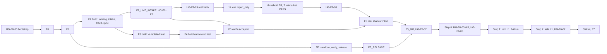

# PHASES — ishlab chiqarish rejasi, gate’lar va kuzatuv oynalari

Holat: spetsifikatsiya · Runtime: NOT_RUN · Sana: 2026-10-23.

To‘liq ishlab turgan biznes tizimi quriladi (Q48 ✅: MVP yo‘q). Bosqichlar mahsulot qamrovini kichraytirmaydi; ular haqiqiy reklama vakolatini dalil bo‘yicha ochadi. Bu hujjat build topshirig‘i — bajarilgan deploy yoki go-live tasdig‘i emas. U [INVARIANTS](../11_Production_Contracts/INVARIANTS.md), [OPERATING_ENVELOPE](../11_Production_Contracts/OPERATING_ENVELOPE.md), [CONFIG_CONTRACT](../11_Production_Contracts/CONFIG_CONTRACT.md), [readiness.yaml](../09_Config_Templates/readiness.yaml) va [PRODUCTION_ACCEPTANCE](../12_Acceptance/PRODUCTION_ACCEPTANCE.md) bilan birga qo‘llanadi. Builder ish tartibi — [CLAUDE.md](../CLAUDE.md) (§3 faza sikli, §4 HUMAN_GATE protokoli, §5 spetsifikatsiya jim bo‘lganda).

## 1. Faza va natija

| Faza | Quriladigan to‘liq natija | Boshlash sharti | Qabul sharti (§2.2) |
|---|---|---|---|
| F0 | Owner PC `amt-pc` (Ubuntu Server 24.04, RAID1, UPS), `owner`/`builder`/`amt-build` va har servis UID’i, Cloudflare Tunnel (kiruvchi port yo‘q), Tailscale orqali SSH (sshd), Omada VLAN izolyatsiyasi, sops+age, lokal snapshot, repolar (`main` va tag ruleset) va tekshirilgan bootstrap | HG-F0-01 → HG-F0-07 → HG-F0-05 → HG-F0-03 → HG-F0-04 → HG-F0-00 (§4.2) | F0 AT, HG-F0-00…05, HG-F0-07, HG-F0-08; recovery reyestri ochilgan |
| F1 | Paperclip, Hermes, Langfuse, tg-auth, lokal Bot API, llm-proxy, root publisher `amt-release` (`validate → prepare → activate → ack`), managed runner va workflow runtime prototiplari | F0 accepted | F1 AT, HG-F1-01…06; F1_AUTH, F1_COST_RUNTIME, F1_ISOLATION, F1_WORKFLOW PASS; builder sudo allowlist’ga toraytirilgan (F1-AT-26) |
| F2 | Sale+rent landing, durable intake, CRM/CAPI, consent, Umami/Clarity, biznes baseline, recovery va mustaqil monitoring; tracking gate | F1 accepted | F2_LIVE_INTAKE → HG-F2-09 → 14 kun report_only → threshold PR → 7 ketma-ket PASS → HG-F2-08 (F2_TRACKING_PASS); F2 AT, red team (F2-AT-22) |
| F3 | Guardrail gateway, fenced executor, connectorlar, durable outbox, rollar, sync, pul va spend himoyasi, kill va handback | F1 accepted + F2 build artefaktlari merged (§2.3) | F3 AT barchasi `pass`, red team critical 0, HG-F3-01…05, HG-GIT-01 merged; F3_CONTROLLED_TEST PASS; production write yo‘q |
| F4 | Olti agent, mustaqil Reviewer, Hermes CMO, repo skill’lari, routine/timer, branded render va offer provenance | F3 `verified_in_staging` (isolated control suite `pass`) | F4 AT barchasi `pass`, red team critical 0, HG-F4-01…04, HG-GIT-01 merged; F4_AGENTS va F4_CONTENT PASS; barcha pipeline L0 |
| FE | Engineering sandbox, mustaqil verification custody, release controller kengaytmasi, harness handover, yaxshilanish xotirasi | F1 accepted (F1_ISOLATION + F1_WORKFLOW); F2–F4 bilan parallel | Q67: F5 formal eval va real shadow boshlanishidan oldin FE_SANDBOX/FE_RELEASE PASS, qatlam deployed va FE `verified_in_staging`, HG-FE-01…05 yopiq; Q66 exact baseline mustaqil texnik inson signoff’i shu gate’dan oldin; F6 Step 1 dan keyin `technically_accepted`; F7 da EVO-AT14 bilan `business_accepted` ([FE_Evolution](FE_Evolution.md)) |
| F5 | Har rol model/adapter tanlovi, hard eval, blind copy, global readiness yopilishi, 7 kun real shadow, ikki savolli go/no-go | F4 `verified_in_staging` + **Q67: FE qatlam deployed, FE `verified_in_staging`, FE_RELEASE PASS va Q66 baseline human signoff** — formal evaldan oldin. **Real shadow:** shu FE shartlari + F3 va F4 accepted + HG-F2-08 | F5 AT, HG-F5-01…04; F5_GO PASS (FE_RELEASE bilan); HG-F5-02 ning A va B qismlari yozilgan |
| F6 | Pre-live drill → rent L1 14 kun → dalil bo‘yicha sale L1 (to‘liq takeover) | **F0–F5 accepted** (F3/F4: barcha AT `pass`, red team critical 0, HG-GIT-01 merged), F5_GO PASS, HG-F5-02 A = GO | F6 AT, HG-F6-01…06; F6_STEP1 va F6_STEP2 PASS; HG-F6-02 qarori |
| F7 | To‘liq takeover’dan 30 kun keyingi biznes qabul, retro, Trust Ramp review, SOP/ADR va keyingi chorak | F6 accepted; F7 soati §3 langaridan 30 kun | F7 AT (F7-AT-06 biznes qabul), HG-F7-01; FE `business_accepted` |

**Qabul tranzitiv.** Faza kirish sharti talab qilgan har faza o‘zi ham qabul qilingan bo‘ladi. F6 kirishi F0–F5 ning har birini talab qiladi; F5 real shadow F3 va F4 accepted hamda HG-F2-08 ni kutadi. F3_CONTROLLED_TEST va F4_AGENTS F2_LIVE_INTAKE dan meros oladi (§4.3), shuning uchun F3/F4 qabuli F2 jonli intake tayyorligidan keyin yopiladi; ularning build va isolated testi esa parallel. Istalgan fazada ochiq critical red-team topilmasi bo‘lsa qabul yo‘q.

## 2. Lifecycle, merge, release va parallel ish

### 2.1 Yagona lifecycle lug‘ati

Faza, release va upgrade candidate bitta zanjirni yozadi ([evolution-policy.yaml](../09_Config_Templates/evolution-policy.yaml) `outcome.lifecycle`, I23). Faza ledger’i `build/F<n>/STATUS.md` da: har milestone uchun holat, UTC vaqt, dalil havolasi (commit yoki manifest digest, EVIDENCE qatori) va kim belgilagani.

| Holat | Faza ledger’idagi ma’nosi | Kim belgilaydi |
|---|---|---|
| `specified` | faza boshlanmagan; `PLAN.md` yozilgan | builder |
| `implemented` | kod, infra va testlar yozilgan | builder |
| `verified_in_staging` | isolated/staging muhitda faza AT’lari `pass` | builder (EVIDENCE) |
| `merged` | owner `main`ga merge qilgan (HG-GIT-01) | owner |
| `released` | owner release tasdig‘i (HG-REL-01); landing/Umami uchun owner Dokploy deploy’i | owner |
| `deployed` | hostda faol revision, kerakli servis ACK’lari bilan | `amt-release` (ACK) |
| `observed` | faza kuzatuv oynasi dalil bilan yopilgan | builder qayd etadi, owner ko‘radi |
| `technically_accepted` | barcha AT, HG va red team (critical 0) yopiq | owner |
| `business_accepted` | biznes dalili bor yoki `not_applicable` (sababi bilan) | owner |

Muqobil yakunlar: `rejected | inconclusive | rolled_back | cancelled | not_applicable`. Fazaga kerak bo‘lmagan holat `not_applicable` va sabab bilan yoziladi. **Faza qabul qilingan (accepted)** = `technically_accepted` ∧ (`business_accepted` ∨ uning `not_applicable`i) ∧ fazaning HG, AT va kuzatuv oynalari yopiq. `merged` deploy emas; `deployed` biznes qabul emas. Intake receipt holati `accepted` (I08) boshqa obyekt va faza qabuli bilan aralashtirilmaydi.

Test va dalil natijasi: `not_run | pass | fail | blocked | inconclusive` (data’da kichik harf; `inconclusive` faqat biznes yoki statistik test uchun; katta harf faqat ko‘rsatishda). Readiness yozuvi: `pending | evidenced | approved | not_applicable`.

### 2.2 Faza qabul asosi

| Faza | `technically_accepted` asosi | `business_accepted` asosi |
|---|---|---|
| F0 | F0 AT, HG-F0-00…05, HG-F0-07, HG-F0-08 | `not_applicable` — infratuzilma |
| F1 | F1 AT, HG-F1-01…06, F1 profillari, builder sudo toraytirilgan | `not_applicable` — platforma |
| F2 | F2 AT, F2 HG’lari, F2_LIVE_INTAKE PASS | HG-F2-08: real trafikda tracking gate va real lead zanjiri (F2_TRACKING_PASS) |
| F3 | F3 AT, red team critical 0, HG-F3-01…05, HG-GIT-01, F3_CONTROLLED_TEST PASS | `not_applicable` — production write yo‘q |
| F4 | F4 AT, red team critical 0, HG-F4-01…04, HG-GIT-01, F4_AGENTS + F4_CONTENT PASS | `not_applicable` — barcha pipeline L0 |
| F5 | F5 AT, HG-F5-01…04, F5_GO PASS, HG-F5-02 A = GO | `not_applicable` — shadow biznes foydasini isbotlamaydi; HG-F5-02 ning B qismi F6 exposure’ini belgilaydi |
| F6 | F6 AT, HG-F6-01…06, F6_STEP1 va F6_STEP2 PASS | HG-F6-02 qarori F6-AT-05 va F6-AT-15 dalili bilan; dalil yetmasa F6 `observed`da qoladi (extend/hold) |
| F7 | F7 AT, HG-F7-01 | F7-AT-06 — butun tizim biznes qabuli |
| FE | FE-AT-01…15, HG-FE-01…05, F6 Step 1 dan keyin kamida bitta haqiqiy AMT host release FE yo‘lidan o‘tgan | EVO-AT14 (F7) |

### 2.3 Parallel ish

- **F3 va F4 kirishi uchun F2 artefaktlari:** §A landing/intake, §B capi-bridge va webhook inbox, §C history-import va baseline job, §D sync, tracking-health, intake reconciliation va monitor servislari `main`ga merged. HG-F2-14/09/08 va §E kuzatuvi F3/F4 build’i uchun shart emas.
- F2 `observed`ga yetguncha F3/F4 `implemented` yoki `verified_in_staging` bo‘lishi mumkin. Bu F2 gate’ini chetlab o‘tmaydi: F5 real shadow va har production write kutadi.
- FE F1 accepted’dan keyin F2–F4 bilan parallel quriladi; Q67 va `readiness.yaml#rules.phase_entry_profiles.F5` bo‘yicha sandbox, mustaqil verification va release qatlami deployed, FE `verified_in_staging`, FE_SANDBOX/FE_RELEASE PASS va HG-FE-01…05 yopiq bo‘lmaguncha **F5 formal eval ham, real shadow ham boshlanmaydi**. Q66 exact baseline mustaqil texnik inson signoff’i FE_RELEASE’dan oldin, demak formal evaldan ham oldin; engineering E human review har doim saqlanadi.
- F2–F4da synthetic/offline fixture va harness kodi tayyorlanishi mumkin; bu F5 formal model/adapter eval natijasi yoki shadow kuni emas. F4ning o‘z acceptance smoke sinovlari o‘z gate/cap’larida qoladi; ularni FE tayyor bo‘lmasdan F5 formal eval deb hisoblash mumkin emas.
- Profil talablari production bundle’da majburlanadi (§4.3). Isolated, staging va sandbox muhitlari ([environments.yaml](../09_Config_Templates/environments.yaml)) production credential, job va egress’siz ishlaydi, shuning uchun build testlari profil kutmaydi. Production resurslari bilan kesishma validator xatosi.

### 2.4 Merge, release va artefakt identifikatsiyasi

- Har PR’ni owner merge qiladi (**HG-GIT-01**). `main` ruleset: PR va owner review majburiy; bypass, force-push va o‘chirish yo‘q.
- Tag ruleset (HG-F0-05): `release-*` va `F*-done` tag’larini yaratish, o‘zgartirish va o‘chirish faqat owner’da, bypass yo‘q. Builder credentiali bu tag’larni yarata olmaydi (F0-AT-15); engineering credentiali faqat `cand/*` branch’larga push qiladi.
- AMT host runtime config va kodi faqat root egaligidagi `amt-release` publisher orqali chiqadi: `validate → prepare → activate → ack` (F1’da quriladi). Publisher owner imzolagan annotated `release-*` tag’ni `/etc/amt/release-signers` dagi kalit bilan tekshiradi, commit `main`dan reachable va tag commit = manifest commit bo‘lishini talab qiladi (F1-AT-24) va repo’dagi ixtiyoriy script’ni root’da bajarmaydi. Install, build va test unprivileged `amt-build` ostida. Agent `main` working tree’dan kod o‘qimaydi; runtime rollari DB’da, YAML eksporti DB’ni qayta seed qilmaydi.
- Har AMT host release — **HG-REL-01**: F1 dan boshlab har release `release_approvals` yozuvi (`/release approve <candidate_id>`, typed code, `upgrade_release`; manifest digest, approver, nonce hash, control epoch, muddat) **va** owner imzolagan `release-*` tag bilan; tag’ning o‘zi hech qachon yetarli emas. FE_RELEASE gacha yozuvdagi `verification_id`, `verdict` va `evaluator_revision` bo‘sh bo‘lishi mumkin (`release-policy.yaml#release_approval.nullable_before_fe_release`); FE_RELEASE dan boshlab ular majburiy va release `build_once_promote` qoidasiga bo‘ysunadi: artefakt sandbox’da bir marta quriladi, digest’lari candidate manifest’da, verification shu digest’larda, publisher aynan shularni chiqaradi. Merge fast-forward yoki rebase va tree-hash tengligi bilan; aks holda yangi manifest va qayta verification.
- Q65 faqat birinchi F1 publish’da ops-botdan oldingi tasdiq yo‘lini yopadi: [FIRST_RELEASE](FIRST_RELEASE.md) bo‘yicha owner fixed SSH importer aynan imzolangan candidate uchun canonical typed confirmation/release approval/audit va unique initialization marker yaratadi; publisher baribir DB yozuvi **va** owner signed tag’ni talab qiladi. Initial F1, null base, bo‘sh enabled/snapshot capability’lar; existing current/history/killed state yoki boshqa nonce/candidate bilan qayta seed rad; failed first ACK current yaratmaydi va faqat o‘sha pending identity retry qilinadi. Keyingi release `deployment.kind: update`, active base va odatiy Telegram typed approval bilan.
- Manifest `deployment` maydoni kind, phase F1…F7, to‘liq registered deployed `services` va registry ACK class’idan aynan hisoblangan `required_acks`ni digest’ga bog‘laydi. `release-policy.yaml#deployment` cumulative phase floor hamda barcha capability dependency’larini majburlaydi; informational target_profile future/installed protective ACK’ni yashirishga asos emas. F1 absent F2/F3 servislarini kutmaydi; ACK failure update’da oldingi current’ni, initial’da current yo‘qligi va admission deny’ni saqlaydi.
- Release manifest `target_profile`ni olib yuradi; `amt-release` va `amt-control` PASS bo‘lmagan profilga bog‘liq capability yoki rejimni rad etadi ([execution-policy.yaml](../09_Config_Templates/execution-policy.yaml) `capability_requires_profile`).
- Release sinflari ([release-policy.yaml](../09_Config_Templates/release-policy.yaml) `release_classes`): `normal` — global rejim `killed` bo‘lsa rad; `recovery` — manifest `release_class: recovery` deb e’lon qilgan va faqat containment, reconciliation yoki oldin tekshirilgan release’ni tiklaydigan owner tasdiqlagan release, `killed` da ham ruxsat (F1-AT-24).
- `amt-release` faqat AMT host uchun. Landing va Umami: AMT PR ochadi (WF-B04), owner merge qiladi va production Dokploy’da deploy qiladi (Q46.4 ✅), AMT chiqarilgan snapshot’ni read-only tekshiradi. `amt-release`da Dokploy yoki landing credentiali yo‘q.

### 2.5 Builder huquqlari (◇ P-05, qattiqroq — darhol qo‘llanadi)

| Davr | Builder huquqi | Tekshiruv |
|---|---|---|
| HG-F0-00 → F1 accepted | `builder` vaqtinchalik NOPASSWD sudo; barcha install/build/test `amt-build` ostida (sudo, docker va sirlarsiz) | F0-AT-06 |
| F1 accepted → HG-F6-06 | sudo buyruq allowlist’iga toraytirilgan (F1 ning oxirgi vazifasi); boshqa root ishi `build/NEEDS_HUMAN.md` orqali owner’da | F1-AT-26 |
| HG-F6-06 (F6 Step 1 dan oldin) | sudoers fayli o‘chiriladi; `sudo`, `docker`, `adm`, `lxd` guruhlaridan chiqariladi; builder yoza oladigan root-run yo‘l qolmaydi; `ops.credential_inventory` dagi har production credential (Meta, amoCRM, CAPI, OpenRouter, Telegram botlari, Langfuse, GitHub, Cloudflare Tunnel tokeni, Tailscale node kaliti, age, tg-auth break-glass) rotation qilinadi; builder home’dagi sir qoldiqlari tozalanadi | F6-AT-11 |
| F6 Step 1 dan keyin | builder sudo’siz; o‘zgarish faqat sandbox → verification → owner merge → owner release yo‘li bilan ([SELF_EVOLUTION](../03_Architecture/SELF_EVOLUTION.md)); vaqtinchalik yordam faqat **HG-OPS-02** (aniq buyruq allowlist’i, `expires_at`, owner revoke) | HG-OPS-02 dan keyin F6-AT-11 + F1-AT-19 qayta `pass`, so‘ng owner resume |
| Host yo‘qolgandan keyin (yangi PC) | F2 live intake’dan oldin — F0 qaytadan `build` rejimida; undan keyin faqat `00-owner-bootstrap.sh --rebuild`: builder sudo’sini yaratmaydi, qolgan root qadamlarini owner imzolangan `release-*` tag’da `git verify-tag` bilan tekshirilgan root egaligidagi clone’dan ko‘rib chiqilgan `infra/bootstrap/*.sh` bilan [BACKUP_RESTORE](../06_Runbooks/BACKUP_RESTORE.md) §5.1 tartibida bajaradi; yordam faqat HG-OPS-02 | F6-AT-11 qayta |

## 3. Kuzatuv vaqti va langarlar

Ketma-ket minimal kuzatuv: **14 + 7 + 7 + 14 + 30 = 72 kun**. Bu qurish, review, kutish (jumladan Step 1 uchun dushanbani kutish) yoki failure’dan keyingi takroriy kuzatuvni o‘z ichiga olmaydi. Kalendardagi aniq go-live sanasi oldindan uydirilmaydi. Barcha vaqtlar Asia/Tashkent.

| Oyna | Davomiylik | Langar (soat qachon boshlanadi) | Shart | Manba |
|---|---|---|---|---|
| Tracking report_only | ≥14 kun | HG-F2-09 ro‘yxatidagi barcha faol ad’lar `go.wolter.uz`ga yo‘naltirilgan vaqt (`tracking-health.yaml` `report_only_clock_starts`) | real hajm, consent va missingness ko‘rsatiladi; kamida bitta real lead zanjiri | Q37 ✅; ★ (DECISION_LOG H) |
| Tracking enforce | 7 ketma-ket kun | owner threshold PR’i merge qilinib (HG-GIT-01) active ACK olingandan keyingi birinchi to‘liq kun | streak’ni faqat `pass` davom ettiradi; `fail/unknown/stale/low_n` uzadi; `warn` ⧗ OD-17 | Q37 ✅; ★ |
| F5 real shadow | 7 kun | HG-F2-08 va F3+F4 accepted bo‘lgandan keyingi birinchi to‘liq kun | gateway shadow, barcha pipeline L0, AMT normal remote write 0 | Q36 ✅ |
| F6 Step 1 (rent L1) | 14 kun = 2 to‘liq event-week | HG-F6-01 vaqti; Step 1 dushanba boshlanadi (◇ P-13) | sale targetologda; KC-01 ikki marta baholanadi | Q36 ✅, Q31 ✅ |
| F7 | 30 kun | HG-F6-02 dan keyingi birinchi sale live dispatch vaqti | yetilgan kogorta va biznes guardrail davom etadi | Q13 ✅ (C12) |
| Targetolog `ads_approver` | 4 hafta (Step1 + 28 kun) | HG-F6-01 vaqti | HG-F6-05 Step1 + 21 kunda (◇ P-17); eslatma tugashdan 7 kun oldin (`roles.yaml` `expiry_reminder_days_before`) | Q31 ✅; ★ (Step 1 dan hisoblash) |
| Kill criteria | 2 hafta ketma-ket | event-week dushanba 00:00; baholash dushanba 07:30 (`operations.yaml` `kill_criteria`) | KC-01: qualified CPL taqqoslanadigan baseline’dan >25% yomon → pipeline L0 + handback + C05 | Q31 ✅; ◇ P-13 |
| Approval TTL | 12 soat | `change_set_items.presented_at` | 10:00 batch uchun 22:00; urgent item o‘z taqdim vaqtidan; avto-tasdiq yo‘q; expiry/freshness/epoch har dispatch’da | Q32 ✅, Q38 ✅ |
| Trust Ramp | 10 ketma-ket `met` item + 14 kun incidentsiz | 14 kun shu action_type × pipeline’dagi oxirgi sanalgan itemdan keyin (`trust_ramp.graduation.incident_window_anchor`) | har juftlik owner HG-L2-01 bilan; shadow va `inconclusive` sanalmaydi (◇ P-04); `met` deterministik, sanaladigan `met`dan boshqa har natija seriyani 0 ga qaytaradi (◇ P-42) | Q08 ✅; ★ (DECISION_LOG G) |
| Spending limit yangilash | har oy 1-kuni | — | HG-OPS-01, `cap_update_formula` (◇ P-02) va API read-back | Q37 ✅; ★ (H) |
| Restore tekshiruvi (`restore_check`) | taxminan har oy (P25D; har doim P30D ichida) | `recovery.restore_check` dalili vaqti; kunlik 04:30 muddat tekshiruvi, 03:30 dagi xavfsizlik yangilanishlaridan keyin (`operations.yaml#schedule`) | lokal snapshot’dan `restore_test` ga isolated restore, o‘lchangan RPO/RTO | ★ (G) |
| To‘liq mashq (`kill_drill` eslatadi) | har chorak (P92D ichida) | `recovery.full_drill` dalili vaqti; kunlik 10:00 muddat tekshiruvi — P75D da va P83D dan har kuni owner’ga eslatma, mashqni owner belgilaydi va ishtirok etadi | AMT PC’dagi izolyatsiyalangan `restore_drill` konteynerida (tarmoqsiz) lokal snapshot’dan to‘liq restore, PII’siz manba eksportidan qayta qurish (CAPI sintetik endpoint’ga), fixture’larda simulyatsiya qilingan Meta endpoint’iga qarshi to‘liq A/B, schema-aware rollback + production’da Tailscale orqali SSH bilan rejimni o‘zgartirmaydigan `amt-kill --self-test` (◇ P-12) | ★ (G); ◇ P-12 |
| Premortem review | HG-F2-08 dan oldin; to‘liq takeover’dan 4 hafta keyin; 2027-01-15 va keyin har 3–4 oyda | — | [PREMORTEM](../00_Decisions/PREMORTEM.md) | premortem |

## 4. HUMAN_GATE reyestri

> Builder har HG’ga yetganda `build/NEEDS_HUMAN.md` yozadi (eng yangisi tepada) va ops-bot ishlasa Telegram’da xabar beradi ([CLAUDE.md §4](../CLAUDE.md)). Owner topshiradigan sirlar **faqat** `sops` (`secrets/*.sops.yaml`) yoki serverga SSH (Tailscale) yoki fizik konsol orqali — chat, issue yoki Telegram orqali hech qachon. sops F0 ning 7-vazifasida paydo bo‘ladi; undan oldingi bootstrap sirlari faqat SSH yoki konsol bilan qo‘yiladi.

### 4.1 Gate jadvali

| HG | Faza | Owner nima qiladi | Qaytariladigan narsa | Bloklaydi |
|---|---|---|---|---|
| HG-F0-01 | F0 | **PC’ni o‘rnatish** (Q52, Q53): ikkinchi 1 TB NVMe (ikkinchi M.2 slot bo‘lmasa — 1 TB SATA SSD); PC qulflangan server qutisida, qutiga raqamli plomba (tamper-evident seal; ◇ P-32); BIOS: "Restore on AC Power Loss = Power On", USB’dan yuklash faqat o‘rnatishda, administrator paroli, ona plata qo‘llasa chassis-intrusion jurnali yoqiladi; UPS’ga PC, ONT va ER605 ulanadi (USB signal kabeli bilan, port bo‘lsa); AMT VLAN SG2428P orqali o‘tsa switch va Omada controller ham UPS’ga, aks holda PC ER605 portiga to‘g‘ridan; PC AMT VLAN portiga (HG-F0-07) | disk ro‘yxati, ona plata va UPS modeli; BIOS skrinshotlari, plomba raqami | HG-F0-00, F0-AT-12, F0-AT-19, F0-AT-22 |
| HG-F0-07 | F0 | **Omada** (Q59): controller (OC200/OC300); AMT VLAN; SG2428P’da PC porti AMT VLAN’ga untagged (yoki PC ER605 portiga to‘g‘ridan); PC uchun **statik IPv4** (DHCP yo‘q — gateway boshqaruv ACL’i DHCP unicast yangilanishini ham to‘sadi), gateway — AMT VLAN gateway’i, DNS `1.1.1.1` va `9.9.9.9`; ER605 ACL: AMT↔ofis LAN deny, AMT tarmog‘i uchun "Gateway Management Page" ACL (gateway’ning barcha interfeys IP’lari, AMT VLAN gateway manzili ham; routing ishlayveradi), AMT→internet allow; switch va controller ACL: AMT→SG2428P va controller boshqaruv IP’lari deny; AMT uchun port forward/virtual server/DMZ/UPnP yo‘q; AMT VLAN’da IPv6 o‘chiq | VLAN/ACL skrinshoti; PC’ning statik IP manzili va gateway’i | F0-AT-02, F0-AT-16 |
| HG-F0-05 | F0 | GitHub: private `wolter-amt` va `wolter-landing`. Owner shu `project-os/` to‘plamini `wolter-amt` `main`ga birinchi commit sifatida push qiladi, so‘ng rulesetlarni yoqadi: **`main`** (PR, owner review, bypass yo‘q, force-push/o‘chirish yo‘q) va **tag ruleset** (`release-*`, `F*-done` create/update/delete faqat owner, bypass yo‘q). Owner release imzo kaliti. Builder’ning per-repo deploy key’lari bu gate’da emas: ular PC’da yaratiladi va owner ularni HG-F0-00 skripti so‘raganda GitHub’ga qo‘shadi (faqat branch push; tag yarata olmaydi, ruleset bypass actor emas — F0-AT-15). F0-AT-15 uchun owner shu rulesetlar bilan sozlangan **izolyatsiyalangan test repo** ham yaratadi va unga production kalitlari bilan bir xil sozlamali **egizak deploy key** qo‘shadi (F0-AT-15 (2) da builder shu kalit bilan urinadi); F0-AT-15 (1) ni — ruleset, bypass ro‘yxati va deploy key sozlamalarini API orqali o‘qishni — owner o‘zi faqat o‘qish huquqli fine-grained token bilan bajaradi | repo URL’lar (test repo ham); signer public key; owner’ning ruleset va deploy key read-back’i | HG-F0-00 (clone), F0-AT-15, F1-AT-24 |
| HG-F0-03 | F0 | **age** kalit juftligi; private kalit owner’da + qog‘oz/QR nusxasi seyfda (Q56) | public key (`age1…`) | sops (F0 7-vazifa), barcha sirlar |
| HG-F0-04 | F0 | **Tailscale** (Q58): owner hisobi; avval [tailscale-policy.hujson](../09_Config_Templates/tailscale-policy.hujson) siyosati (`OWNER_LOGIN` owner login’i bilan almashtirilib) admin konsolga qo‘yiladi — `tests` bloki o‘tmasa Tailscale uni saqlamaydi — va tailnet’da device approval yoqiladi; **shundan keyin** AMT tuguni uchun bir martalik, muddatli, **oldindan tasdiqlangan (pre-approved)** `tag:amt` auth key yaratiladi — aks holda tasdiqlanmagan tugun trafik yubora olmaydi; AMT tugunining key expiry o‘chiriladi (builder sozlamasi). Builder F0’da shu matnni `infra/tailscale/acl.hujson` ga commit qiladi; keyingi o‘zgarish faqat PR va shu gate bilan | siyosat eksporti, device approval sozlamasi skrinshoti, auth key (bir marta, oldindan tasdiqlangan, faylga — SSH/konsol orqali) | HG-F0-00, F0-AT-05, F0-AT-08 |
| **HG-F0-00** | F0 | **Owner bootstrap:** USB’dan Ubuntu Server 24.04, RAID1 (ikkala diskda ESP), [F0_Server](F0_Server.md) Appendix A dagi `00-owner-bootstrap.sh` (`owner`, `builder`, `amt-build`; builder vaqtinchalik NOPASSWD — ◇ P-05; Tailscale (HG-F0-04 dagi oldindan tasdiqlangan auth key, fayldan); Node + Claude Code; builder’ning per-repo deploy key’lari — skript so‘raganda owner ularni GitHub’ga qo‘shadi; repo clone), so‘ng `builder` sifatida `claude` login (Max 20x, Q23 ✅) | — | butun build |
| HG-F0-02 | F0 | **Cloudflare Tunnel** (Q57): Zero Trust’da masofadan boshqariladigan tunnel; public hostname’lar `mar`, `mar2`, `mar3` → `http://127.0.0.1:8080`, oxirgi qoida `http_status:404`; boshqa hostname yo‘q. **Akkaunt himoyasi:** 2FA, a’zolar ro‘yxatida faqat owner, keraksiz API token yo‘q; "Cloudflare Tunnel Write" huquqli API token (token aylantirish va ulanishlarni uzish uchun) va F0-AT-04 uchun faqat o‘qish huquqli token owner’da qoladi, AMT PC’ga qo‘yilmaydi | tunnel token (sops); akkaunt sozlamalari skrinshoti | F0-AT-03, F0-AT-04, F1 |
| HG-F0-08 | F0 | `infra/bootstrap/external-check.sh` ni **ofisdan tashqarida** (masalan mobil internet) va **ofis LAN’idan** (AMT VLAN’dan tashqarida) ishga tushirib natijani berish | skript chiqishi | F0-AT-02, F0-AT-03, F0-AT-05, F0-AT-16 |
| HG-F1-02 | F1 | BotFather: **ops-bot** tokeni; owner Telegram user ID; Telegram cloud password yoqilganini attestatsiya qilish (`people.cloud_password_attested_at`) | token (sops), user ID | tg-auth, ops-bot, `ops.roles_owner` |
| HG-F1-05 | F1 | Lokal `telegram-bot-api` uchun **`api_id` va `api_hash`** (my.telegram.org, owner akkaunti) | 2 qiymat (sops) | ops-bot, 20 MB+ fayllar (OI-23) |
| HG-F1-06 | F1 | Telegram **supergroup** "Wolter AMT" + topic’lar; ops-bot admin; BotFather `/setprivacy` → Disable; a’zolar faqat owner, ads_approver, viewer (◇ P-10) | group ID | change set, alertlar |
| HG-F1-01 | F1 | Paperclip **superadmin** (birinchi login) | — | F1-AT-01, F1-AT-06 |
| HG-F1-04 | F1 | tg-auth **break-glass** kodlarini oflayn saqlash | tasdiq | F1-AT-09, `ops.roles_owner` |
| HG-F1-03 | F1 | OpenRouter: akkaunt, kredit, **bitta kalit**, limit USD 150/oy (15 000 USD minor, `openrouter.key_hard_cap_minor`); Broadcast → Langfuse (`mar3`); kalit **faqat llm-proxy**’ga; har so‘rovda `data_collection: deny` (Q44★), akkaunt darajasida ham data collection o‘chiq (qo‘shimcha); account-wide ZDR yoqilmaydi (Q44★) | API key (sops) | `vendor.openrouter_period`, `budget.request_bounds`, billable testlar |
| HG-F2-15 | F2 | Boshlang‘ich **`offers.yaml`** (landing qamrovi: narx, shart, da’vo, muddat, special category qarori) va landing asset huquqlari — HG-F2-01 dan oldin | PR merge (HG-GIT-01), huquq dalili | HG-F2-01, `offers.initial`, `offers.asset_rights` |
| HG-F2-07 | F2 | Landing **rozilik matni** (xizmat va marketing maqsadlari alohida); qabul qiluvchilar ro‘yxati Cloudflare edge’ni nomlaydi va privacy_owner OPEN_ITEMS §4 C-41 (edge’da ochiq ko‘rinadigan lead custom field’lari) bo‘yicha qaror qiladi | ✅ matn versiyasi; C-41 qarori | `privacy.purposes`, landing go-live |
| HG-F2-06 | F2 | **Qualified ta’rifi** — call-center rahbari bilan yozma (status ID’lari, kim va qachon qo‘yadi, qualified fakt qoidasi ◇ P-19) | imzolangan `knowledge/qualified-definition.md` | `business.qualification`, `pipelines.yaml` |
| HG-F2-04 | F2 | amoCRM: **long-lived token** — AMT pipeline’lari va maydon tahririni qamraydigan eng kam huquqli mavjud foydalanuvchi nomidan (token o‘sha foydalanuvchi huquqini oladi, VR-16; amoCRM faqat admin’ga chiqarishga ruxsat bersa — admin, qoldiq xavf SECURITY §3.1), rol skrinshoti dalilga — rol har AMT pipeline’da **barcha lead’larni ko‘rish** huquqiga ega (faqat o‘ziniki yoki guruhniki emas: token ko‘rinishi ham shu rolniki, aks holda sync, `capi_lookup` va qualified soni jim to‘liqsiz bo‘ladi) va webhook obunalari ro‘yxatini o‘qiy oladi (admin kerak bo‘lsa — admin, SECURITY §3.1) — va `issuing_user_role` `ops.credential_inventory`ga; [TRACKING_CAPI §3](../03_Architecture/TRACKING_CAPI.md) dagi maydonlar, **webhook** faqat `add_lead` va `status_lead` hodisalariga → `mar2/amo/<secret>`; hook o‘chsa uni qayta yoqadigan amoCRM admini nomlanadi (INC-28) | token (sops), maydon ID’lari | capi-bridge, landing, baseline |
| HG-F2-05 | F2 | Meta Events Manager: Pixel ID, **CAPI access token**, **CRM dataset** | Pixel ID, token (sops), dataset ID | `vendor.meta_capi` |
| HG-F2-13 | F2 | Landing **production env qiymatlarini** Dokploy’da o‘rnatish: builder `infra/prod/landing.env.example` va sops bilan shifrlangan qiymatlar faylini tayyorlaydi, owner uni lokal ochib Dokploy’ga kiritadi | ✅ | F2-AT-04, HG-F2-01 |
| HG-F2-01 | F2 | `go.wolter.uz` DNS + production Dokploy’da `wolter-landing`; **merge + deploy** | deploy URL | F2-AT-03, F2-AT-04, F2-AT-06 |
| HG-F2-02 | F2 | Production Dokploy’da **Umami** (builder `infra/prod/umami/` compose tayyorlaydi); API kaliti | API key (sops) | F2-AT-11 |
| HG-F2-11 | F2 | Cloudflare DNS: `stats.wolter.uz` | ✅ | F2-AT-11 |
| HG-F2-03 | F2 | Microsoft **Clarity** loyihasi; maskalash | project ID | F2-AT-11 |
| HG-F2-12 | F2 | `AMT:TEST` tegli test lidni call-center/owner statuslar bo‘yicha surishi; sales_lead oldindan ogohlantiriladi (builder production lid statusini o‘zgartirmaydi) | ✅ | F2-AT-07 |
| HG-F2-10 | F2 | Meta sarf tarixini eksport qilish (CSV, ≥12 oy, kampaniya × kun) | CSV fayl | F2-AT-13, baseline |
| HG-F2-19 | F2 | Meta Business: **app**, system user `amt-read` (`ads_read`), ad account’ga biriktirish — sync-worker Meta insights va Events Manager datasi uchun | `amt-read` token (sops), ad account ID | F2 sync va tracking tekshiruvlari, HG-F2-14 |
| HG-F2-16 | F2 | Intake roster: owner `/role add` bilan sales_lead, intake primary/deputy (`ops_responder` flag’i) va fleet_operator — HG-F2-14 dan oldin | Telegram ID’lar (`amt.people`/`amt.roles`; readiness’da opaque `person_ref`) | HG-F2-14, `ops.roles_roster`, `ops.intake_responders` |
| HG-F2-17 | F2 | **Off-host mustaqil monitor** xizmati va alternate kanal akkauntlari (owner ochadi va to‘laydi; xarajat `budget.tco`da); xizmat har heartbeat’ni ACK qilishdan oldin saqlaydi va tarixini kamida 8 kun saqlaydi — CAPI dispatch lease va host yo‘qolishidagi qayta yuborish qoidasi shunga tayanadi; to‘liq shartnoma (ACK’da `observed_at` va nonce HMAC bilan, AMT PC’da ham landing production hostida ham emas) — `runtime-isolation.yaml#external_dependencies[independent-monitor]` | endpoint, kanal ma’lumoti va ACK kaliti (sops); birinchi ACK’dan oldin saqlash qatlami to‘xtatilgan monitor ACK bermasligi testi yoki vendorning yozma kafolati | HG-F2-14, `ops.independent_monitor` |
| HG-F2-18 | F2 | Production Dokploy hostida landing custody va Umami **backup target**, owner bajargan restore dalili (builder production’ga tegmaydi) | backup target, restore log | HG-F2-14, `recovery.intake_datasets`, `recovery.intake_drill` |
| **HG-F2-14** | F2 | Jonli trafikdan oldin: intake custody, outage/retry/reconcile, landing+Umami backup/restore, mustaqil monitor, primary/deputy ACK va eskalatsiya, credential inventari, breach javobi dalillarini tasdiqlash (◇ P-27) | F2_LIVE_INTAKE dalil havolalari | HG-F2-09 |
| **HG-F2-09** | F2 | Mavjud jonli Meta reklamalarining manzilini **go.wolter.uz** ga o‘tkazish (kanonik URL parametrlari bilan, [TRACKING_CAPI §2](../03_Architecture/TRACKING_CAPI.md)) — owner yoki targetolog; Tilda zaxira bo‘lib qoladi | ✅ + o‘zgartirilgan ad’lar ro‘yxati | tracking report_only soati |
| **HG-F2-08** | F2 | **Tracking gate**: 14 kun o‘lchov, tasdiqlangan chegaralar, 7 ketma-ket PASS va real lead zanjiri dalilini ko‘rib PASS deb tasdiqlash | ✅ revision | F2_TRACKING_PASS; F5 real shadow va keyingi live gate’lar |
| HG-F3-01 | F3 | system user `amt-write` (`ads_management`), ad account’ga biriktirish | `amt-write` token (sops) | meta-write-ops, F3-AT-05 |
| HG-F3-02 | F3 | Ads Manager **account spending limit** — majburiy, AI’dan mustaqil (Q37 ✅): `spend_cap = provider_counter_now + to_native(max(0, ads.monthly_cap_minor − verified_MTD − ads.safety_margin_minor))` (◇ P-02), valyuta va timezone bilan; qiymat API orqali o‘qib tekshiriladi | skrinshot + read-back | `vendor.meta_cap`, F3-AT-17 |
| HG-F3-03 | F3 | **PAUSED test kampaniya** yaratishga ruxsat (hech qachon faollashtirilmaydi; activate faqat simulyatsiya) | ✅ + test manifest | `meta.remote_test`, F3-AT-05 |
| HG-F3-04 | F3 | Google Cloud **service account** + Drive `AMT/raw` papkasiga ulash | JSON key (sops) | Drive intake, F3-AT-13 |
| HG-F3-05 | F3 | Qolgan rol egalari: owner har odam uchun alohida `/role add` (seed emas) — content_contributor(lar) va qolgan sales/fleet odamlari | Telegram ID’lar (DB’da) | ops-bot rollari, F3-AT-07, F3-AT-29 |
| HG-F4-01 | F4 | BotFather: **Hermes CMO** bot tokeni | token (sops) | Hermes CMO |
| HG-F4-02 | F4 | `offers.yaml` reklama qamrovi: ad copy da’volari va taqiqlangan da’volar, special ad category tasdig‘i, expiry/revocation propagation SLA va faol artefakt egasi | PR merge | `offers.propagation`, Reviewer, F4-AT-21 |
| HG-F4-03 | F4 | **Brend kit** (logo, shrift, rang, foto/video arxivi) va **golden copy** namunalar; asset huquqlari | Drive havolalari, huquq dalili | Creative Studio, `knowledge/brand-kit.md` |
| **HG-F4-04** | F4 | F5 eval + shadow prognozi `openrouter.build_eval_max_pct` (★ 40%) dan oshsa owner tanlaydi: (a) F5 eval/shadow’ni ikki oyga bo‘lish, (b) eval qamrovi yoki chastotasini kamaytirish, (c) Q10 ni almashtiruvchi yangi owner Q (⟲ Q10) | qaror | F5 |
| HG-F5-03 | F5 | Uchinchi baholovchi (ona tili o‘zbek, `native_language_attested`) tayinlash; targetologni `viewer` + `golden_copy_rater` + `shadow_rater` + `language_checker` sifatida faollashtirish | Telegram ID | HG-F5-01 |
| HG-F5-01 | F5 | Golden copy **blind test** — owner, targetolog va HG-F5-03 dagi odam baholaydi | baholar | model tanlash |
| **HG-F5-04** | F5 | Global readiness yopilishi: F5_GO kalitlari va meros profillar; Trust Ramp ★ parametrlarini `build/F5/TRUST_RAMP_FEASIBILITY.md` bilan ko‘rib chiqish (◇ P-42) | signed readiness revision | HG-F5-02 |
| HG-F5-02 | F5 | **Go/no-go**: A) operatsion xavfsizlik GO/NO-GO dalil bilan; B) biznes asosi `sufficient`/`inconclusive`/`insufficient` va exposure qarori | `GO_NO_GO.md` qarori | F6 |
| HG-F6-03 | F6 | **Step 1 dan oldin** (◇ P-28) AMT PC’dagi izolyatsiyalangan `restore_drill` konteynerida (tarmoqsiz) fixture’larda simulyatsiya qilingan Meta endpoint’iga qarshi kill (A/B), lokal snapshot’dan to‘liq restore, owner stage qilgan PII’siz manba eksportidan qayta qurish (CAPI sintetik endpoint’ga), schema-aware rollback; production’da Tailscale orqali SSH bilan `amt-kill --self-test`; owner tasdiqlagan PAUSED Meta test integratsiyasi (F6-AT-08 (2)) production’da global `shadow` rejimida, F3-AT-05 dagi `origin=test` PAUSED fixture istisnosi bilan (production credential’lari, faqat PAUSED test entity, faollashtirish simulyatsiya qilinadi; faqat B kill ishlatadigan pauza chaqiruvi `origin=test` item orqali sinaladi, production kill bajarilmaydi — production `control_epoch` va kill latch o‘zgarmaydi) — hech qachon `staging` yoki `restore_drill`da emas; landing custody va Umami restore — production Dokploy hostidagi izolyatsiyalangan restore target’ga (owner, HG-F2-18), jonli DB ustiga hech qachon; EVO-AT07 va EVO-AT12 drill’lari guvohi | ✅ + DRY_RUNS | HG-F6-01, `recovery.full_drill` |
| HG-F6-06 | F6 | **Privilege revocation guvohi va credential rotation** (§2.5) | ✅ + rotation dalili | HG-F6-01 |
| HG-F6-04 | F6 | Har takeover bosqichidan oldin AMT’ga o‘tadigan entity ro‘yxatini tasdiqlash (`/takeover <pipeline> <manifest_id>`, `takeover_scope_change`, `origin=takeover`) | ✅ manifest hash | Step 1 (rent), Step 2 (sale) |
| HG-F6-01 | F6 | **Step 1 go-live** (dushanba, ◇ P-13): F6_STEP1 PASS; global `write_mode` `shadow → enabled` (`global_mode_change`, `/mode global enabled`, typed code; binding: from/to, `profile_evaluation_digest`, `control_epoch`); `/mode rent L1` (`pipeline_mode_change`); targetolog `ads_approver` (`expires_at` = HG-F6-01 + 28 kun) | ✅ | F6 Step 1 |
| HG-F6-05 | F6 | **Step1 + 21 kunda** approver va handback rotatsiyasi: uzaytirish, almashtirish yoki tugatish; `ops.ads_handback_roster` qayta tasdiq (◇ P-17) | ✅ yangi roster | approver muddati (Step1 + 28 kun) |
| HG-F6-02 | F6 | **Step 2** (to‘liq takeover): F6_STEP2 PASS (ikkinchi KC-01 baholashi, `business.step1_comparison`, `sale.readiness`, `ops.sale_handback_roster`); `/mode sale L1` | ✅ `STEP2_DECISION.md` | F6 Step 2, F7 soati |
| HG-F7-01 | F7 | Retro natijalari, Trust Ramp review (har juftlik HG-L2-01 orqali) va keyingi chorak rejasini tasdiqlash | ✅ | F7 yopilishi |
| HG-FE-01 | FE | Engineering LLM kirishi va byudjeti yoki manual rejim (⧗ OD-02) | signed readiness revision | FE_SANDBOX (pullik engineering) |
| HG-FE-03 | FE | Sig‘im o‘lchovi, production zaxirasi yoki alohida build host (pul) | o‘lchov hisoboti, qaror | FE_SANDBOX, sandbox build’lari |
| HG-FE-02 | FE | Holdout va kalit custody’si mustaqil tekshiruvchi bilan; Q66/Q67 exact baseline’ni mustaqil texnik inson tekshiradi, engineering E uchun faol independent reviewer person_ref tayinlanadi (⧗ OD-12 shaxs) | custody attestatsiyasi, baseline manifest signoff’i, reviewer person_ref | FE_RELEASE; F5 formal eval/shadow boshlanishi |
| HG-FE-05 | FE | `evolution.outcome_policy` va `release.scope_observation` tasdig‘i | signed readiness revision | FE_RELEASE |
| HG-FE-04 | FE | FE-AT-04/06/08/09/10 drill’lari guvohi; deployed sandbox/verification/release zanjirining dalili | ✅ | FE `verified_in_staging` va FE_RELEASE → F5 formal eval hamda real shadow (Q67) |
| **HG-GIT-01** | doimiy | Har PR’ni (`phase/F<n>`, config, `offers.yaml`, `cand/*` dan ochilgan PR) ko‘rib **merge** qilish — `main` ruleset owner tasdig‘ini talab qiladi | merge | faza `merged`, runtime config |
| **HG-REL-01** | doimiy | Har AMT host code release uchun owner tasdig‘i: Q65 ilk F1 uchun [FIRST_RELEASE](FIRST_RELEASE.md) bo‘yicha bir martalik owner SSH signed envelope → fixed importer → canonical `release_approvals` + audit; undan keyin `/release approve <candidate_id>` (typed code). Har ikkala yo‘lda owner imzolagan annotated `release-*` tag ham majburiy; FE_RELEASE dan boshlab yozuv verification natijasiga ham bog‘lanadi | approval yozuvi, imzolangan tag | har AMT host release |
| **HG-OPS-01** | doimiy | **Har oy 1-kuni** spending limit’ni `cap_update_formula` (◇ P-02) bo‘yicha yangilash; valyuta, timezone va pending sarf tekshiriladi; API read-back; WF-O04 run’i (◇ P-52): kun oxirigacha mos read-back bo‘lmasa critical eskalatsiya, kutilgan cap faqat mos read-back bilan almashadi | skrinshot + read-back | gateway headroom, `vendor.meta_cap` davomiyligi |
| **HG-OPS-02** | doimiy | Vaqtinchalik **scoped builder huquqi**: aniq buyruq allowlist’i, `expires_at`, owner revoke; tugagach F6-AT-11 + F1-AT-19 qayta `pass`, so‘ng owner resume | grant va revoke dalili | — (faqat `--rebuild` yoki Step 1 dan keyingi yordam) |
| **HG-L2-01** | doimiy | Har action_type × pipeline uchun L2 graduation (`/graduate <action_type>[:<direction>] <pipeline>`, `trust_graduation`; trust kaliti `budget_change` uchun yo‘nalish bilan, ◇ P-55): 10 ketma-ket `met` + 14 kun incidentsiz + identity isolation dalili; NEVER_AUTO o‘zgarmaydi | ✅ binding | shu juftlik uchun L2 |

### 4.2 Ketma-ketlik zanjirlari

- **F0:** HG-F0-01 → HG-F0-07 → HG-F0-05 (repolar, `project-os/` push, keyin `main` va tag rulesetlari, signer kaliti, F0-AT-15 uchun test repo va egizak deploy key) → HG-F0-03 → HG-F0-04 (avval Tailscale siyosati va device approval, keyin oldindan tasdiqlangan auth key) → HG-F0-00 (bootstrap, builder deploy key’larini qo‘shish va builder `claude` login) → builder 3-vazifadan boshlaydi → HG-F0-02 (tunnel va Cloudflare akkaunt himoyasi) → HG-F0-08 (F0 oxirida).
- **F1:** HG-F1-02 + HG-F1-05 → HG-F1-06 → HG-F1-01 → HG-F1-04; HG-REL-01 ilk F1da Q65 [FIRST_RELEASE](FIRST_RELEASE.md) orqali, keyingi release’da Telegram; HG-F1-03 birinchi billable testdan oldin; F1 ning oxirgi vazifasi — builder sudo’sini toraytirish (F1-AT-26) → HG-GIT-01.
- **F2:** HG-F2-15 + HG-F2-07 + HG-F2-06 + HG-F2-04 + HG-F2-05 → HG-F2-13 → HG-F2-01 → HG-F2-02 + HG-F2-11 + HG-F2-03 → HG-F2-12 → HG-F2-19 + HG-F2-10 → HG-F2-16 → HG-F2-17 → HG-F2-18 → HG-F2-14 → HG-F2-09 → 14 kun report_only → threshold PR (HG-GIT-01) → 7 ketma-ket PASS → HG-F2-08.
- **F3:** HG-F3-01 → HG-F3-02 (read-back) → HG-F2-08 (F2_TRACKING_PASS) → HG-F3-03 → HG-F3-04; HG-F3-05 rollar uchun; HG-OPS-01 shu fazadan boshlab har oy.
- **F4:** HG-F4-01, HG-F4-02, HG-F4-03; HG-F4-04 F4 hisobotidan keyin, kerak bo‘lsa.
- **F5:** avval Q67 FE deployed + `verified_in_staging` + FE_RELEASE PASS, HG-FE-01…05 va Q66 human baseline signoff → HG-F5-03 → formal eval/HG-F5-01; F3/F4 accepted + HG-F2-08 bo‘lgach real shadow 7 kun; HG-F5-04 → HG-F5-02.
- **F6:** HG-F6-03 → HG-F6-06 → HG-F6-04 (rent) → HG-F6-01 (dushanba) → 14 kun (KC-01 ikki baholash) → HG-F6-04 (sale) → HG-F6-02. HG-F6-05 Step 2 dan qat’i nazar Step1 + 21 kunda.
- **FE:** HG-FE-01 + HG-FE-03 → HG-FE-02 (Q66 exact baseline human signoff) → HG-FE-05 → HG-FE-04 + qatlam deployed/FE_RELEASE PASS → **F5 formal eval boshlanishi va real shadow’dan oldin** (Q67).

### 4.3 Readiness profili ↔ HUMAN_GATE

Qoidalar ([readiness.yaml](../09_Config_Templates/readiness.yaml) `rules`; tafsilot [CONFIG_CONTRACT](../11_Production_Contracts/CONFIG_CONTRACT.md)):

1. `profiles` DAG; `requires` tranzitiv meros beradi. Profil PASS = o‘z va meros kalitlarining har biri `approved` (va `max_evidence_age` dan eski emas) yoki valid `not_applicable`. Noma’lum profil nomi validator xatosi.
2. Har kalitning bitta `gate`i bor (eng erta profil); keyingi profillar uni meros oladi. Keyingi gate to‘liqroq yoki yangiroq dalil talab qilsa, alohida kalit va `max_evidence_age` ishlatiladi. `max_evidence_age` imzoda va gate’da meros kalitlar uchun ham tekshiriladi. Gate — capability’ni ochadigan yoki oshiradigan o‘tish: capability’ni yangi yoqadigan release, owner’ning `/mode global enabled`, `/mode <pipeline> L1\|L2` va `/graduate` amallari; odatiy release, `maintenance_release` va `/resume` gate emas, ular `operational_validity` bilan o‘tadi (`readiness.yaml#rules`: `gate_time`, `pass_persistence`). Gate faqat oshirish: pasaytirish (`enabled → shadow`, `L2 → L1`, `L1 → L0`, trust `L2 → L1`) profil tekshirmaydi. Shuning uchun HG-F6-01 (`/mode global enabled`, `/mode rent L1`), F6_STEP2 (`/mode sale L1`), L2 (`/mode <pipeline> L2`, `/graduate` — L2_ENABLE va o‘sha pipeline’ning L1 profili) va AUTO_RELEASE_ENABLE (`release.auto`ni yoqadigan release) oldidan `budget.ads_fresh_check` (P1D), `ops.ads_handback_roster` (P7D), `recovery.restore_check` (P30D) va `recovery.full_drill` (P92D) yangilanadi; sale L1/L2 va AUTO_RELEASE_ENABLE gate’larida `sale.readiness` (P1D) va `ops.sale_handback_roster` (P7D) ham. Bu dalillarni production’da WF-O01 tayyorlaydi.
3. `accountable_role` ∈ {owner, sales_lead, fleet_operator, technical_operator, finance_owner, privacy_owner, independent_reviewer}. Builder va agentlar faqat `prepared_by`. `approved_by` — `approved_at` paytida shu rolga ega shaxs va dalilni tayyorlagan shaxs emas; `co_signers` ham imzolaydi.
4. `not_applicable` faqat `criticality: optional` uchun, sabab va owner imzosi bilan; critical kalit hech qachon N/A emas.
5. Runtime bog‘lanish: release’da yoqiladigan capability gate natijasi release snapshot’ida, owner o‘tishi bilan ochiladigani `control_events`da yoziladi; `amt-release` va `amt-control` gate’dan o‘tmagan yoki `operational_validity` bajarilmagan capability yoki rejimni rad etadi; release manifest `capabilities_enabled` va `target_profile`ni ko‘rsatadi.
6. Profil PASS HUMAN_GATE o‘rnini bosmaydi: har HG revision va dalil bilan alohida yopiladi. Readiness qiymati owner qaroriga muqobil yaratmaydi (masalan Q37 spending limit, Q25 7 req/s, pul cap’lari).

| Profil | requires | Shu profilda gate’langan kalitlar | HUMAN_GATE | Ochadigan capability |
|---|---|---|---|---|
| F1_AUTH | — | `ops.roles_owner` | HG-F1-01, HG-F1-02, HG-F1-04, HG-F1-05, HG-F1-06 | — (owner identity, tg-auth, ops-bot transport) |
| F1_COST_RUNTIME | — | `vendor.openrouter_period`, `budget.request_bounds` | HG-F1-03 | `llm.billable` |
| F1_ISOLATION | — | `vendor.runner_isolation` (prototip, F1-AT-21), `vendor.component_locks` | HG-GIT-01 (F1) | — |
| F1_WORKFLOW | — | `workflow.mechanism` | HG-GIT-01 (F1) | `workflow.runtime` |
| F2_LIVE_INTAKE | F1_AUTH, F1_COST_RUNTIME, F1_ISOLATION, F1_WORKFLOW | `ops.roles_roster`, `ops.intake_responders`, `ops.independent_monitor`, `ops.ack_minutes`, `ops.escalation`, `ops.credential_inventory`, `recovery.intake_datasets`, `recovery.intake_drill`, `business.qualification`, `sales.sop`, `offers.initial`, `offers.asset_rights`, `privacy.purposes`, `privacy.retention`, `privacy.breach_response`, `tracking.freshness`, `vendor.meta_capi`, `vendor.amocrm_quota` | HG-F2-01…07, HG-F2-10…13, HG-F2-15…18, HG-F2-19 → HG-F2-14 | `intake.live_traffic` (so‘ng HG-F2-09) |
| F2_TRACKING_PASS | F2_LIVE_INTAKE | `tracking.thresholds`, `tracking.pass_7d` | HG-F2-09 → 14 kun → threshold PR (HG-GIT-01) → 7 kun → HG-F2-08 | `shadow.real_data` |
| F3_CONTROLLED_TEST | F2_TRACKING_PASS | `ops.kill_targets`, `vendor.meta_cap`, `vendor.meta_access_tier`, `vendor.meta_read_tools` | HG-F3-01, HG-F3-02, HG-F3-03, HG-F3-04, HG-F3-05 | `meta.remote_test` (faqat PAUSED test entity) |
| F4_AGENTS | F3_CONTROLLED_TEST | `vendor.runner_isolation_final` (◇ P-07; imkonsiz bo‘lsa ⧗ OD-05) | HG-F4-01, HG-GIT-01 (F4) | `agents.run` |
| F4_CONTENT | F4_AGENTS | `offers.propagation`, `budget.media` (ixtiyoriy) | HG-F4-02, HG-F4-03 | `creative.publish` |
| FE_SANDBOX | F1_ISOLATION, F1_WORKFLOW | `engineering.budget` (ixtiyoriy), `engineering.llm_access` (ixtiyoriy), `capacity.sandbox_host` | HG-FE-01, HG-FE-03 | `sandbox.candidate` |
| FE_RELEASE | FE_SANDBOX | `workflow.recovery`, `verification.custody`, `engineering.independent_reviewer`, `release.scope_observation`, `evolution.outcome_policy` | HG-FE-02, HG-FE-04, HG-FE-05 | `release.manifest` |
| F5_GO | F2_TRACKING_PASS, F4_CONTENT, FE_RELEASE | `ops.resource_envelope`, `ops.founder_time_budget` (ixtiyoriy), `sales.qa`, `business.outcome_sources`, `business.contribution_policy`, `business.attribution`, `business.baseline`, `business.acceptance`, `business.exposure` (iqtisodiy kalitlar ◇ P-08, ⧗ OD-06), `fleet.freshness`, `fleet.waitlist`, `fleet.thresholds`, `vendor.qualified_optimization`, `budget.anomaly`, `budget.ads_pacing`, `budget.ads_limits`, `budget.tco`, `models.assignments`, `config.closure` | HG-F5-03, HG-F5-01, HG-F4-04 (kerak bo‘lsa) → HG-F5-04 → HG-F5-02 | — (F6 tayyorgarligi; live write yo‘q) |
| F6_STEP1 | F5_GO | `ops.independent_monitor_full`, `ops.ads_handback_roster` (P7D), `recovery.full_datasets`, `recovery.restore_check` (P30D; kunlik muddat tekshiruvi P25D da), `recovery.full_drill` (P92D; owner belgilagan choraklik mashq), `budget.ads_fresh_check` (P1D) | HG-F6-03 → HG-F6-06 → HG-F6-04 (rent) → HG-F6-01 | `write_mode.enabled`, `pipeline.rent.L1` |
| F6_STEP2 | F6_STEP1 | `ops.sale_handback_roster` (P7D), `business.step1_comparison`, `sale.readiness` (P1D; ◇ P-09) | HG-F6-04 (sale) → HG-F6-02 | `pipeline.sale.L1` |
| L2_ENABLE | F6_STEP1 | — (shartlar `approval-policy.yaml` `trust_ramp.graduation`da) | HG-L2-01 (har juftlik); HG-F7-01 review | `pipeline.any.L2` |
| PRE_SCREEN | F5_GO | `models.pre_screen` (Q61; owner; F5-AT-14 natijasi, chegaralar, scope `uz_ru` yoki `ru_only`, tasdiqlangan snapshot). Uni hech bir boshqa profil meros olmaydi: kalit tasdiqlanmasa yoki `/readiness withdraw` qilinsa faqat pre-screen o‘chadi, F6 gate’lariga tegmaydi | — (owner F5-AT-14 dalili bilan `models.pre_screen` ni imzolaydi) | `review.pre_screen` |
| AUTO_RELEASE_ENABLE | F6_STEP2, FE_RELEASE | `auto_release.decision_ref` va `evolution.fe_acceptance` (ikkalasi critical, hech qachon N/A emas; auto-release qarori yo‘q ekan profil PASS bo‘lmaydi) | Q11 ni o‘zgartiruvchi yangi owner Q (⧗ OD-03) | `release.auto` |

Kalit bo‘linishlari (bir kalit — bir gate): `ops.roles_owner` (F1_AUTH) / `ops.roles_roster` (F2_LIVE_INTAKE); `ops.intake_responders` (F2_LIVE_INTAKE) / `ops.ads_handback_roster` (F6_STEP1) / `ops.sale_handback_roster` (F6_STEP2); `recovery.intake_datasets` + `recovery.intake_drill` (F2_LIVE_INTAKE) / `recovery.full_datasets` + `recovery.full_drill` (F6_STEP1); `ops.independent_monitor` (F2_LIVE_INTAKE) / `ops.independent_monitor_full` (F6_STEP1); `vendor.meta_cap` (F3_CONTROLLED_TEST) / `budget.ads_fresh_check` (F6_STEP1); `vendor.runner_isolation` (F1_ISOLATION) / `vendor.runner_isolation_final` (F4_AGENTS); `tracking.thresholds` + `tracking.pass_7d` (F2_TRACKING_PASS). Landing offer va asset’larni ko‘rsatgani uchun `offers.initial` va `offers.asset_rights` F2_LIVE_INTAKE da (HG-F2-15).

## 5. Dalil va yopilish

| Fayl | Mazmun |
|---|---|
| `build/F<n>/PLAN.md` | vazifalar tartibi, risklar (RSK-03), qaysi AT qaysi talabni isbotlaydi |
| `build/F<n>/EVIDENCE.md` | har AT: ID, buyruq yoki usul, commit/config/schema yoki manifest digest, muhit, UTC vaqt, fixture, redacted natija, bajaruvchi, natija holati (§2.1) |
| `build/F<n>/REPORT.md` | o‘zbekcha: BLUF, qurilgan narsa, AT jadvali, og‘ishlar (`Holat: Proposed` ADR havolasi bilan, [CLAUDE.md §5](../CLAUDE.md)), ochiq bandlar, biznes ta’siri, xarajat, readiness havolalari |
| `build/F<n>/STATUS.md` | faza lifecycle ledger’i (§2.1) |
| `build/NEEDS_HUMAN.md` | ochiq HG’lar (eng yangisi tepada): ID, sabab, aniq qadam, qaytarish usuli, keyingi tekshiruv |
| `infra/VERSIONS.lock.md` | pinned versiyalar, manba hash’i, litsenziya va tekshirilgan sana |

- Noma’lum yoki yurgizilmagan test `not_run`; matnda talab borligi `pass` emas. Bu hujjatlar to‘plamida runtime, remote, drill va model eval natijalari `not_run`; statik hujjat tekshiruvi runtime `pass` emas.
- Testlar qayta yurgiziladigan bo‘ladi (`infra/tests/` yoki `services/*/test`). Umumiy kod o‘zgarsa, shu kodni ishlatadigan oldingi faza AT’lari qayta yurgiziladi; gateway, llm-proxy, control yoki executor o‘zgarishida adversarial suite ham ([EVALS](../07_Evals/EVALS.md)).
- **Mustaqil red team F1–F6:** F1-AT-25, F2-AT-22, F3-AT-18, F4-AT-15, F5-AT-05, F6-AT-12. Mustaqil = muallif sessiyasining konteksti va izohlarisiz yangi kontekst (alohida subagent yoki inson). Ochiq critical topilma bo‘lsa faza qabul qilinmaydi.
- Merge kutilayotganda keyingi ish `phase/F<n>` ustidagi stacked branch’da davom etishi mumkin; runtime config talab qiladigan qadamlar merge’ni kutadi. Stacked branch `main`ga faqat asos faza merged bo‘lgach kiradi. F3, F4 va FE stacked emas — ular kerakli artefaktlar merged bo‘lgan `main`dan alohida branch’da quriladi. `F<n>-done` tag’ini owner faqat faza qabul qilinganda (§2.1) qo‘yadi.
- Faza AT identifikatorlari barqaror; ID ma’nosi o‘zgarsa yangi ID beriladi. Talab → test bog‘lanishi [REQUIREMENT_TRACEABILITY](../12_Acceptance/REQUIREMENT_TRACEABILITY.json) (`phase_acceptance_ids`) va PRD `Tekshiruv` ustunida. [PRODUCTION_ACCEPTANCE](../12_Acceptance/PRODUCTION_ACCEPTANCE.md) dagi UAT, EVO-AT01…EVO-AT14 va [WORKFLOW_TESTS](../12_Acceptance/WORKFLOW_TESTS.md) faza AT’lari o‘rnini bosmaydi.
- **To‘liq qabul:** F0–F7 va FE ning barcha AT’lari (F7-AT-06/07 bilan), tegishli UAT, EVO-AT, WF-TEST, kalibrlash, runbook egasi, barcha HG yopiq va real biznes kuzatuvi dalili.
- Fault injection faqat isolated test yoki restore nusxasida; production konfiguratsiyasini tekshirish read-only. Haqiqiy remote integratsiya faqat owner tasdiqlagan PAUSED test entity’da, o‘z gate’i bilan; aktivlashtirish simulyatsiya qilinadi.
